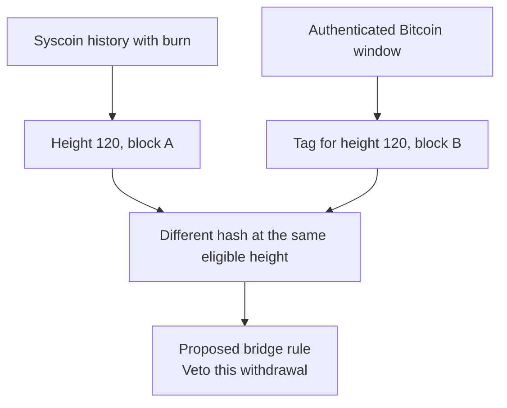

We designed a Bitcoin bridge that checks a withdrawal’s Syscoin history against evidence already published on Bitcoin. The light client can refuse a release when it sees a conflict without relying on a majority of Syscoin miners to select the winning sidechain fork for the bridge. The Bitcoin history used to make that decision still needs its own authenticated chain view. Core already provides the coinbase-tag mechanism. The BitVM-based release protocol and the witness encryption direction are research. [Syscoin bridge paper, §§7–8](https://syscoin.org/btc_bridge.pdf#page=8) · [Network and release status](../intro/status.mdx)

## What a Bitcoin miner commits to

<figure className="editorial-plate">

<figcaption>The machines supply hashpower. The participating pool builds the coinbase that carries the Syscoin reference. Once the parent block lands on Bitcoin, a reader can inspect what the pool published.</figcaption>
</figure>

| Part of the parent coinbase | What it binds |
| --- | --- |
| **Auxiliary Merkle root in the input script** | Commits to the candidate Syscoin block through an auxiliary Merkle proof. Syscoin verifies the parent header’s work against the Syscoin target. Such work can be valid for Syscoin even if it never produces a Bitcoin block. |
| **`sys` reference in an output** | An `OP_RETURN` payload carries the `sys` marker, an earlier Syscoin block hash, and its height. The mining template rounds down to an earlier ten-block boundary. Multiple correct templates can refer to the same ancestor. When the parent block lands in Bitcoin’s active chain, the tag becomes public evidence of that reference. |

A Bitcoin header commits to the coinbase through the transaction Merkle root. An inclusion proof establishes that the miner published those bytes in that block. The bridge still has to verify Bitcoin chain membership and check the reference against the supplied Syscoin ancestry. A tag in Bitcoin alone cannot certify that the referenced Syscoin block is valid, finalized, or the block that received the AuxPoW proof. [AuxPoW verification](https://github.com/syscoin/syscoin/blob/b3b4f643383a2149807a25fe38d26b5f058daa60/src/auxpow.cpp#L39-L110) · [Mining template](https://github.com/syscoin/syscoin/blob/b3b4f643383a2149807a25fe38d26b5f058daa60/src/rpc/auxpow_miner.cpp#L303-L332) · [Activated PQ tag checks](https://github.com/syscoin/syscoin/blob/b3b4f643383a2149807a25fe38d26b5f058daa60/src/validation.cpp#L10530-L10625)

## Inspect a tag in a Bitcoin block

Bitcoin blocks `976621` and `976623` both carry a `sys` output naming Syscoin height `2345720` and hash `6c5dc51f2e929822702fcac8281081f05088972c1ddd6eaeb11e0d20014079ac`. The corresponding Syscoin block matches that height and hash. Inspect the outputs of the Bitcoin coinbase transactions to see the repeated commitment. Repetition by itself is expected. To identify the work that actually mined a particular Syscoin block, inspect its AuxPoW parent separately. [Bitcoin coinbase at height 976621](https://mempool.space/tx/76423b124f5fb4046e9d93d84ec339fcbabc2ac6f178842c5765bf1c31bbd506) · [Bitcoin coinbase at height 976623](https://mempool.space/tx/b4bb215ab48d38474cfa84fa6d89d459ebd2fb3675d2f9cea89939f2fd0dd735) · [Syscoin block 2345720 in Blockbook](https://explorer-blockbook.syscoin.org/api/v2/block/2345720?pageSize=1)

The [Syscoin AuxPoW mining dashboard](https://status-api.syscoin.org/local/mining) lets readers monitor pool activity and indexed Bitcoin commitment counts. For a particular bridge claim, verify the original Bitcoin block and coinbase against the relevant evidence window.

## Detecting a fork versus choosing one

A withdrawal claim says that a user burned the bridged asset on Syscoin and is entitled to BTC. A fork-choice light client selects a Syscoin history and looks for the burn there. The proposed fork-detecting policy asks whether the claimed burn and its ancestry are consistent with the qualifying evidence in Bitcoin. That distinction matters because the vault can keep funds locked while Syscoin participants resolve a disagreement.

For example, suppose the claimed history contains block **A** at Syscoin height 120. Within the Bitcoin range being checked, a qualifying coinbase tag names block **B** at height 120. Those histories disagree at the same height. The verifier can veto release without knowing whether A or B will ultimately win. Two tags that both name A show repetition. A tag naming an ancestor shared by both branches cannot distinguish them.

Under a policy that vetoes on one conflict, **one honest participating miner is enough to supply the fork alarm** if it actually publishes a timely, relevant tag in the accepted Bitcoin window. Merely having an honest miner online gives no assurance of inclusion during a finite window. The policy also requires positive supporting evidence before release. Untagged blocks, stale references, and valid repeated references need explicit handling. [Syscoin bridge paper, §§7.2–7.4](https://syscoin.org/btc_bridge.pdf#page=8)

The honest-work assumption remains on the Bitcoin side. The paper analyzes sustained Bitcoin hashpower majority as a way to suppress or replace evidence across the relevant window. Bitcoin’s security over a finite window is probabilistic. A short window can close before any honest participant publishes a qualifying tag. Even unanimous observed tags can be insufficient if the required number of supporting references never arrives. [Bitcoin window assumptions, §8.3.3](https://syscoin.org/btc_bridge.pdf#page=15) · [Bitcoin proof-of-work model](https://bitcoin.org/bitcoin.pdf)

Algorithm 2 in the paper counts strictly ascending references and returns as soon as it reaches its threshold. Under that pseudocode, encountering the same tagged block twice before the threshold would fail the ascending-order test. The live coinbase examples above show why a production policy needs explicit rules for repeats. A veto covering an entire Bitcoin window would also need a fresh, independently anchored range and enforced coverage of its later blocks, or a separate challenge rule. [Algorithm 2, lines 21–35](https://syscoin.org/btc_bridge.pdf#page=12)

## From detection to enforcement on Bitcoin

- **BitVM-based bridge.** Our BitVM2 proposal checks tag consistency inside the withdrawal proof. BitVM supplies the dispute mechanism for releasing vault funds, including operator reimbursement when an operator has advanced BTC to a user. An available challenger must be able to see the evidence and get a valid challenge into Bitcoin within the deadline. The miner that publishes the tag, the challenger, and the honest participant assumed during setup have distinct roles. We retain BitVM2’s PowPV Bitcoin anchoring. That check addresses the Bitcoin history a claimant supplies. The tag predicate addresses the Syscoin history that the claimant uses to justify release. [Syscoin bridge paper, §§7–8](https://syscoin.org/btc_bridge.pdf#page=8) · [BitVM2, §6](https://bitvm.org/bitvm_bridge.pdf#page=19)
- **Witness encryption research.** A future witness-gated design could incorporate Bitcoin-anchored fork evidence into the public relation that controls a capability for a particular Bitcoin spend. The relation would need to authenticate the history, the evidence window, and the spend it authorizes. The public PQ witness-KEM work is a draft research program. It has yet to establish a complete primitive or an integrated bridge. [Author’s research note](https://x.com/realSidhuJag/status/2110051160241684833) · [PVUGC research draft](https://github.com/syscoin/PVUGC/pull/1)

There is also a separate path in the opposite direction. In the activated PQ design, a Sentry certificate can attest to a Bitcoin checkpoint and forward it to NEVM through a validated Core receipt. That attestation gives a consumer a reference for its own Bitcoin header checks. BTC release and coinbase-tag interpretation belong to the bridge protocol. [PQ checkpoint path](./post-quantum.mdx#checkpoints-and-recovery)

Rootstock’s Armadillo is a related use of Bitcoin coinbase commitments for detecting visible sidechain forks. Union’s published bridge model assumes a light client can choose the canonical source history among competing forks. The Syscoin proposal combines its consensus-defined ancestor reference with Bitcoin-window evidence and makes a conflicting reference a reason to veto a proposed peg-out. [Rootstock’s fork monitoring](https://dev.rootstock.io/node-operators/merged-mining/reference/) · [Union bridge assumptions](https://arxiv.org/html/2501.07435v1#S2.SS1) · [Syscoin bridge paper](https://syscoin.org/btc_bridge.pdf)
