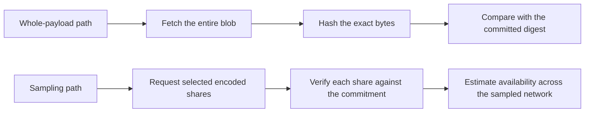

A rollup that wants independent verification has to answer three questions. Can someone obtain the input bytes? Which history published them? Which state transition did the settlement verifier accept? Different systems assign these jobs to different participants. The comparison below covers the named publication paths and their verification rules.

| Publication path | Commitment and availability check | History and settlement |
| --- | --- | --- |
| **Syscoin PoDA** | Core relays whole blobs and verifies their payload hashes. A reader with the bytes can independently recompute the digest. BLAKE2s-256 is the typed option, with legacy Keccak-256 support. | Core serves blobs within a bounded window. Archive operators can retain them for replay. AuxPoW and the active ChainLock policy establish Core ordering and finality. A rollup's execution proof is checked by its configured verifier. [PoDA design](./data-availability.mdx) · [Core and NEVM](./core.mdx) |
| **Bitcoin blocks** | The header commits to the transaction Merkle root. SegWit adds a witness commitment through the coinbase. Full nodes download and validate the block data. | Pruned nodes may discard old block files after validation. Historical sync needs peers that serve the required blocks. Fork choice follows accumulated proof of work, giving confirmations probabilistic security. [Bitcoin paper](https://bitcoin.org/bitcoin.pdf) · [BIP 141](https://github.com/bitcoin/bips/blob/master/bip-0141.mediawiki) · [Bitcoin Core pruning](https://bitcoin.org/en/full-node#reduce-storage) |
| **Ethereum blobs after Fusaka** | The blob identifier is a versioned hash of a KZG commitment. PeerDAS extends blobs with erasure coding and distributes columns. Nodes custody assigned columns and sample peers to check availability. | Blob serving is time-bounded. Archival retrieval requires a data source that keeps the bytes. Ethereum proof-of-stake consensus orders the publication, and the rollup's contracts define its settlement rules. [EIP-4844](https://eips.ethereum.org/EIPS/eip-4844) · [EIP-7594](https://eips.ethereum.org/EIPS/eip-7594) · [Storage strategies](https://ethereum.org/developers/docs/data-availability/blockchain-data-storage-strategies/) |
| **Celestia regular blobs** | A data square is extended in two dimensions with Reed–Solomon coding. Namespaced Merkle trees allow applications to authenticate their own shares. Light nodes sample shares to gain availability confidence. | Celestia consensus orders data publication. Its DA service leaves rollup execution and settlement to the rollup stack. Light-node sampling has a defined window and historical readers need providers that retain the required shares. [Celestia data availability](https://docs.celestia.org/learn/celestia-101/data-availability/) · [Celestia retrievability](https://docs.celestia.org/learn/celestia-101/retrievability/) |
| **Celestia Fibre** | Publishers split encoded blobs across validator-operated Fibre servers. Signed storage attestations from a voting-power quorum support settlement of the publication. Readers request shards by blob ID and reconstruct the payload. | Active on Mainnet Beta. Consensus records the commitment and finalizes payment. Server storage is time-bounded and availability depends on the provider quorum and reachable shards. [When to use Fibre](https://docs.celestia.org/build/post-retrieve-blob/fibre/when-to-use/) · [Fibre network status](https://docs.celestia.org/build/post-retrieve-blob/fibre/client-brief/#status) |
| **Avail DA** | Data is arranged in a matrix with rows extended by Reed–Solomon coding. KZG commitments authenticate individual cells. Light clients sample cells through the peer network or RPC. | Avail's nominated proof-of-stake validators finalize headers. Rollup execution and settlement follow the rollup stack. Historical retrieval depends on who retains its data. [How Avail DA works](https://docs.availproject.org/docs/da/concepts/how-avail-da-works) |

## Whole-payload verification and data availability sampling

PoDA's whole-blob check gives the reader the exact bytes to feed into a decoder, state reconstruction, or a prover. It costs bandwidth proportional to the bytes that reader fetches. Compact zkSYS references remove that payload from the Edgechain-to-Gateway batch envelope. Publishers and validating readers still need a data path for the bytes. [zkSYS publication and retrieval](./zksys.mdx) · [PoDA validation and limits](./data-availability.mdx)

Erasure coding allows reconstruction from enough authenticated shares. Sampling lets a light participant check a much smaller amount while gaining probabilistic confidence that enough data was distributed. The confidence depends on coding, sampling, custody, and the client's view of peers. An application replaying every transition still needs enough data to reconstruct its input. Ethereum and Avail use KZG openings for samples. Celestia's regular blob path uses authenticated shares under Merkle roots. Sampling and polynomial commitments are separate design choices. [Ethereum PeerDAS](https://ethereum.org/roadmap/fusaka/peerdas/) · [Celestia data availability](https://docs.celestia.org/learn/celestia-101/data-availability/) · [Avail DA](https://docs.availproject.org/docs/da/concepts/how-avail-da-works)

A valid commitment identifies data under the commitment scheme's assumptions. A successful fetch establishes access for that reader at that time. Canonical inclusion and finality establish which publication belongs to the accepted chain. A settlement proof covers the statement and inputs its verifier checks. Applications that need to replay old batches should plan how to obtain payloads, their ordering, and the relevant state after the live serving window. [PoDA evidence and retention](./data-availability.mdx#availability-inclusion-and-finality)

Ethereum's blob interface associates availability with an Ethereum blob transaction and its consensus-layer publication. An application can build additional indexing and retrieval services around those commitments. Syscoin's Core interface lets an Edgechain publish independently and lets Gateway look up the content by digest through the same live DA service. zkSYS uses that interface to admit a small commit transaction while the full payload travels on the separate DA path. The cost moves toward Core propagation and retrieval, where block limits and fees constrain demand. [Ethereum blob transactions](https://eips.ethereum.org/EIPS/eip-4844) · [Gateway admission and settlement](./zksys.mdx#what-gateway-changes)

## Where cryptographic assumptions enter

Syscoin's design uses hashes for different jobs. AuxPoW validates SHA-256 mining work. PoDA uses a whole-blob hash to bind the payload. The PQ ChainLock protocol uses SHAKE-based signatures for operator identity and scheduled voting. Each choice protects a different object and has its own parameter, implementation, and operational assumptions. [Post-quantum ChainLocks](./post-quantum.mdx) · [Network and release status](../intro/status.mdx)

Ethereum blobs and Avail use KZG, which has a structured setup and pairing-based group assumptions. Celestia's regular Merkle commitment uses hash assumptions, while validator authorization is a separate layer. Bitcoin's hashes protect mining work and block commitments. Spending rules also use classical signatures such as ECDSA or Taproot Schnorr. The cryptography of a data commitment gives only one part of each system's post-quantum profile. [Ethereum KZG specification](https://eips.ethereum.org/EIPS/eip-4844) · [Avail commitments](https://docs.availproject.org/docs/da/concepts/how-avail-da-works#kzg-polynomial-commitments) · [Celestia validator keys](https://docs.celestia.org/operate/consensus-validators/validator-node/) · [BIP 340](https://github.com/bitcoin/bips/blob/master/bip-0340.mediawiki)

The same rule applies above the base chain. A hash-based recursive proof path can have different assumptions from a deployment that wraps its proofs with a pairing-based proof for cheap contract verification. Evaluate the complete path an application accepts, including account signatures, the deployed verifier, upgrade authorities, and any bridge or custody keys. [zkSYS proof and settlement path](./zksys.mdx) · [Cryptographic standards and research](../reference/research.mdx)

## Direct verification and recursive aggregation

In the activated Syscoin design, Core nodes verify SLH-DSA authorization and each scheduled WOTS+ signature in the ChainLock certificate. The pinned certificate carries 801 roster-slot signatures and is about 1 MB. Core's slower time budget and bounded quorum make that an explicit bandwidth and verification trade. Moving rollup execution proofs to zkSYS lets Core take that trade on finality while applications benefit from succinct batch proofs. [Syscoin certificate checks](./post-quantum.mdx#what-a-full-node-verifies) · [System architecture](./overview.mdx#why-core-and-zksys-run-at-different-speeds)

Ethereum's draft EIP-8292 defines an aggregator role for its proposed PQ consensus. A specialized leanVM prover proves that hash-based validator signatures are valid, and recursive aggregation can combine leaf proofs into larger claims. This design reduces the signature material other validators need to receive and check. The consensus path would also depend on the soundness of the proof system and the speed at which aggregators can produce proofs. The signatures are hash-based and the proof uses algebraic constraints and commitments. The leanVM project reports that the formal statements and the implementation's correspondence to the specification are still under review. [Draft EIP-8292](https://eips.ethereum.org/EIPS/eip-8292) · [leanVM development and verification status](https://github.com/leanEthereum/leanVM#work-in-progress)

## Protocol recovery and social recovery

Ethereum's deployed proof-of-stake protocol uses in-protocol penalties for defined forms of misbehavior and an inactivity leak to help restore finality after some outages. Its documentation treats coordinated social recovery as an exceptional fallback for conflicting finality or a dishonest finalized history. That judgment is distinct from applying evidence that a protocol can verify. [Ethereum rewards and penalties](https://ethereum.org/developers/docs/consensus-mechanisms/pos/rewards-and-penalties/) · [Ethereum attack and defense documentation](https://ethereum.org/developers/docs/consensus-mechanisms/pos/attack-and-defense/#people-the-last-line-of-defense)

Syscoin keeps proof-of-work block production separate from Sentry finality. A certificate outage can leave the active tip moving while finality stalls. That property gives miners a way to contribute valid work through normal consensus during a finality outage. It applies above the last durable ChainLock, which the protocol enforces. Recovering progress when new certificates are missing and selecting between histories after a finality safety failure are different problems. [Core finality outage behavior](./core.mdx#what-survives-a-finality-outage) · [Quorum safety assumptions](./post-quantum.mdx#what-a-full-node-verifies)

## Rollup economics and collateral

Gas, rollup security bonds, and governance tokens can play different roles. For this comparison, consider the zkSYS design with PQ ChainLocks active and zkSYS running as an execution layer. The example describes the intended architecture. See the [network status page](../intro/status.mdx) for the actual rollout.

| Design | How users pay for execution | How the separate token is issued or earned |
| --- | --- | --- |
| **Arbitrum One** | ETH pays gas. The protocol can also require a WETH bond for assertions. | ARB governs the DAO and had its own initial supply and distribution. ARB issuance is separate from the WETH assertion bond. [Arbitrum gas FAQ](https://docs.arbitrum.io/get-started/faq) · [Nitro assertion bonds](https://docs.arbitrum.io/how-arbitrum-works/inside-arbitrum-nitro) · [ARB token](https://docs.arbitrum.foundation/concepts/arb-token) |
| **OP Mainnet** | ETH pays gas. The execution and parent-chain fees follow the documented fee model. | OP participates in Optimism Collective governance and has its own initial allocation and distribution schedule. [OP Mainnet fees](https://docs.optimism.io/op-stack/transactions/fees) · [Optimism governance](https://optimism.io/community-agreement) · [OP supply](https://gov.optimism.io/t/clarification-on-op-token-supply/5589) |
| **zkSYS design** | Native SYS is the ordinary fee path. An enabled Gas Tank lets an eligible transaction pay with prepaid zkSYS credit. The Gas Tank backs each outstanding unit of credit with a unit of deposited zkSYS. | The design links scheduled reward weight to SYS locked in the native staking vault and to eligible, SYS-collateralized Sentry Nodes. zkSYS rewards accrue according to the issuer's accounting. This link is a rule for earning issuance. The design creates no fixed-rate zkSYS claim on a pool of SYS. [Native staking vault](https://github.com/syscoin/zksync-os-server/blob/v0.24.4/contracts/src/zksys/ZkSysNativeStakingVault.sol) · [Reward weights](https://github.com/syscoin/zksync-os-server/blob/v0.24.4/contracts/src/zksys/ZkSysRewardWeightRegistry.sol) · [Issuer](https://github.com/syscoin/zksync-os-server/blob/v0.24.4/contracts/src/zksys/ZkSysIssuer.sol) · [Gas Tank](https://github.com/syscoin/zksync-os-server/blob/v0.24.4/contracts/src/zksys/ZkSysGasTank.sol) |

The economic distinction is how the separate asset is distributed and what it does. Arbitrum One and OP Mainnet can use Ethereum settlement and charge users in ETH while issuing their governance tokens under independent allocation rules. The zkSYS design connects part of its reward issuance to SYS at stake and gives the reward token a use in paying for execution. Gas Tank credit can coexist with a native SYS balance requirement in transaction admission. [Pinned zkSYS fee accounting](https://github.com/syscoin/zksync-os-server/blob/v0.24.4/lib/revm_consistency_checker/src/syscoin_gas_tank.rs) · [zkSYS fee and issuance design thread](https://x.com/realSidhuJag/status/2072913754313072659)

Collateral-linked rewards make the source of some emissions inspectable. How much value is captured by users, operators, and insiders still depends on rules for allocation, mint and upgrade authority, fee routing, and access to sequencing and proving. zkSYS's direction is decentralized sequencing and broader prover participation. The opt-in prover service design documents separate provisioning, enrollment, and activation work. [zkSYS prover service design](https://github.com/syscoin/zksync-os-server/blob/v0.24.4/docs/src/design/prover_service_v1.md)
