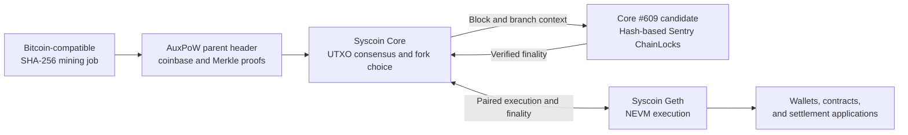
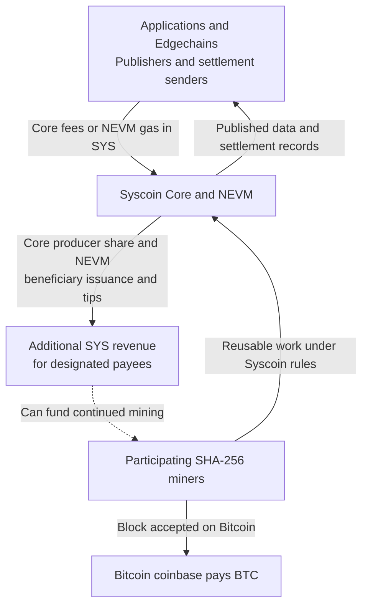

In the activated PQ architecture, Syscoin Core validates the UTXO chain and its auxiliary proof of work (AuxPoW). Sentry Nodes certify accepted history with hash-based ChainLocks. Core pairs its blocks with NEVM, the Network-Enhanced Virtual Machine, and coordinates connection, disconnection, and the finality boundary with Syscoin Geth. The UTXO and NEVM chains each have their own block hashes, heights, and RPCs. [Core #609 design](https://github.com/syscoin/syscoin/blob/b3b4f643383a2149807a25fe38d26b5f058daa60/doc/pq-chainlocks.md) · [Paired NEVM implementation](https://github.com/syscoin/go-ethereum/blob/1c046ba92f8ea95be024a790e9444b80ccbf019a/eth/nevm_finality_test.go)

The figure follows the **Core #609 candidate with PQ rules active**. Released Core v5.1.3 uses BLS ChainLocks. The pinned candidate’s public compatibility profile replays the legacy chain with its finality services disabled. [Network and release status](../intro/status.mdx)

## What Bitcoin merge-mining contributes

A pool commits to the Syscoin candidate in the auxiliary-chain Merkle tree. The parent coinbase commits to that tree, and the parent header commits to the coinbase through its transaction Merkle root. Core checks both links and tests the parent header's hash against the **Syscoin** target. A valid proof can come from work below the Bitcoin difficulty threshold. If a pool also finds a Bitcoin block, the identical header can appear on Bitcoin's active chain and as an AuxPoW parent on Syscoin. Checking that overlap requires matching the actual parent header hash. [AuxPoW verification](https://github.com/syscoin/syscoin/blob/ff8df9b44d603faf3cf78af28c633a066a8ec9a7/src/auxpow.cpp) · [Syscoin block validation](https://github.com/syscoin/syscoin/blob/ff8df9b44d603faf3cf78af28c633a066a8ec9a7/src/validation.cpp)

There are two commitments to track in the parent coinbase.

| Commitment | What it binds | Where to look |
| --- | --- | --- |
| Merged-mining root | The candidate Syscoin block through its auxiliary-chain Merkle proof. | Parent coinbase input script. |
| `sys` reference | A specific recent Syscoin ancestor and its height. | Parent coinbase output script. Obtain it as `coinbasescript` from `createauxblock`. |

For a Syscoin parent at height `p`, Core expects the reference at the largest multiple of ten at or below `p − 5`. For example, a template extending height 12,348 references height 12,340. The same reference can legitimately appear in multiple templates across that interval. A stale reference can invalidate the **Syscoin** submission even when the parent block is valid Bitcoin work. Under activated PQ rules, Core also requires the exact canonical output format and the modern child chain ID. [Released mining RPC](https://github.com/syscoin/syscoin/blob/ff8df9b44d603faf3cf78af28c633a066a8ec9a7/src/rpc/mining.cpp#L1169-L1229) · [Activated AuxPoW checks](https://github.com/syscoin/syscoin/blob/b3b4f643383a2149807a25fe38d26b5f058daa60/src/validation.cpp#L10531-L10624)

Those references are also the input to Syscoin’s [Bitcoin-anchored fork detection design](./bitcoin-bridge.mdx). A participating miner that finds a Bitcoin block can give a bridge independent evidence of what the pool saw on the Syscoin side.

Syscoin's post-NEVM block spacing target is 150 seconds on mainnet. Bitcoin and Syscoin apply their own difficulty, consensus, and fork choice rules. A remembered Bitcoin coinbase tag alone cannot establish a Syscoin inclusion or calculate the pool's accepted Syscoin work. [Mainnet parameters](https://github.com/syscoin/syscoin/blob/ff8df9b44d603faf3cf78af28c633a066a8ec9a7/src/kernel/chainparams.cpp#L155-L221)

## Why Bitcoin and Syscoin fit together

A pool already searching for a valid Bitcoin header can include a commitment to a Syscoin candidate in the same mining job. If the work meets Syscoin’s target and the child block passes Syscoin’s rules, the pool can earn SYS. Earning the Bitcoin block reward requires a block accepted on Bitcoin as well. Bitcoin nodes validate their own blocks. Syscoin nodes validate the UTXOs, published blobs and paired NEVM execution. An application can therefore buy publication and settlement on Syscoin while its full payload stays off Bitcoin. [Released AuxPoW checks](https://github.com/syscoin/syscoin/blob/ff8df9b44d603faf3cf78af28c633a066a8ec9a7/src/auxpow.cpp#L39-L110) · [Bitcoin block and coinbase rules](https://developer.bitcoin.org/devguide/block_chain.html#proof-of-work) · [Core publication and NEVM settlement](./data-availability.mdx)

*The mining and payment paths shown are released mainnet rules. zkSYS Genesis uses the application path on testnet.* Solid arrows show work, services, or payments under the respective chain’s rules. The dashed arrow shows a choice the pool makes about its earnings.

The pool gets a second source of revenue from the mining equipment it already runs. It can pass SYS receipts on to hashpower providers, use them to cover electricity or invest in more capacity. Pool terms, demand for Syscoin block space and the purchasing power of SYS determine how far those receipts go. BTC withdrawals follow a separate set of proposed bridge rules. [Which SYS receipts reach producers](./modular-alignment.mdx#who-pays-for-the-shared-infrastructure) · [Proposed Bitcoin-anchored withdrawals](./bitcoin-bridge.mdx)

## Why Core synchronizes headers first

A new node can ask a peer for headers before spending bandwidth on transaction bodies. Each Syscoin child block has an **80-byte committed header**. For a merge-mined block the peer also sends the variable-size AuxPoW wrapper, including the parent coinbase, the two Merkle branches, and the parent header. The receiver can check continuity, the coinbase and child commitments, and the parent’s hash against the claimed Syscoin target using those bytes alone. Core accepts at most 2,000 headers per message and caps their summed serialized size at 6 MiB for peers using the negotiated size limit. [Wire header](https://github.com/syscoin/syscoin/blob/b3b4f643383a2149807a25fe38d26b5f058daa60/src/primitives/block.h#L47-L73) · [AuxPoW fields](https://github.com/syscoin/syscoin/blob/b3b4f643383a2149807a25fe38d26b5f058daa60/src/auxpow.h#L43-L56) · [Work and Merkle checks](https://github.com/syscoin/syscoin/blob/b3b4f643383a2149807a25fe38d26b5f058daa60/src/validation.cpp#L2087-L2107) · [Header limits](https://github.com/syscoin/syscoin/blob/b3b4f643383a2149807a25fe38d26b5f058daa60/src/net_processing.cpp#L2280-L2336)

Core uses cumulative target-derived work to decide which unfamiliar histories deserve resources. During an initial sync with insufficient work from an ordinary peer, Core can retain sparse commitments, then request the headers a second time after the work threshold is met. This trades header bandwidth for bounded initial memory. Header acceptance checks the required difficulty in the preceding chain’s context. A node still downloads or reconstructs the full blocks, checks the transactions and state transitions, and applies its ChainLock rules. [Work threshold](https://github.com/syscoin/syscoin/blob/b3b4f643383a2149807a25fe38d26b5f058daa60/src/net_processing.cpp#L5797-L5824) · [Two-pass synchronization](https://github.com/syscoin/syscoin/blob/b3b4f643383a2149807a25fe38d26b5f058daa60/src/headerssync.h#L73-L102) · [Header difficulty checks](https://github.com/syscoin/syscoin/blob/b3b4f643383a2149807a25fe38d26b5f058daa60/src/validation.cpp#L10639-L10672)

Near the tip, compact block relay can save a second transmission of transactions a peer already has. Its message carries the header, prefilled transactions, **6-byte short transaction IDs**, and any accompanying NEVM block data. A peer requests missing transactions to finish reconstruction. zkSYS uses a related idea at a different hop. Gateway carries **32-byte blob digests** while Core propagates the full live blobs. A new verifier that needs those bytes still has to fetch them. Adding peers increases the sender’s outgoing traffic, and header presync or missing transactions can add round trips. [Compact block fields](https://github.com/syscoin/syscoin/blob/b3b4f643383a2149807a25fe38d26b5f058daa60/src/blockencodings.h#L104-L125) · [Missing transaction requests](https://github.com/syscoin/syscoin/blob/b3b4f643383a2149807a25fe38d26b5f058daa60/src/net_processing.cpp#L8193-L8207) · [Gateway byte counts](./data-availability.mdx#how-much-crosses-gateway)

## Proof of work and finality

Sentry Nodes derive their voting authority from frozen branch state. Four rosters are active, and a PQ ChainLock carries 267 authenticated scheduled WOTS+ signatures from each of three selected rosters. The verifier checks the signed statement and the block’s ancestry before advancing the durable finality boundary. A valid proof-of-work branch can grow above the last accepted ChainLock while the next certificate is pending. Applications can distinguish the two by checking active-chain inclusion and ancestry under the actual accepted lock. [PQ signature, roster, and safety rules](./post-quantum.mdx#what-a-full-node-verifies)

A ChainLock can also attest a scheduled Bitcoin checkpoint. Only an authenticated advance carried at the prescribed height can forward a new Bitcoin hash to NEVM. [Bitcoin checkpoints and recovery](./post-quantum.mdx#checkpoints-and-recovery)

## What survives a finality outage

| Condition | What the node can verify and do |
| --- | --- |
| No durable ChainLock yet | Select the valid branch with the most work. |
| A durable ChainLock exists and new certificates stall | Keep verifying work and accepting eligible descendants of the locked block. Applications waiting for a new lock or a dependent settlement may have to wait. |
| A branch conflicts with accepted durable finality | Reject the conflict under the active rules, even if the branch accumulates more work. The ordinary mining contest cannot reconcile incompatible histories that different nodes have already locked. |

The near-tip rule constrains what a newly received certificate can change. For an ordinary live or current catch-up certificate with target height `H`, the target must be the latest signable height and its branch must share the active chain's ancestor at `H−5`. Core #560 introduced the ancestry check for BLS ChainLocks. The activated PQ implementation preserves it. This prevents a certificate in the current signing window from reviving a branch that diverged earlier. A competing branch that respects durable finality can still win through greater cumulative work and then qualify for a new certificate. [Core #560 and its regression test](https://github.com/syscoin/syscoin/pull/560) · [PQ ancestry checks](https://github.com/syscoin/syscoin/blob/b3b4f643383a2149807a25fe38d26b5f058daa60/src/llmq/quorums_chainlocks.cpp#L1840-L1889) · [PQ shallow and deep branch tests](https://github.com/syscoin/syscoin/blob/b3b4f643383a2149807a25fe38d26b5f058daa60/src/test/pq_chainlock_handler_tests.cpp#L8143-L8220)

Mining capacity is external to the chain. A compatible miner can redirect its work, but a pool tag provides evidence about submitted work and does not measure independent control of the underlying hardware. Sentry eligibility is visible in the on-chain registry, which likewise does not establish operational independence. Verify live mining and quorum behavior separately. [Core liveness and reorg invariants](https://github.com/syscoin/syscoin/blob/b3b4f643383a2149807a25fe38d26b5f058daa60/doc/pq-chainlocks.md#L2695-L2708) · [Block conflict check](https://github.com/syscoin/syscoin/blob/b3b4f643383a2149807a25fe38d26b5f058daa60/src/validation.cpp#L10972-L10986)

## Choosing the right record for a transaction

A plain UTXO payment creates a Core transaction. An NEVM contract call produces an execution receipt. A blob publication has a Core inclusion record and a separate data lookup. For an operation that crosses layers, record the network, transaction hash, and block hash for each leg before checking how they correspond.

| Question | What to check |
| --- | --- |
| Did my UTXO transaction enter a block? | Resolve the transaction to a block on the Core active chain. Check the hash as well as the height. |
| Did the node accept a ChainLock for that history? | Query Core's active ChainLock and verify ancestry from its block hash to your block. |
| Did my NEVM contract call execute? | Query the NEVM transaction receipt and its block. Track the exact Core-to-NEVM correspondence when waiting for paired finality. |
| Can a client recover the input bytes? | Check the data service's actual payload response and verify its commitment. A block or a commitment alone only establishes the metadata available at that layer. |

In the paired Geth implementation, the `safe` and `finalized` selectors require an executed canonical block with the matching Core-provided boundary. A newer `latest` head can advance while those selectors stay at the last accepted boundary. Availability during startup or recovery depends on re-establishing that binding. The DA membership index tracks a different property, commitment membership over its rolling history. [Paired Geth finality tests](https://github.com/syscoin/go-ethereum/blob/1c046ba92f8ea95be024a790e9444b80ccbf019a/eth/nevm_finality_test.go) · [Paired Geth DA index upgrade](https://github.com/syscoin/go-ethereum/blob/1c046ba92f8ea95be024a790e9444b80ccbf019a/docs/syscoin-data-hash-index-upgrade.md)

## Released behavior

Core v5.1.3 uses BLS signatures and distributed key generation (DKG) for ChainLocks. Core #609’s public compatibility-replay profile leaves PQ activation unset. See [Network and release status](../intro/status.mdx) for deployment details and the [Core command reference](../reference/core.mdx) for the commands supported by your node. [Released ChainLock implementation](https://github.com/syscoin/syscoin/blob/ff8df9b44d603faf3cf78af28c633a066a8ec9a7/src/llmq/quorums_chainlocks.cpp)
