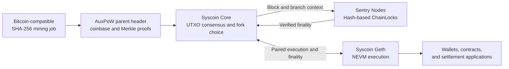

In the activated PQ architecture, Syscoin Core validates the UTXO chain and its auxiliary proof of work (AuxPoW). Sentry Nodes certify accepted history with hash-based ChainLocks. Core pairs its blocks with NEVM, the Network-Enhanced Virtual Machine, and coordinates connection, disconnection, and the finality boundary with Syscoin Geth. The UTXO and NEVM chains each have their own block hashes, heights, and RPCs. [Core #609 design](https://github.com/syscoin/syscoin/blob/b3b4f643383a2149807a25fe38d26b5f058daa60/doc/pq-chainlocks.md) · [Paired NEVM implementation](https://github.com/syscoin/go-ethereum/blob/1c046ba92f8ea95be024a790e9444b80ccbf019a/eth/nevm_finality_test.go)

This page describes the system with PQ rules active. See [Network and release status](../intro/status.mdx) for the deployed code and activation scope.

## What Bitcoin merge-mining contributes

A pool commits to the Syscoin candidate in the auxiliary-chain Merkle tree. The parent coinbase commits to that tree, and the parent header commits to the coinbase through its transaction Merkle root. Core checks both links and tests the parent header's hash against the **Syscoin** target. A valid proof can come from work below the Bitcoin difficulty threshold. If a pool also finds a Bitcoin block, the identical header can appear on Bitcoin's active chain and as an AuxPoW parent on Syscoin. Checking that overlap requires matching the actual parent header hash. [AuxPoW verification](https://github.com/syscoin/syscoin/blob/ff8df9b44d603faf3cf78af28c633a066a8ec9a7/src/auxpow.cpp) · [Syscoin block validation](https://github.com/syscoin/syscoin/blob/ff8df9b44d603faf3cf78af28c633a066a8ec9a7/src/validation.cpp)

There are two commitments to track in the parent coinbase.

| Commitment | What it binds | Where to look |
| --- | --- | --- |
| Merged-mining root | The candidate Syscoin block through its auxiliary-chain Merkle proof. | Parent coinbase input script. |
| `sys` reference | A specific recent Syscoin ancestor and its height. | Parent coinbase output script. Obtain it as `coinbasescript` from `createauxblock`. |

For a Syscoin parent at height `p`, Core expects the reference at the largest multiple of ten at or below `p − 5`. For example, a template extending height 12,348 references height 12,340. The same reference can legitimately appear in multiple templates across that interval. A stale reference can invalidate the **Syscoin** submission even when the parent block is valid Bitcoin work. Under activated PQ rules, Core also requires the exact canonical output format and the modern child chain ID. [Released mining RPC](https://github.com/syscoin/syscoin/blob/ff8df9b44d603faf3cf78af28c633a066a8ec9a7/src/rpc/mining.cpp#L1169-L1229) · [Activated AuxPoW checks](https://github.com/syscoin/syscoin/blob/b3b4f643383a2149807a25fe38d26b5f058daa60/src/validation.cpp#L10531-L10624)

Syscoin's post-NEVM block spacing target is 150 seconds on mainnet. Bitcoin and Syscoin apply their own difficulty, consensus, and fork choice rules. A remembered Bitcoin coinbase tag alone cannot establish a Syscoin inclusion or calculate the pool's accepted Syscoin work. [Mainnet parameters](https://github.com/syscoin/syscoin/blob/ff8df9b44d603faf3cf78af28c633a066a8ec9a7/src/kernel/chainparams.cpp#L155-L221)

## Proof of work and finality

Sentry Nodes derive their voting authority from frozen branch state. Four rosters are active, and a PQ ChainLock carries 267 authenticated scheduled WOTS+ signatures from each of three selected rosters. The verifier checks the signed statement and the block’s ancestry before advancing the durable finality boundary. A valid proof-of-work branch can grow above the last accepted ChainLock while the next certificate is pending. Applications can distinguish the two by checking active-chain inclusion and ancestry under the actual accepted lock. [PQ signature, roster, and safety rules](./post-quantum.mdx#what-a-full-node-verifies)

A ChainLock can also attest a scheduled Bitcoin checkpoint. Only an authenticated advance carried at the prescribed height can forward a new Bitcoin hash to NEVM. [Bitcoin checkpoints and recovery](./post-quantum.mdx#checkpoints-and-recovery)

## Following the same transaction through the stack

| Question | What to check |
| --- | --- |
| Did my UTXO transaction enter a block? | Resolve the transaction to a block on the Core active chain. Check the hash as well as the height. |
| Did the node accept a ChainLock for that history? | Query Core's active ChainLock and verify ancestry from its block hash to your block. |
| Did the corresponding NEVM transition execute? | Query the NEVM block and receipts. Track the exact Core-to-NEVM correspondence when waiting for paired finality. |
| Can a client recover the input bytes? | Check the data service's actual payload response and verify its commitment. A block or a commitment alone only establishes the metadata available at that layer. |

In the paired Geth implementation, the `safe` and `finalized` selectors require an executed canonical block with the matching Core-provided boundary. A newer `latest` head can advance while those selectors stay at the last accepted boundary. Availability during startup or recovery depends on re-establishing that binding. The DA membership index tracks a different property, commitment membership over its rolling history. [Paired Geth finality tests](https://github.com/syscoin/go-ethereum/blob/1c046ba92f8ea95be024a790e9444b80ccbf019a/eth/nevm_finality_test.go) · [Paired Geth DA index upgrade](https://github.com/syscoin/go-ethereum/blob/1c046ba92f8ea95be024a790e9444b80ccbf019a/docs/syscoin-data-hash-index-upgrade.md)

## Released behavior

Core v5.1.3 uses BLS signatures and distributed key generation (DKG) for ChainLocks. Core #609’s public compatibility-replay profile leaves PQ activation unset. See [Network and release status](../intro/status.mdx) for deployment details and the [Core command reference](../reference/core.mdx) for the commands supported by your node. [Released ChainLock implementation](https://github.com/syscoin/syscoin/blob/ff8df9b44d603faf3cf78af28c633a066a8ec9a7/src/llmq/quorums_chainlocks.cpp)
