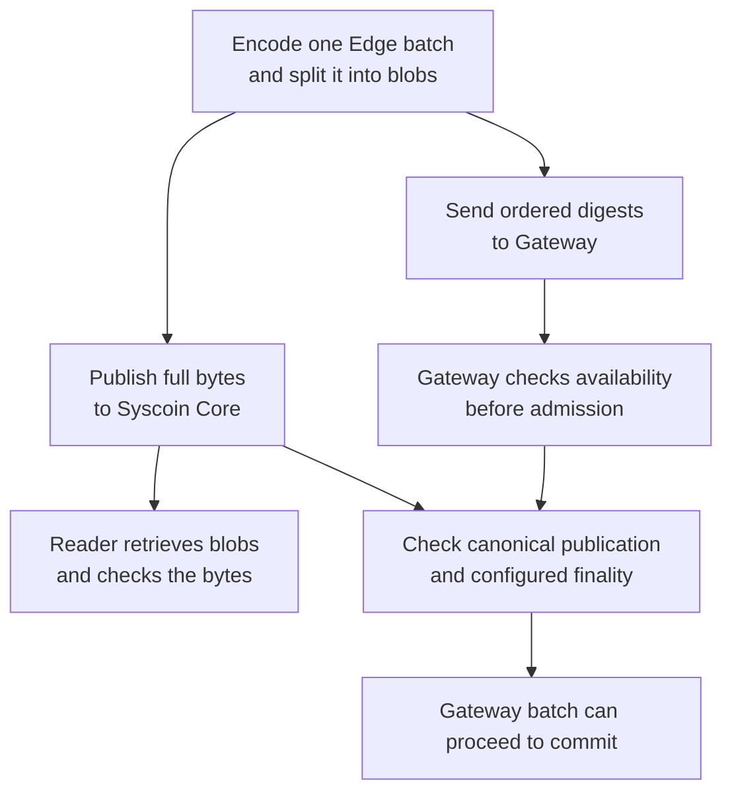

A rollup publishes data so independent participants can reconstruct its state. Syscoin’s Proof of Data Availability (PoDA) gives the batch two paths. The publisher sends the bytes to Syscoin Core, where another participant can fetch and check them. It sends their ordered hashes to Gateway, where settlement can identify the same data without carrying a second copy. The zkSYS code calls the Core publication path “Bitcoin DA” because Core uses Bitcoin-compatible merge mining. The blob payloads travel over the Syscoin network. [Core 5.1.0 release notes](https://github.com/syscoin/syscoin/releases/tag/v5.1.0) · [zkSYS batch publication](https://github.com/syscoin/zksync-os-server/blob/v0.24.4/node/bin/src/batcher/mod.rs#L578-L605)

**Design scenario.** The diagram uses zkSYS v0.24.4 compact references and assumes the candidate PQ ChainLock rules are active. The settlement path can check whether the publication belongs to a locked Core history. A reader who retrieves and rehashes the blob checks the bytes they received. [Core #609](https://github.com/syscoin/syscoin/pull/609) · [Geth #42](https://github.com/syscoin/go-ethereum/pull/42) · [Network and release status](../intro/status.mdx)

## How much crosses Gateway?

A **5 MiB** Edge batch illustrates what changes for the aggregator. Core receives **5,242,911 bytes**, including the 31-byte length prefix, split across three blobs. In the earlier full-data design, Gateway would have carried the Edge payload in a **5,243,040-byte relay message**. The v0.24.4 Edge commit supplies three ordered BLAKE2s digests totaling **96 bytes**. Gateway adds the batch context and forwards a **288-byte relay message**. Core still propagates the payload, and readers still need it for replay. [Earlier full-data relay](https://github.com/syscoin/zksync-os-server/blob/570e2d0fe0f062671176970e8309c87fe0a0145b/node/bin/src/batcher/seal_criteria.rs#L13-L35) · [Current blob encoder](https://github.com/syscoin/zksync-os-server/blob/v0.24.4/lib/batch_types/src/batch_info.rs#L366-L397) · [Current relay encoder](https://github.com/syscoin/zksync-os-server/blob/v0.24.4/scripts/patches/era-contracts-syscoin.patch#L2064-L2081)

| Edge public data | Core blobs in v0.24.4 | Edge commit DA field, earlier → compact | Gateway relay message, earlier → compact |
| --- | ---: | ---: | ---: |
| 1 KiB | 1 | 1,154 → 32 B | 1,184 → 224 B |
| 2 MiB minus 31 B | 1 | 2,097,251 → 32 B | 2,097,312 → 224 B |
| Exactly 2 MiB | 2 | 2,097,346 → 64 B | 2,097,312 → 256 B |
| 5 MiB | 3 | 5,243,138 → 96 B | 5,243,040 → 288 B |
| 64 MiB minus 31 B (encoder limit) | 32 | 67,110,947 → 1,024 B | 67,109,024 → 1,216 B |

These are byte counts from the two encoders for the same application input. The earlier Edge commit field included the payload and per-blob headers. Its Gateway relay used a 160-byte ABI header and rounded the payload up to a 32-byte boundary. The compact Edge field uses 32 bytes per blob. Its relay adds 192 bytes for the version, chain, batch, commitment, and dynamic-array encoding. The two fields belong to successive hops. Each excludes the surrounding transaction, proof, and other Gateway state changes. [Earlier commit field](https://github.com/syscoin/zksync-os-server/blob/570e2d0fe0f062671176970e8309c87fe0a0145b/lib/batch_types/src/batch_info.rs#L349-L384) · [Current commit field](https://github.com/syscoin/zksync-os-server/blob/v0.24.4/lib/batch_types/src/batch_info.rs#L580-L595) · [Current relay message layout](https://github.com/syscoin/zksync-os-server/blob/v0.24.4/lib/batch_types/src/batch_info.rs#L92-L141)

At the upper encoding bound, the Gateway relay message shrinks from 67,109,024 to 1,216 bytes, a ratio of about **55,188 to 1**. The host and proving guest enforce the 31-byte prefix, which is why exactly 2 MiB of application data already needs two digests. Gateway also caps all forwarded references in one batch at 32. The saving is on the Gateway hop. Core still carries the full payload and settlement still waits for publication and proof. [Gateway limits](https://github.com/syscoin/zksync-os-server/blob/v0.24.4/lib/batch_types/src/batch_info.rs#L17-L27) · [Capacity and settlement tradeoffs](./design-tradeoffs.mdx#what-scales-when-a-community-adds-an-application)

## Why BLAKE2s fits the prover

Edge proofs must bind execution to the batch bytes that readers can retrieve. In Syscoin’s V8 proving guest, the batch program computes standard **BLAKE2s-256** over each chunk of the length-prefixed batch. The full payload takes this hash path. Airbender’s proving library can delegate its BLAKE2s round work to a specialized circuit. An ordinary Core node or archive reader can verify the identical 32-byte digest with a conventional BLAKE2s implementation. [Guest commitment calculation](https://github.com/syscoin/zksync-os-server/blob/v0.24.4/scripts/patches/zksync-os-syscoin-v0.4.0.patch#L271-L289) · [Proving and ordinary implementations](https://github.com/matter-labs/airbender-platform/blob/a350ee3e08bef4cbe2b7bc968966bee45bc98a17/crates/airbender-crypto/src/blake2s/mod.rs#L1-L33) · [Delegated round processing](https://github.com/matter-labs/airbender-platform/blob/a350ee3e08bef4cbe2b7bc968966bee45bc98a17/crates/airbender-crypto/src/blake2s/delegated_extended.rs#L37-L83)

The guest then applies **Keccak-256** to the ordered list of blob digests. For the 5 MiB example, this outer hash processes 96 bytes. Gateway binds the references to their chain and batch and hashes them into its ordered root. The SNARK wrapper verifies aggregated execution proof work at settlement and brings its own assumptions. This division places the prover-friendly hash on the largest input while preserving the commitment format expected by the settlement contracts. [Edge commitment](https://github.com/syscoin/zksync-os-server/blob/v0.24.4/lib/batch_types/src/batch_info.rs#L580-L592) · [Gateway reference binding](https://github.com/syscoin/zksync-os-server/blob/v0.24.4/lib/batch_types/src/batch_info.rs#L49-L71) · [Settlement wrapper](./zksys.mdx#why-there-are-two-proof-stages)

On April 13, 2026, Jagdeep Sidhu published commitment-stage RISC-V cycle counts for a **nine-blob workload**. The Foundation reproduced those counts in Figure 7 of its June 30 v31 testnet report. Sidhu estimated the total at **roughly 1.1 MiB**. The v0.24.4 encoder fits that much application data in one Syscoin blob, and Core allows up to 32 publications in a block. [Original workload and cycle counts](https://x.com/realSidhuJag/status/2043835947029316074) · [June testnet report](https://syscoin.org/news/zksys-update)

**Figure 7.** The logarithmic bars show guest cycles spent building the commitment. The report gives aggregate counts for this workload and reports H100 throughput separately. [Open the full-size chart](../../static/img/da-proving-cost.png) · [Original workload](https://x.com/realSidhuJag/status/2043835947029316074) · [Testnet report, Figure 7](https://syscoin.org/news/zksys-update)

| DA commitment path tested | Reported guest cycles | Relative to BLAKE2s |
| --- | ---: | ---: |
| KZG path | 540,000,000 | 1,800× |
| Keccak path | 154,000,000 | ≈513× |
| BLAKE2s path | 300,000 | 1× |

Switching this workload from KZG to BLAKE2s cut commitment work from **540 million guest cycles to 300,000**. Producing the full proof also takes application execution, delegated circuits, aggregation and wrapping. Ethereum’s KZG openings serve additional purposes such as verifying sampled blob cells. The choice trades those capabilities for a whole-blob digest that Airbender can prove efficiently and that ordinary readers can recompute. [DA sampling comparison](./comparison.mdx#whole-payload-verification-and-data-availability-sampling) · [Execution and proof stages](./zksys.mdx#why-there-are-two-proof-stages)

## What the hash commits to

Core accepts a legacy Keccak-256 digest or a BLAKE2s-256 digest. The typed BLAKE2s form is the byte `0x01` followed by the 32-byte digest where a versioned identifier is called for. Core decodes the algorithm and digest separately, recomputes the selected hash on supplied bytes, and rejects a mismatch. For Core blob lookups and the NEVM membership interface, use the 32-byte digest. Hash the exact payload bytes, including their order, and retain the algorithm alongside the identifier. SHA3-256 and Ethereum Keccak-256 are distinct algorithms. [Core encoding](https://github.com/syscoin/syscoin/blob/b3b4f643383a2149807a25fe38d26b5f058daa60/src/primitives/transaction.cpp#L31-L74) · [Core blob checks](https://github.com/syscoin/syscoin/blob/b3b4f643383a2149807a25fe38d26b5f058daa60/src/validation.cpp#L5984-L5999) · [Core lookup](https://github.com/syscoin/syscoin/blob/b3b4f643383a2149807a25fe38d26b5f058daa60/src/services/rpc/nevmrpc.cpp#L103-L167)

This commitment is to a whole blob. A recipient downloads the bytes and recomputes the digest. There is no structured reference string or pairing operation in that check. Its cost is the full download. Core’s publication and relay rules make fresh data available, and an archive can serve it after the live window closes. [BLAKE2 specification, RFC 7693](https://www.rfc-editor.org/rfc/rfc7693) · [Core data processing](https://github.com/syscoin/syscoin/blob/b3b4f643383a2149807a25fe38d26b5f058daa60/src/validation.cpp#L6002-L6055)

One Syscoin Core block can include **32 DA publications of up to 2 MiB each**, or **64 MiB of blob payload across all publishers**. The data is carried as transaction sidecars. A zkSYS Edge batch also has a 32-blob encoding limit. Its 31-byte length prefix leaves **67,108,833 application bytes** at that limit. Block occupancy depends on publishers, fees and relay. zkSYS derives ordered identifiers from the canonical publication bytes and checks those identifiers against the batch's operator DA input before publishing. [Core limits](https://github.com/syscoin/syscoin/blob/b3b4f643383a2149807a25fe38d26b5f058daa60/src/primitives/transaction.h#L72-L75) · [Core count check](https://github.com/syscoin/syscoin/blob/b3b4f643383a2149807a25fe38d26b5f058daa60/src/validation.cpp#L6065-L6078) · [Edge batch limit](https://github.com/syscoin/zksync-os-server/blob/v0.24.4/lib/batch_types/src/batch_info.rs#L17-L27) · [zkSYS batcher](https://github.com/syscoin/zksync-os-server/blob/v0.24.4/node/bin/src/batcher/mod.rs#L578-L605)

## How PoW and compact relay protect the data path

Core can decide whether a proposed block is worth fetching before it downloads the blob payloads. On the ordinary headers-first path, the node checks proof of work and header continuity. For a merge-mined block, it verifies the parent’s work against the Syscoin target and the commitment linking that work to the child header. Near the tip, Core considers direct block download only for a valid header tree with at least the active tip’s cumulative work. A compact block can also arrive as an announcement. Core checks its header before trying to reconstruct missing transactions. [AuxPoW checks](https://github.com/syscoin/syscoin/blob/b3b4f643383a2149807a25fe38d26b5f058daa60/src/validation.cpp#L2087-L2107) · [Headers and direct fetch](https://github.com/syscoin/syscoin/blob/b3b4f643383a2149807a25fe38d26b5f058daa60/src/net_processing.cpp#L6075-L6091) · [Compact announcement checks](https://github.com/syscoin/syscoin/blob/b3b4f643383a2149807a25fe38d26b5f058daa60/src/net_processing.cpp#L8059-L8094)

There are two identifiers on this path. The **6-byte short ID** helps a peer locate an already-known transaction. The **32-byte PoDA digest** in that transaction lets the peer authenticate its full blob. The header’s Merkle root binds the transaction list. Each receiver checks the reconstructed block and, for a recent publication, the attached blob bytes. [Compact transaction IDs](https://github.com/syscoin/syscoin/blob/b3b4f643383a2149807a25fe38d26b5f058daa60/src/blockencodings.cpp#L20-L54) · [Reconstructed block checks](https://github.com/syscoin/syscoin/blob/b3b4f643383a2149807a25fe38d26b5f058daa60/src/blockencodings.cpp#L218-L245) · [Blob validation](https://github.com/syscoin/syscoin/blob/b3b4f643383a2149807a25fe38d26b5f058daa60/src/validation.cpp#L5984-L6039)

| What the receiving peer already holds | What crosses the connection |
| --- | --- |
| A matching transaction and its blob bytes | The compact announcement normally includes the header, coinbase, and one short ID per other transaction. Syscoin also carries any attached NEVM block data. The peer reuses the transaction from its mempool or extra transaction cache. |
| Some transaction positions still unresolved | The peer can request the missing positions with `getblocktxn`. The sender returns those transactions in `blocktxn`. For a recent blob publication, the receiver still needs the full sidecar, the payload supplied alongside the transaction. |
| Compact reconstruction fails | Core can request the full block with `getdata` or await another in-flight download. It applies the same block and sidecar rules to the result. |

For example, take a block with **32 publications of 2 MiB each**. On a connection where the receiving peer already holds all 32 transactions with their blobs, the compact announcement spends **192 bytes on their short IDs**. If it lacks four of those transactions and obtains them by index, their attached payloads add **8 MiB** to that exchange, plus transaction and message framing. Initial transaction propagation can deliver blob bytes before any miner includes them, under separate mempool admission rules. This is where the network still pays for whole-data publication. The bandwidth saved at block time depends on how much data peers already share. [Local transaction matching](https://github.com/syscoin/syscoin/blob/b3b4f643383a2149807a25fe38d26b5f058daa60/src/blockencodings.cpp#L118-L172) · [Missing positions and full-block fallback](https://github.com/syscoin/syscoin/blob/b3b4f643383a2149807a25fe38d26b5f058daa60/src/net_processing.cpp#L8177-L8207) · [Sidecar network serialization](https://github.com/syscoin/syscoin/blob/b3b4f643383a2149807a25fe38d26b5f058daa60/src/primitives/transaction.h#L528-L537) · [Mempool admission](https://github.com/syscoin/syscoin/blob/b3b4f643383a2149807a25fe38d26b5f058daa60/src/validation.cpp#L1013-L1023)

## Availability, inclusion, and finality

| Check | Evidence to inspect | What it establishes |
| --- | --- | --- |
| Byte integrity | Recomputed digest of retrieved bytes | The bytes match the identifier under the selected hash assumptions. |
| Availability lookup | Local Core blob metadata, or the configured PoDA archive response | A source reports the blob. Retrieve and hash the bytes when the application needs independent integrity verification. |
| Publication and finality | Canonical Core block containing the publication, with the required confirmations or ChainLock | The publication satisfies a specified settlement policy. |
| NEVM membership | The `0x63` precompile returns the exact 32-byte digest | A reference is present in sysgeth’s current canonical membership window. |
| Execution validity | A settlement proof accepted by the active verifier for the expected batch | The verifier accepted a particular state transition under its configured proof system. |

The v0.24.4 DA client checks availability with bounded JSON-RPC batches of `getnevmblobdata` calls using `getdata=false`. For entries the client treats as missing locally, it queries the configured PoDA archive in a separate batch. The Gateway admission and batch verification paths check these references. The commit path checks canonical publication and its configured finality separately. In the Tanenbaum one-confirmation configuration, a narrow NEVM registration path can satisfy the gate for previously registered hashes. The same fallback does not apply to mainnet or ChainLock policies. [DA client availability](https://github.com/syscoin/bitcoin_da_client/blob/1b6f11d3e538120759e062ca0a478973653c1038/src/lib.rs#L757-L820) · [Gateway batch checks](https://github.com/syscoin/zksync-os-server/blob/v0.24.4/lib/batch_verification/src/verifier/mod.rs#L456-L520) · [Finality gate](https://github.com/syscoin/zksync-os-server/blob/v0.24.4/node/bin/src/batcher/bitcoin_da_finality_gate.rs#L518-L639) · [Tanenbaum fallback policy](https://github.com/syscoin/zksync-os-server/blob/v0.24.4/docs/src/guides/bitcoin_da_publication_queue.md#reusing-a-publication-after-metadata-expiry)

## Retention and replay

A node following the live tip checks blob bytes. A node syncing old history can validate the publication commitment after those bytes have expired. Core #609 makes this distinction using the block’s median-time-past (MTP) and the node’s adjusted current time. A *sidecar* is the blob data supplied alongside the transaction that commits to its digest. [Block validation](https://github.com/syscoin/syscoin/blob/b3b4f643383a2149807a25fe38d26b5f058daa60/src/validation.cpp#L6422-L6431) · [Time limits](https://github.com/syscoin/syscoin/blob/b3b4f643383a2149807a25fe38d26b5f058daa60/src/primitives/transaction.h#L74-L81)

| Age of the block by that clock | Sidecar rule |
| --- | --- |
| Up to and including 2 hours | The node requires a nonempty sidecar and checks its digest. |
| More than 2 hours | The node can accept the publication without a sidecar. If supplied, the node checks the bytes unless the old-block rule below applies. |
| More than 8 hours, with a recent ChainLock | The node requires the sidecar to be absent or empty. This rule requires a positive best ChainLock MTP no older than 2 hours against the same adjusted clock. |

The mempool applies the sidecar checks using the active tip’s MTP. A person inspecting an old batch’s contents still needs matching bytes even when a Core node can sync its historical block from the commitment alone. [Sidecar checks](https://github.com/syscoin/syscoin/blob/b3b4f643383a2149807a25fe38d26b5f058daa60/src/validation.cpp#L6002-L6046) · [Mempool clock](https://github.com/syscoin/syscoin/blob/b3b4f643383a2149807a25fe38d26b5f058daa60/src/validation.cpp#L1013-L1023)

Suppose every block carries the full **64 MiB** of blob payload and blocks arrive at the **150-second mainnet target**. A node receiving one copy of each new payload averages **0.427 MiB/s**, or **3.58 Mbit/s** (`67,108,864 bytes × 8 bits/byte ÷ 150 seconds ÷ 1,000,000 bits/Mbit`). At that pace six hours gives 144 blocks and **9 GiB** of payload before database overhead. Short bursts, duplicate transfers and serving peers can require substantially more link capacity. Finality delays can increase retained bytes. Archive operators can keep longer histories for replay and disputes. [Mainnet target](https://github.com/syscoin/syscoin/blob/b3b4f643383a2149807a25fe38d26b5f058daa60/src/kernel/chainparams.cpp#L138-L145) · [Blob limits](https://github.com/syscoin/syscoin/blob/b3b4f643383a2149807a25fe38d26b5f058daa60/src/primitives/transaction.h#L72-L81)

### Why a ChainLock changes when Core can delete bytes

Suppose a blob is published once and no later publication renews its timestamp. Under Core #609, `getnevmblobdata` stops serving it when the **active tip’s MTP** is more than six hours past the blob’s recorded MTP. If ChainLocks stall, the unlocked suffix can still reorganize. A branch with an earlier tip MTP can bring the same publication back inside the lookup window. Keeping its bytes during that interval lets the node serve it again. [Expiry predicate](https://github.com/syscoin/syscoin/blob/b3b4f643383a2149807a25fe38d26b5f058daa60/src/services/nevmconsensus.h#L33-L41) · [Core query semantics](https://github.com/syscoin/syscoin/blob/b3b4f643383a2149807a25fe38d26b5f058daa60/src/services/rpc/nevmrpc.cpp#L160-L179)

Under the activated PQ mainnet rules, accepting and enforcing a new ChainLock triggers pruning against the **best accepted ChainLock block’s MTP**. Once that clock passes the six-hour threshold, a normal reorganization respecting the lock cannot take the surviving publication back inside the window. Core can erase its stored payload and metadata. This gives independent validators a shared boundary for reclaiming storage, and it explains why a finality outage can increase disk use even while lookups expire on schedule. A node running with `-testnet` can also prune during a database flush using active-tip MTP. [PQ ChainLock acceptance and pruning](https://github.com/syscoin/syscoin/blob/b3b4f643383a2149807a25fe38d26b5f058daa60/src/llmq/quorums_chainlocks.cpp#L20571-L20605) · [Payload and metadata deletion](https://github.com/syscoin/syscoin/blob/b3b4f643383a2149807a25fe38d26b5f058daa60/src/services/nevmconsensus.cpp#L239-L261) · [Testnet flush](https://github.com/syscoin/syscoin/blob/b3b4f643383a2149807a25fe38d26b5f058daa60/src/services/nevmconsensus.cpp#L110-L135) · [Flush clock](https://github.com/syscoin/syscoin/blob/b3b4f643383a2149807a25fe38d26b5f058daa60/src/validation.cpp#L7287-L7293)

Paired sysgeth #42 uses a third boundary. The `0x63` precompile returns the digest while one or more registrations remain in its **50,001-block current canonical window**. A historical Ethereum `eth_call` selects past EVM state, but this precompile still consults the current membership index. A positive result can outlast Core’s live byte service or reflect a later registration of the same digest. To establish when that particular publication happened, verify its transaction in the original canonical Core block and apply the required finality policy. [Membership window](https://github.com/syscoin/go-ethereum/blob/1c046ba92f8ea95be024a790e9444b80ccbf019a/docs/syscoin-data-hash-index-upgrade.md#L3-L6) · [Historical-call semantics](https://github.com/syscoin/go-ethereum/blob/1c046ba92f8ea95be024a790e9444b80ccbf019a/docs/syscoin-data-hash-index-upgrade.md#L92-L96) · [Reference count read](https://github.com/syscoin/go-ethereum/blob/1c046ba92f8ea95be024a790e9444b80ccbf019a/core/rawdb/accessors_execution.go#L111-L117)

### What can someone verify a week later?

<figure className="editorial-plate">

<figcaption>Illustrative recovery. After Core’s lookup window closes, an archive that retained the blob can supply a copy. A reader can hash the returned bytes and compare the result with the digest in the original publication.</figcaption>
</figure>

Consider a cooperative that gives members seven days to appeal a compute reservation. It can keep that promise without asking every Core node to store a week of data. What the cooperative needs to preserve depends on the question a member can ask. [The reservation and appeal](../intro/human-and-ai.mdx)

| Member’s question | Evidence that answers it |
| --- | --- |
| Which batch settled? | Verify the recorded settlement against the expected chain, batch commitment, and verifier. The accepted proof attests to execution under that program. [Settlement stages](./zksys.mdx#why-there-are-two-proof-stages) |
| What did the batch publish? | Keep the original Core block hash and transaction ID, the batch’s **ordered** digests, and a reachable copy of the encoded blobs. Hash each blob, reassemble them in order, and check the batch commitment. The zkSYS recovery path similarly authenticates bytes fetched for republication before sending them to the wallet. [Batch encoding](https://github.com/syscoin/zksync-os-server/blob/v0.24.4/lib/batch_types/src/batch_info.rs#L366-L397) · [Ordered commitment](https://github.com/syscoin/zksync-os-server/blob/v0.24.4/lib/batch_types/src/batch_info.rs#L580-L591) · [Recovery authentication](https://github.com/syscoin/zksync-os-server/blob/v0.24.4/node/bin/src/batcher/bitcoin_da_finality_gate.rs#L423-L449) |
| Can a replacement operator independently run the same blocks? | zkSYS’s **block replay archive** stores transaction inputs, block context, protocol version, and forced preimages. Restore those records against a known canonical block hash and replay from the correct prior state. This is a separate service from the PoDA archive that serves content-addressed blob bytes. [Replay inputs](https://github.com/syscoin/zksync-os-server/blob/v0.24.4/lib/storage_api/src/model.rs#L33-L61) · [Recovery and execution checks](https://github.com/syscoin/zksync-os-server/blob/v0.24.4/lib/replay_archive/README.md#L3-L15) · [Operator restore procedure](https://github.com/syscoin/zksync-os-server/blob/v0.24.4/docs/src/guides/gateway_launch.md#L1352-L1367) |

Use the [zkSYS and DA command reference](../reference/zksys.mdx) to query a blob, verify its bytes, and check the public Genesis network.
