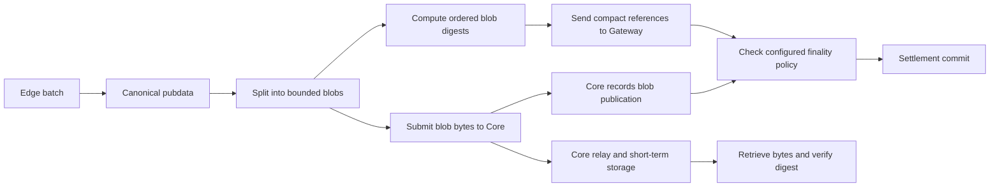

A rollup publishes data so independent participants can reconstruct its state. Syscoin's Proof of Data Availability (PoDA) publishes the bytes as blobs on Syscoin Core. In the zkSYS code this path is called Bitcoin DA. A compact digest identifies each blob. zkSYS can send those identifiers through Gateway while keeping the larger payloads on the DA path. Syscoin Core blocks receive merge-mined proof of work through AuxPoW. [Core 5.1.0 release notes](https://github.com/syscoin/syscoin/releases/tag/v5.1.0) · [zkSYS batch publication](https://github.com/syscoin/zksync-os-server/blob/v0.24.4/node/bin/src/batcher/mod.rs#L578-L605)

The diagram shows zkSYS using compact references for Edge-to-Gateway settlement under the activated PQ architecture. Finality lets the settlement path check that a blob publication belongs to a locked Core history. Retrieval and digest verification establish that a verifier has the corresponding bytes. [Core #609](https://github.com/syscoin/syscoin/pull/609) · [Geth #42](https://github.com/syscoin/go-ethereum/pull/42) · [Network and release status](../intro/status.mdx)

## What the hash commits to

Core accepts a legacy Keccak-256 digest or a BLAKE2s-256 digest. The typed BLAKE2s form is the byte `0x01` followed by the 32-byte digest where a versioned identifier is called for. Core decodes the algorithm and digest separately, recomputes the selected hash on supplied bytes, and rejects a mismatch. For Core blob lookups and the NEVM membership interface, use the 32-byte digest. Hash the exact payload bytes, including their order, and retain the algorithm alongside the identifier. SHA3-256 and Ethereum Keccak-256 are distinct algorithms. [Core encoding](https://github.com/syscoin/syscoin/blob/b3b4f643383a2149807a25fe38d26b5f058daa60/src/primitives/transaction.cpp#L31-L74) · [Core blob checks](https://github.com/syscoin/syscoin/blob/b3b4f643383a2149807a25fe38d26b5f058daa60/src/validation.cpp#L5984-L5999) · [Core lookup](https://github.com/syscoin/syscoin/blob/b3b4f643383a2149807a25fe38d26b5f058daa60/src/services/rpc/nevmrpc.cpp#L103-L167)

This commitment is to a whole blob. A recipient downloads the bytes and recomputes the digest. There is no structured reference string or pairing operation in that check. A digest does not supply bytes or provide a polynomial opening, erasure coding, or data availability sampling by itself. The availability design therefore also depends on publication and relay rules, block inclusion, and a retrieval and retention policy. BLAKE2s is a distinct choice from the hash used for Bitcoin mining or Ethereum-compatible transaction formats. [BLAKE2 specification, RFC 7693](https://www.rfc-editor.org/rfc/rfc7693) · [Core data processing](https://github.com/syscoin/syscoin/blob/b3b4f643383a2149807a25fe38d26b5f058daa60/src/validation.cpp#L6002-L6055)

Core sets a blob size limit of 2 MiB and a block limit of 32 blobs, with an aggregate blob data limit of 64 MiB. These are validation bounds. Effective capacity also depends on block production, relay, wallet funding, fees, and the publisher's own batching policy. zkSYS derives ordered identifiers from the canonical publication bytes and checks those identifiers against the batch's operator DA input before publishing. [Core limits](https://github.com/syscoin/syscoin/blob/b3b4f643383a2149807a25fe38d26b5f058daa60/src/primitives/transaction.h#L72-L81) · [zkSYS batcher](https://github.com/syscoin/zksync-os-server/blob/v0.24.4/node/bin/src/batcher/mod.rs#L578-L605)

## Availability, inclusion, and finality

| Check | Evidence to inspect | What it establishes |
| --- | --- | --- |
| Byte integrity | Recomputed digest of retrieved bytes | The bytes match the identifier under the selected hash assumptions. |
| Availability lookup | Local Core blob metadata, or the configured PoDA archive response | A source reports the blob. Retrieve and hash the bytes when the application needs independent integrity verification. |
| Publication and finality | Canonical Core block containing the publication, with the required confirmations or ChainLock | The publication satisfies a specified settlement policy. |
| NEVM membership | The `0x63` precompile returns the exact 32-byte digest at the queried NEVM state | The digest is present in that state's registration view. |
| Execution validity | A settlement proof accepted by the active verifier for the expected batch | The verifier accepted a particular state transition under its configured proof system. |

The v0.24.4 DA client checks availability with bounded JSON-RPC batches of `getnevmblobdata` calls using `getdata=false`. For entries the client treats as missing locally, it queries the configured PoDA archive in a separate batch. The Gateway admission and batch verification paths check these references. The commit path checks canonical publication and its configured finality separately. In the Tanenbaum one-confirmation configuration, a narrow NEVM registration path can satisfy the gate for previously registered hashes. The same fallback does not apply to mainnet or ChainLock policies. [DA client availability](https://github.com/syscoin/bitcoin_da_client/blob/1b6f11d3e538120759e062ca0a478973653c1038/src/lib.rs#L757-L820) · [Gateway batch checks](https://github.com/syscoin/zksync-os-server/blob/v0.24.4/lib/batch_verification/src/verifier/mod.rs#L456-L520) · [Finality gate](https://github.com/syscoin/zksync-os-server/blob/v0.24.4/node/bin/src/batcher/bitcoin_da_finality_gate.rs#L518-L639) · [Tanenbaum fallback policy](https://github.com/syscoin/zksync-os-server/blob/v0.24.4/docs/src/guides/bitcoin_da_publication_queue.md#reusing-a-publication-after-metadata-expiry)

## Retention and replay

At an illustrative steady pace of one full 64 MiB blob block per 150 seconds, six hours is 144 blocks, or 9 GiB of raw payloads. The average payload rate at that ceiling is about 0.43 MiB/s, or 3.58 Mbit/s, before peer fan-out, protocol overhead, bursts, and reorg retention. This is an arithmetic envelope, with actual storage depending on Core's finality and pruning rules. Archive operators can keep longer histories for replay, recovery, or application-specific dispute windows. [Mainnet target](./core.mdx#what-bitcoin-merge-mining-contributes) · [Blob limits](https://github.com/syscoin/syscoin/blob/b3b4f643383a2149807a25fe38d26b5f058daa60/src/primitives/transaction.h#L72-L81)

Core blob lookup is time-bounded. Under the Core #609 rules, `getnevmblobdata` treats a blob as expired once active-tip median-time-past is more than six hours past the blob's recorded median time. Median-time-past is a chain clock and may differ from local time. Core distinguishes lookup visibility from physical pruning so that bytes can be retained until verified finality makes irreversible pruning safe. Normal Core retention does not guarantee historical retrieval. An archive can retain and serve bytes beyond the Core window, and independent replay requires the relevant payloads, decoding rules, and state or authenticated snapshot. Verify any archived payload against the original digest. [Expiry predicate](https://github.com/syscoin/syscoin/blob/b3b4f643383a2149807a25fe38d26b5f058daa60/src/services/nevmconsensus.h#L33-L41) · [Core query semantics](https://github.com/syscoin/syscoin/blob/b3b4f643383a2149807a25fe38d26b5f058daa60/src/services/rpc/nevmrpc.cpp#L160-L216)

In paired sysgeth #42, DA membership follows a persisted reference count for the canonical chain. An entry remains present while there is a canonical reference, including when several blocks register the same digest. The precompile exposes that membership as the digest or an empty response. It does not return the payload or its publication transaction, and a successful membership query alone is not a historical archive lookup or ChainLock proof. [Reference count read](https://github.com/syscoin/go-ethereum/blob/1c046ba92f8ea95be024a790e9444b80ccbf019a/core/rawdb/accessors_execution.go#L91-L117) · [Precompile implementation](https://github.com/syscoin/go-ethereum/blob/1c046ba92f8ea95be024a790e9444b80ccbf019a/core/vm/contracts.go#L1212-L1226) · [Canonical index tests](https://github.com/syscoin/go-ethereum/blob/1c046ba92f8ea95be024a790e9444b80ccbf019a/core/datahash_index_test.go)

Use the [zkSYS and DA command reference](../reference/zksys.mdx) to query a blob, verify its bytes, and check the public Genesis network.
