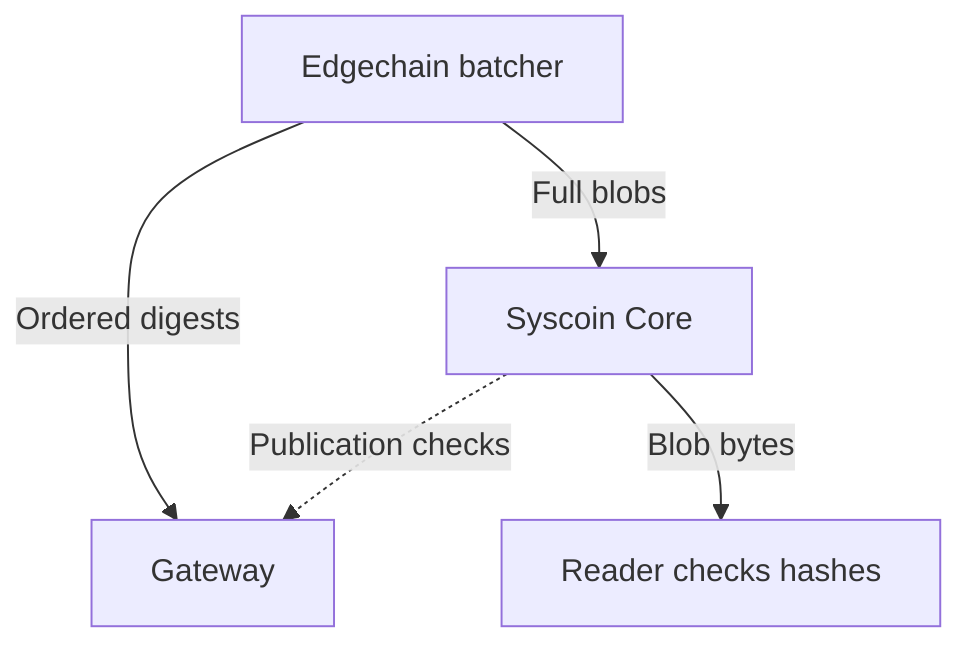
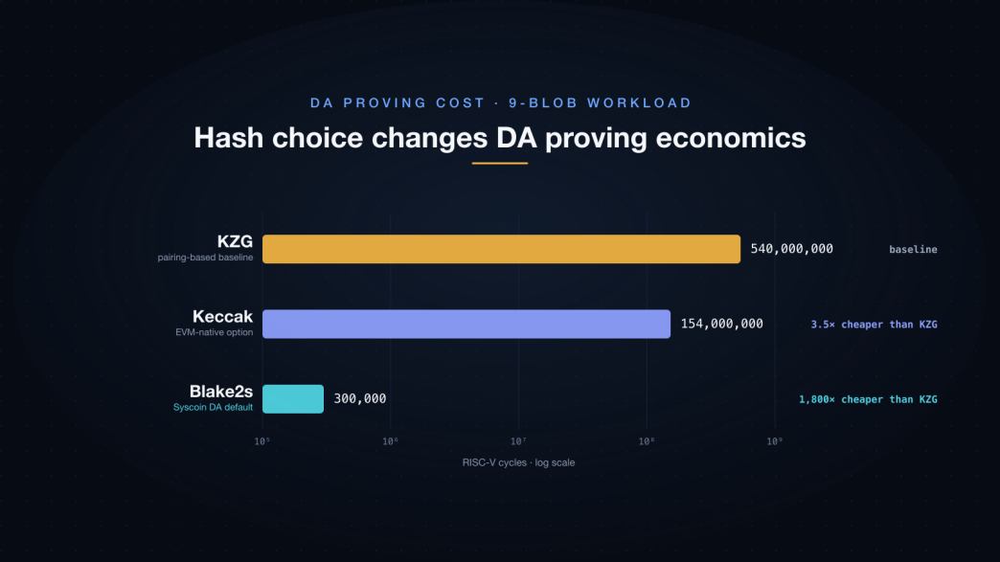

import {BlobRetentionFigure} from '@site/src/components/ProtocolFigures';

Syscoin’s Proof of Data Availability (PoDA) lets applications publish blobs on Core. A publication transaction commits to the blob’s digest. Core validates and relays the full bytes for recent publications. With zkSYS, the Edgechain sends full blobs to Core and sends their ordered digests to Gateway for settlement. The zkSYS code calls this “Bitcoin DA” because Core is merge-mined. The blob bytes are published on Syscoin. [Core release notes](https://github.com/syscoin/syscoin/releases/tag/v5.1.0) · [zkSYS batcher](https://github.com/syscoin/zksync-os-server/blob/v0.24.4/node/bin/src/batcher/mod.rs#L578-L605)

Gateway checks availability before admission and checks canonical publication under the configured confirmation or finality policy before commit. Archives can serve retained blobs to readers after Core’s serving window closes. [Availability and finality checks](#availability-inclusion-and-finality)

## How much crosses Gateway?

A **5 MiB** Edge batch illustrates what changes for the aggregator. Core receives **5,242,911 bytes**, including the 31-byte length prefix, split across three blobs. In the earlier full-data design, Gateway would have carried the Edge payload in a **5,243,040-byte relay message**. The v0.24.4 Edge commit supplies three ordered BLAKE2s digests totaling **96 bytes**. Gateway adds the batch context and forwards a **288-byte relay message**. Core still propagates the payload, and readers still need it for replay. [Earlier full-data relay](https://github.com/syscoin/zksync-os-server/blob/570e2d0fe0f062671176970e8309c87fe0a0145b/node/bin/src/batcher/seal_criteria.rs#L13-L35) · [Current blob encoder](https://github.com/syscoin/zksync-os-server/blob/v0.24.4/lib/batch_types/src/batch_info.rs#L366-L397) · [Current relay encoder](https://github.com/syscoin/zksync-os-server/blob/v0.24.4/scripts/patches/era-contracts-syscoin.patch#L2064-L2081)

| Edge public data | Core blobs in v0.24.4 | Edge commit DA field, earlier → compact | Gateway relay message, earlier → compact |
| --- | ---: | ---: | ---: |
| 1 KiB | 1 | 1,154 → 32 B | 1,184 → 224 B |
| 2 MiB minus 31 B | 1 | 2,097,251 → 32 B | 2,097,312 → 224 B |
| Exactly 2 MiB | 2 | 2,097,346 → 64 B | 2,097,312 → 256 B |
| 5 MiB | 3 | 5,243,138 → 96 B | 5,243,040 → 288 B |
| 64 MiB minus 31 B (encoder limit) | 32 | 67,110,947 → 1,024 B | 67,109,024 → 1,216 B |

These are byte counts from the two encoders for the same application input. The earlier Edge commit field included the payload and per-blob headers. Its Gateway relay used a 160-byte ABI header and rounded the payload up to a 32-byte boundary. The compact Edge field uses 32 bytes per blob. Its relay adds 192 bytes for the version, chain, batch, commitment, and dynamic-array encoding. The two fields belong to successive hops. Each excludes the surrounding transaction, proof, and other Gateway state changes. [Earlier commit field](https://github.com/syscoin/zksync-os-server/blob/570e2d0fe0f062671176970e8309c87fe0a0145b/lib/batch_types/src/batch_info.rs#L349-L384) · [Current commit field](https://github.com/syscoin/zksync-os-server/blob/v0.24.4/lib/batch_types/src/batch_info.rs#L580-L595) · [Current relay message layout](https://github.com/syscoin/zksync-os-server/blob/v0.24.4/lib/batch_types/src/batch_info.rs#L92-L141)

At the upper encoding bound, the Gateway relay message shrinks from 67,109,024 to 1,216 bytes, a ratio of about **55,188 to 1**. The host and proving guest enforce the 31-byte prefix, which is why exactly 2 MiB of application data already needs two digests. Gateway also caps all forwarded references in one batch at 32. These counts apply to the Gateway relay. Core still carries the full payload. [Gateway limits](https://github.com/syscoin/zksync-os-server/blob/v0.24.4/lib/batch_types/src/batch_info.rs#L17-L27) · [Capacity and settlement tradeoffs](./design-tradeoffs.mdx#what-scales-when-a-community-adds-an-application)

## Why BLAKE2s fits the prover

Edge proofs must bind execution to the batch bytes that readers can retrieve. In Syscoin’s V8 proving guest, the batch program computes standard **BLAKE2s-256** over each chunk of the length-prefixed batch. The full payload takes this hash path. Airbender’s proving library can delegate its BLAKE2s round work to a specialized circuit. An ordinary Core node or archive reader can verify the identical 32-byte digest with a conventional BLAKE2s implementation. [Guest commitment calculation](https://github.com/syscoin/zksync-os-server/blob/v0.24.4/scripts/patches/zksync-os-syscoin-v0.4.0.patch#L271-L289) · [Proving and ordinary implementations](https://github.com/matter-labs/airbender-platform/blob/a350ee3e08bef4cbe2b7bc968966bee45bc98a17/crates/airbender-crypto/src/blake2s/mod.rs#L1-L33) · [Delegated round processing](https://github.com/matter-labs/airbender-platform/blob/a350ee3e08bef4cbe2b7bc968966bee45bc98a17/crates/airbender-crypto/src/blake2s/delegated_extended.rs#L37-L83)

The guest then applies **Keccak-256** to the ordered list of blob digests. For the 5 MiB example, this outer hash processes 96 bytes. Gateway binds the references to their chain and batch and hashes them into its ordered root. The SNARK wrapper verifies aggregated execution proof work at settlement and brings its own assumptions. This division places the prover-friendly hash on the largest input while preserving the commitment format expected by the settlement contracts. [Edge commitment](https://github.com/syscoin/zksync-os-server/blob/v0.24.4/lib/batch_types/src/batch_info.rs#L580-L592) · [Gateway reference binding](https://github.com/syscoin/zksync-os-server/blob/v0.24.4/lib/batch_types/src/batch_info.rs#L49-L71) · [Settlement wrapper](./zksys.mdx#why-there-are-two-proof-stages)

The zkSYS team reported these commitment costs for the same nine-blob workload, estimated at roughly 1.1 MiB. The counts cover RISC-V guest work to build the commitment. The full proof also covers application execution, delegated circuits, aggregation, and wrapping. The report does not include the input fixture or benchmark runner. [Original cycle counts](https://x.com/realSidhuJag/status/2043835947029316074) · [Testnet report](https://syscoin.org/news/zksys-update)

| Commitment path | Guest cycles | Relative to BLAKE2s |
| --- | ---: | ---: |
| KZG | 540,000,000 | 1,800× |
| Keccak | 154,000,000 | ≈513× |
| BLAKE2s | 300,000 | 1× |

## What the hash commits to

Core accepts a legacy Keccak-256 digest or a BLAKE2s-256 digest. The typed BLAKE2s form is the byte `0x01` followed by the 32-byte digest where a versioned identifier is called for. Core decodes the algorithm and digest separately, recomputes the selected hash on supplied bytes, and rejects a mismatch. For Core blob lookups and the NEVM membership interface, use the 32-byte digest. Hash the exact payload bytes, including their order, and retain the algorithm alongside the identifier. SHA3-256 and Ethereum Keccak-256 are distinct algorithms. [Core encoding](https://github.com/syscoin/syscoin/blob/b3b4f643383a2149807a25fe38d26b5f058daa60/src/primitives/transaction.cpp#L31-L74) · [Core blob checks](https://github.com/syscoin/syscoin/blob/b3b4f643383a2149807a25fe38d26b5f058daa60/src/validation.cpp#L5984-L5999) · [Core lookup](https://github.com/syscoin/syscoin/blob/b3b4f643383a2149807a25fe38d26b5f058daa60/src/services/rpc/nevmrpc.cpp#L103-L167)

To verify the commitment, fetch the complete blob and recompute its digest. A Core block can carry up to **32 blobs of 2 MiB each**, for a total of **64 MiB**. The zkSYS batch encoder also limits a batch to 32 blobs. Its 31-byte length prefix leaves **67,108,833 application bytes** at that limit. [BLAKE2 specification](https://www.rfc-editor.org/rfc/rfc7693) · [Core size limits](https://github.com/syscoin/syscoin/blob/v5.1.3/src/primitives/transaction.h#L69-L74) · [zkSYS batch limits](https://github.com/syscoin/zksync-os-server/blob/v0.24.4/lib/batch_types/src/batch_info.rs#L17-L27)

## How PoW and compact relay protect the data path

Core nodes check a mined block’s header and AuxPoW before requesting the body on the headers-first path. Peers can announce a new block in compact form. A **six-byte short ID** identifies a transaction the receiving peer may already hold, while the transaction’s **32-byte PoDA digest** authenticates the full blob. For a recent publication, every validating node checks the full bytes. [Core header sync](./core.mdx#why-core-synchronizes-headers-first) · [Compact block reconstruction](https://github.com/syscoin/syscoin/blob/v5.1.3/src/blockencodings.cpp) · [Blob validation](https://github.com/syscoin/syscoin/blob/v5.1.3/src/validation.cpp#L2508-L2540)

Take a block with 32 publications of 2 MiB each. A peer that already has all 32 transactions and blobs can use the 192 bytes of short IDs to locate them. If four are missing, the peer can request them with `getblocktxn`. The response carries 8 MiB of blob payload in addition to transaction and message framing. A peer can also request the full block if reconstruction fails. [Compact block download](https://github.com/syscoin/syscoin/blob/v5.1.3/src/net_processing.cpp)

## Availability, inclusion, and finality

| Check | Evidence to inspect | What it establishes |
| --- | --- | --- |
| Byte integrity | Recomputed digest of retrieved bytes | The bytes match the identifier under the selected hash assumptions. |
| Availability lookup | Local Core blob metadata, or the configured PoDA archive response | A source reports the blob. Retrieve and hash the bytes when the application needs independent integrity verification. |
| Publication and finality | Canonical Core block containing the publication, with the required confirmations or ChainLock | The publication satisfies a specified settlement policy. |
| NEVM membership | The `0x63` precompile returns the exact 32-byte digest | NEVM recognizes the digest as registered. The rules for expiry depend on the deployment. |
| Execution validity | A settlement proof accepted by the active verifier for the expected batch | The verifier accepted a particular state transition under its configured proof system. |

Gateway’s DA client checks Core metadata in batches using `getnevmblobdata` with `getdata=false`. It can query a configured PoDA archive for missing entries. The commit path separately checks inclusion and the configured finality policy. On Tanenbaum, the one-confirmation test configuration also permits a narrow fallback for previously registered NEVM digests. Mainnet and ChainLock policies require their own publication evidence. [DA client](https://github.com/syscoin/bitcoin_da_client/blob/1b6f11d3e538120759e062ca0a478973653c1038/src/lib.rs#L757-L820) · [Commit policy](https://github.com/syscoin/zksync-os-server/blob/v0.24.4/node/bin/src/batcher/bitcoin_da_finality_gate.rs#L518-L639) · [Tanenbaum fallback](https://github.com/syscoin/zksync-os-server/blob/v0.24.4/docs/src/guides/bitcoin_da_publication_queue.md#reusing-a-publication-after-metadata-expiry)

## Retention and replay

Core compares a block’s median time past (MTP) with the node’s adjusted current time to decide whether it needs the blob bytes. A *sidecar* is the blob payload supplied with the transaction that commits to its digest. [Released validation rules](https://github.com/syscoin/syscoin/blob/v5.1.3/src/validation.cpp#L2508-L2540) · [Time constants](https://github.com/syscoin/syscoin/blob/v5.1.3/src/primitives/transaction.h#L69-L74)

| Age of the block by that clock | Sidecar rule |
| --- | --- |
| Up to and including 2 hours | The node requires a nonempty sidecar and checks the digest. |
| More than 2 hours | The node can accept the commitment alone. It checks any supplied bytes unless the rule below applies. |
| More than 8 hours, with an accepted ChainLock no more than 2 hours old | The sidecar must be absent or empty. |

At the 150-second mainnet block target, a sustained 64 MiB per block would average **3.58 Mbit/s** to receive one copy of each payload. Six hours at that rate would contain **9 GiB** of blob data before overhead. Bursts and serving other peers raise the bandwidth requirement. [Mainnet block target](https://github.com/syscoin/syscoin/blob/v5.1.3/src/kernel/chainparams.cpp)

### Why a ChainLock changes when Core can delete bytes

On mainnet, Core can prune the stored blob and metadata when the last accepted ChainLock’s block MTP is more than six hours after the blob’s recorded MTP. Until the threshold is locked in, a reorganization may move the tip back into the lookup window. Tanenbaum can also prune on a database flush using the active tip’s MTP. [Mainnet ChainLock pruning](https://github.com/syscoin/syscoin/blob/v5.1.3/src/llmq/quorums_chainlocks.cpp#L367-L378) · [Pruning and testnet flush](https://github.com/syscoin/syscoin/blob/v5.1.3/src/services/nevmconsensus.cpp)

Core 5.1.3 serves `getnevmblobdata` from stored metadata until pruning removes it. With tip-based expiry, the lookup stops serving a blob once the **active tip’s MTP** passes the six-hour boundary, even while its bytes remain on disk. [Core 5.1.3 lookup](https://github.com/syscoin/syscoin/blob/v5.1.3/src/services/rpc/nevmrpc.cpp#L154-L164) · [Tip-based expiry rule](https://github.com/syscoin/syscoin/blob/b3b4f643383a2149807a25fe38d26b5f058daa60/src/services/rpc/nevmrpc.cpp#L160-L179)

<BlobRetentionFigure />

NEVM’s `0x63` precompile checks digest membership. With the canonical membership index, the check uses the active **50,001-block window**, even for historical `eth_call` queries. A positive result can outlast Core’s blob service or reflect a later publication of the same digest. To establish when a particular publication happened, find its transaction in the original canonical Core block. [Released precompile](https://github.com/syscoin/go-ethereum/blob/v5.1.0/core/vm/contracts.go#L1215-L1226) · [Canonical index rules](https://github.com/syscoin/go-ethereum/blob/1c046ba92f8ea95be024a790e9444b80ccbf019a/docs/syscoin-data-hash-index-upgrade.md)

### What can someone verify a week later?

Keep the evidence needed for the application’s retention period. Core’s live serving window and the zkSYS replay archive serve separate purposes.

| What you need to verify | What to retain |
| --- | --- |
| Which batch settled? | The settlement transaction and enough context to check the chain, batch commitment, deployed verifier, and submitted proof. [Settlement stages](./zksys.mdx#why-there-are-two-proof-stages) |
| What data did the batch publish? | The original Core block hash and transaction ID, the ordered digests, and the encoded blobs. Hash each blob, reassemble them in order, and check the batch commitment. [Batch encoding](https://github.com/syscoin/zksync-os-server/blob/v0.24.4/lib/batch_types/src/batch_info.rs#L366-L397) · [Ordered commitment](https://github.com/syscoin/zksync-os-server/blob/v0.24.4/lib/batch_types/src/batch_info.rs#L580-L591) |
| Can another operator replay the blocks? | A known prior state and canonical history, plus transaction inputs, block context, protocol version, and any forced preimages from the block replay archive. [Replay archive](https://github.com/syscoin/zksync-os-server/blob/v0.24.4/lib/replay_archive/README.md) |

Use the [zkSYS and DA command reference](../reference/zksys.mdx) to query a blob, verify its bytes, and check the public Genesis network.
