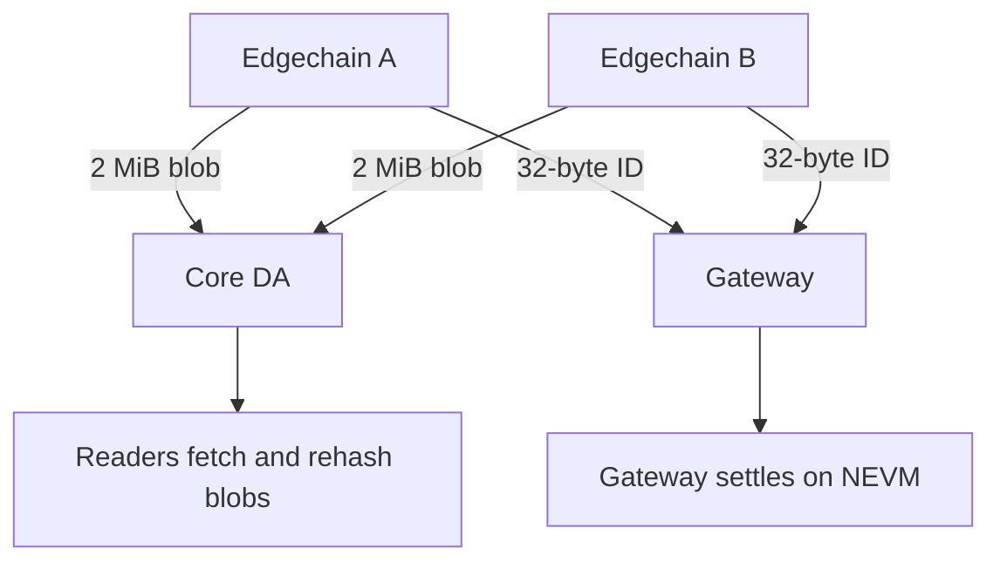

Syscoin's design starts with an operator question. As usage grows, can someone still run a node, check the shared history, recover the data they need, and choose an execution provider? The system keeps consensus rules general and budgets the work every full node must do. zkSYS is the worked example of scaling around that constraint. It moves execution and proof generation to independently operated layers while using Core for full data publication and NEVM for proof settlement. [Architecture assumptions and network status](../intro/status.mdx) · [Syscoin's original design rationale](https://jsidhu.medium.com/blockchain-idealisms-b61c5781ddc3)

## What happens when a second Edgechain joins?

Suppose two Edgechains each produce one full **2 MiB encoded blob**. In zkSYS compact-reference mode, the publishers send **4 MiB of payload to Core** between them. Across their two Gateway commits, the ordered blob-ID fields carry **64 bytes in total**. Each ID is the 32-byte BLAKE2s digest of one blob. Gateway also processes transaction framing, batch commitments, proof settlement, and its own execution data. The 64 bytes measure the blob IDs alone. [Blob size and reference limits](https://github.com/syscoin/zksync-os-server/blob/v0.24.4/lib/batch_types/src/batch_info.rs#L19-L27) · [Blob encoding and digest](https://github.com/syscoin/zksync-os-server/blob/v0.24.4/lib/batch_types/src/batch_info.rs#L366-L398) · [Commitment construction](https://github.com/syscoin/zksync-os-server/blob/v0.24.4/lib/batch_types/src/batch_info.rs#L580-L600)

Each added Edgechain brings its own execution and proving demand. Keeping its full payload off Gateway's commit path allows other chains to share Gateway without relaying those bytes a second time through that path. Core must still carry the combined publication load, and a reader replaying both chains must obtain both blobs. The advantage is largest when batch payloads are large relative to their reference lists and Gateway ingress is the constraint. [Gateway admission and settlement](./zksys.mdx#what-gateway-changes)

## Who pays for each design choice?

| Design choice | What it buys | Cost or assumption that remains |
| --- | --- | --- |
| **Slower Core cadence with direct PQ checks** | Full nodes verify Sentry authorization and the scheduled signatures themselves. ChainLock validation has no recursive proof or prover dependency. | A complete certificate carries about 1 MB of signatures and authentication material. Quorum safety, signer state, timely relay, and the durable finality boundary still matter. [Signature checks and wire size](./post-quantum.mdx#what-a-full-node-verifies) |
| **Full retrieval and hash-based DA** | A reader can obtain the complete bytes and recompute their content hash. A recent publication can be checked independently of the Gateway transaction that references it. | Blob bandwidth rises with the payload. Nodes need to keep up in the live window and archival readers need retained data. A local fetch establishes local access at that time. [DA lifecycle](./data-availability.mdx) |
| **Compact Gateway commitments and validity proofs** | A new Edgechain can use its own execution resources while Gateway processes proofs and commitments. An Edgechain's full payload travels to Core without going through Gateway's transaction data. | Gateway still has shared acceptance and proving costs. The deployment needs sound verifiers, reachable DA, and operators who can maintain the settlement path. [Gateway data path](./zksys.mdx#what-gateway-changes) |
| **Local governance and SYS-linked issuance** | Separate chains can adopt their own operating rules and pay for specialized work. zkSYS connects issuance to SYS stake and eligible collateral, with a native SYS fee path and optional zkSYS gas credit. | Reward concentration, operator entry and replacement, sequencer discretion, upgrade keys, and claim rules determine how much independence that produces. [Enshrine or align?](./modular-alignment.mdx) |

## Why check work before downloading bytes?

Compare two nodes hearing about a new block with a **2 MiB blob**. Both can check the chain of headers and the candidate’s mining evidence before deciding to request its body. The AuxPoW wrapper ties a qualifying parent header to the Syscoin header. The Syscoin header commits to a transaction Merkle root, and the publication transaction commits to the blob digest. A peer proposing a fresh competing block must supply valid mining work for that block. Adding more peer identities cannot manufacture that evidence. The work target is Syscoin’s, and Core applies its ChainLock rules to eligible history. [How Core screens a candidate history](./core.mdx#why-core-synchronizes-headers-first)

The first node already has the publication transaction and its bytes. On the compact-block path it can recognize that transaction from a short ID and avoid receiving the 2 MiB again. The second node still needs the missing data to validate a fresh publication. Both benefit from **work-backed selection of which history to download**. The first also saves bandwidth because peers share data they have seen. An ordinary peer can relay someone else’s valid work, and unconfirmed transaction relay can happen before a miner includes the publication. That is where fee policy, validation, and resource limits still matter. [Compare the wire costs for a 32-blob block](./data-availability.mdx#how-pow-and-compact-relay-protect-the-data-path) · [Live sidecar rules](./data-availability.mdx#retention-and-replay)

## What the DA budget looks like

[Open the full-size DA budget chart](../../static/img/da-payload-budget.webp)

The plot assumes one block per 150 seconds for six hours. Average ingress is payload per block divided by 150 seconds. Raw retention is payload per block multiplied by 144 blocks. These are arithmetic estimates from an illustrative steady load. They exclude relay fan-out, burst traffic, metadata, and extra storage when finality or pruning is delayed. They give operators a baseline for measuring who can keep up. [Timing](./core.mdx#what-bitcoin-merge-mining-contributes) · [Blob limits and retention](./data-availability.mdx#retention-and-replay)

Measurements by Croman and coauthors explain why bytes delivered within one block interval matter. Higher per-interval load can leave slower peers behind. Gencer and coauthors also measure several independent dimensions, including network infrastructure and production concentration. Their historical measurements cannot establish a present-day Syscoin rate or rank current networks. They motivate measuring validator workload and operator control separately. [Croman et al., On Scaling Decentralized Blockchains](https://doi.org/10.1007/978-3-662-53357-4_8) · [Gencer et al., Decentralization in Bitcoin and Ethereum Networks](https://arxiv.org/abs/1801.03998)

Al-Bassam and coauthors show how a light client can gain probabilistic confidence in availability from authenticated erasure-coded shares under networking and honest-rebroadcast assumptions. Syscoin requires the whole payload when Core validates recent publications. A node catching up from older blocks can accept a transaction carrying the commitment with the payload absent. An application rebuilding old rollup state still needs those bytes from a retained copy. This is one reason to measure the cost of recent validation separately from the cost of historical replay. [Al-Bassam et al., Fraud and Data Availability Proofs](https://doi.org/10.1007/978-3-662-64331-0_15) · [Core presence checks](https://github.com/syscoin/syscoin/blob/b3b4f643383a2149807a25fe38d26b5f058daa60/src/validation.cpp#L6002-L6038) · [PoDA retention and replay](./data-availability.mdx#retention-and-replay)

## Published measurements

The two numbers on the original post come from different workloads. One estimates what it costs a prover operator to run a particular GPU setup. The other counts instructions in the DA commitment path. They answer different engineering questions. [Original video and thread](https://x.com/realSidhuJag/status/2043835940322652453) · [Foundation report](https://syscoin.org/eco-update-260505)

| Question | Published result | What was measured |
| --- | --- | --- |
| What can a small prover operator handle? | **77.8 million transactions/month** of estimated proving capacity on **three A5000 GPUs**. At the reported **$700/month**, that is about **$9 per million transactions proved**. | The project extrapolated monthly capacity from its internal proving run. The estimate covers its hardware setup and workload. User fees, DA publication, and the settlement pipeline have separate costs. [May 2026 report](https://syscoin.org/eco-update-260505) |
| What does the DA commitment choice cost inside the guest? | **300,000 RISC-V cycles** for BLAKE2s, **154 million** for Keccak, **540 million** for the KZG path. | The same historical nine-blob workload. BLAKE2s took **1/1,800** of the KZG path’s guest cycles. Proving the rest of the batch, relaying it, and waiting for settlement take additional work and time. [Original chart and mechanism](./data-availability.mdx#why-blake2s-fits-the-prover) |
| What did the zkSYS smart-account signature optimization buy? | **2,810,587 → 1,369,699 guest cycles**, a **51.3% reduction** for the direct call. The forwarded path went from **2,804,184 → 1,363,307**. | Identical fixed signing vectors in the portable SHA-2 verifier, comparing its prior and revised implementations. The precompile’s fixed verification charge stayed at **45,000 gas**. Core’s Sentry ChainLocks use a separate signature path. [Merged implementation and benchmark](https://github.com/syscoin/zksync-os-server/pull/305) |
| How sensitive were early Z-DAG asset payments to latency? | **15,328 transfers/s** at **50 ms** emulated latency and **8,677 transfers/s** at **100 ms**. The **150 ms** case produced no completed measurement. | Whiteblock’s historical Core 4 pre-confirmation test, with 30 nodes, nine assets, 250 sends per asset and an 11-second configured wait. Block settlement has its own cadence. [Test conditions](https://syscoin.org/tps_whiteblock_syscoin_report.pdf#page=2) · [Results, Table VIII](https://syscoin.org/tps_whiteblock_syscoin_report.pdf#page=3) |

For a side-by-side comparison using the same input size, follow 1 MiB through the zkSYS and upstream Ethereum blob encoders. For an operator sizing Gateway, use the table of encoded relay messages across multiple batch sizes. [One MiB across encoders](./comparison.mdx#what-one-mib-costs-in-data-references) · [Gateway message sizes](./data-availability.mdx#how-much-crosses-gateway)

## How to judge whether the design works

- **Independent Core verification.** Measure propagation and validation at different network speeds under sustained and bursty blob load. Track who falls behind, how long a new node takes to sync, and how well relaying recovers when new ChainLocks pause.
- **Scaling across Edgechains.** Compare the marginal payload, queue time, and proving work as active chains join Gateway. Then measure the time from a local receipt to canonical publication and verified settlement. Look for pressure in the shared DA path as well as at Gateway.
- **Operator decentralization.** Measure how many independently controlled parties can order, prove, relay, and recover. Test that they can take over from a stalled operator under the actual rules. Count control of roles and upgrade keys as well as processes or identities.
- **Independent recovery.** Follow an application from a fresh client through its proof, data, and settlement dependencies. Test replay from an authenticated snapshot after the live window and recovery using an independently retained archive.

For a community allocating shared resources, the same architecture lets local users make decisions quickly and others check them later. A proof can make the result independently verifiable. Shared finality matters when local groups contend for the same resource, and governance determines the rules and evidence each group accepts. [Humans, AI, and shared resources](../intro/human-and-ai.mdx) · [The interplanetary example](https://jsidhu.medium.com/truth-states-consciousness-and-decentralized-intelligence-d5415da47dc6)
