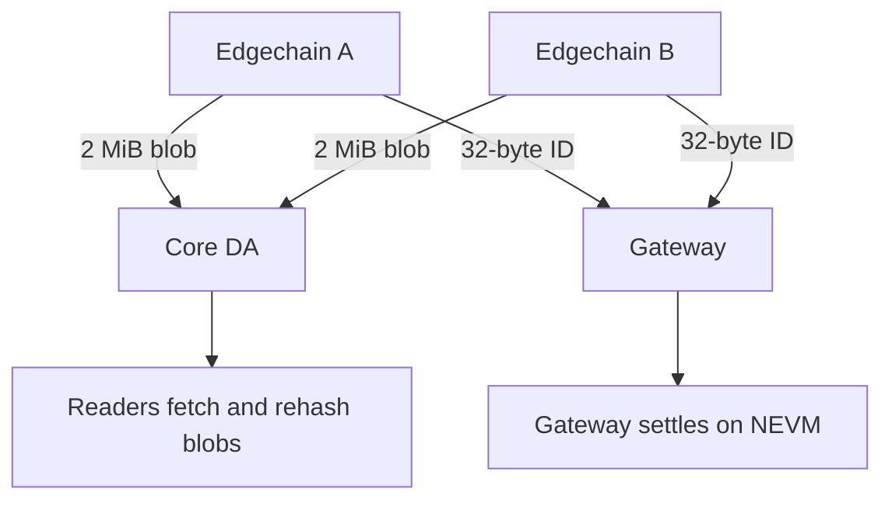
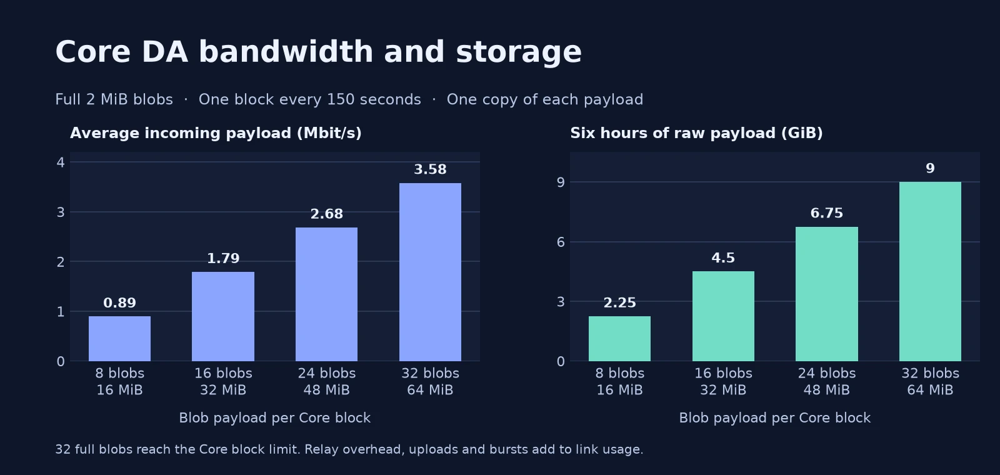

An Edgechain can add execution capacity without running its program on every Core node. The Edgechain orders and executes transactions, Core publishes the data, and Gateway settles batches on NEVM. This page uses concrete batch sizes to show what each layer has to store, relay, and verify. [System architecture](./overview.mdx) · [Network status](../intro/status.mdx)

## What happens when a second Edgechain joins?

Suppose two Edgechains each produce one full **2 MiB encoded blob**. In zkSYS compact-reference mode, the publishers send **4 MiB of payload to Core** between them. Across their two Gateway commits, the ordered blob-ID fields carry **64 bytes in total**. Each ID is the 32-byte BLAKE2s digest of one blob. Gateway also processes transaction framing, batch commitments, proof settlement, and its own execution data. The 64 bytes measure the blob IDs alone. [Blob size and reference limits](https://github.com/syscoin/zksync-os-server/blob/v0.24.4/lib/batch_types/src/batch_info.rs#L19-L27) · [Blob encoding and digest](https://github.com/syscoin/zksync-os-server/blob/v0.24.4/lib/batch_types/src/batch_info.rs#L366-L398) · [Commitment construction](https://github.com/syscoin/zksync-os-server/blob/v0.24.4/lib/batch_types/src/batch_info.rs#L580-L600)

Gateway’s bandwidth savings are largest when batch payloads are large relative to their reference lists. A reader replaying both chains needs both payloads. [Gateway admission and settlement](./zksys.mdx#what-gateway-changes)

## Who pays for each design choice?

| Design choice | What it buys | Cost or assumption that remains |
| --- | --- | --- |
| **Slower Core cadence with direct PQ checks** | Full nodes verify Sentry authorization and the scheduled signatures themselves. ChainLock validation has no recursive proof or prover dependency. | A complete certificate carries about 1 MB of signatures and authentication material. Quorum safety, signer state, timely relay, and the durable finality boundary still matter. [Signature checks and wire size](./post-quantum.mdx#what-a-full-node-verifies) |
| **Full retrieval and hash-based DA** | A reader can obtain the complete bytes and recompute their content hash. A recent publication can be checked independently of the Gateway transaction that references it. | Blob bandwidth rises with the payload. Nodes need to keep up in the live window and archival readers need retained data. A local fetch establishes local access at that time. [DA lifecycle](./data-availability.mdx) |
| **Compact Gateway commitments and validity proofs** | A new Edgechain can use its own execution resources while Gateway processes proofs and commitments. An Edgechain's full payload travels to Core without going through Gateway's transaction data. | Gateway still has shared acceptance and proving costs. The deployment needs sound verifiers, reachable DA, and operators who can maintain the settlement path. [Gateway data path](./zksys.mdx#what-gateway-changes) |
| **Local governance and SYS-linked issuance** | Separate chains can adopt their own operating rules and pay for specialized work. zkSYS connects issuance to SYS stake and eligible collateral, with a native SYS fee path and optional zkSYS gas credit. | Reward concentration, operator entry and replacement, sequencer discretion, upgrade keys, and claim rules determine how much independence that produces. [Enshrine or align?](./modular-alignment.mdx) |

## Why check work before downloading bytes?

Compare two nodes hearing about a new block with a **2 MiB blob**. Both can check the chain of headers and the candidate’s mining evidence before deciding to request its body. The AuxPoW wrapper ties a qualifying parent header to the Syscoin header. The Syscoin header commits to a transaction Merkle root, and the publication transaction commits to the blob digest. A peer proposing a fresh competing block must supply valid mining work for that block. Adding more peer identities cannot manufacture that evidence. The work target is Syscoin’s, and Core applies its ChainLock rules to eligible history. [How Core screens a candidate history](./core.mdx#why-core-synchronizes-headers-first)

The first node already has the publication transaction and its bytes. On the compact-block path it can recognize that transaction from a short ID and avoid receiving the 2 MiB again. The second node still needs the missing data to validate a fresh publication. Peers can also relay valid blocks they did not mine. Mempool validation and fee policy apply to blobs relayed before a miner includes them. [Compare the wire costs for a 32-blob block](./data-availability.mdx#how-pow-and-compact-relay-protect-the-data-path) · [Live sidecar rules](./data-availability.mdx#retention-and-replay)

## What the DA budget looks like

[Open the full-size DA budget chart](../../static/img/da-payload-budget.webp)

The rightmost bars model **32 full blobs × 2 MiB = 64 MiB per block**. At the 150-second mainnet target, receiving one copy of each payload averages **3.58 Mbit/s**. Over six hours, 144 such blocks contain **9 GiB** of raw payload. The protocol limits the bytes each new block can add. Actual traffic depends on how much a node already has, how many copies it receives and which peers it serves. [Mainnet block target](https://github.com/syscoin/syscoin/blob/b3b4f643383a2149807a25fe38d26b5f058daa60/src/kernel/chainparams.cpp#L138-L145) · [Blob limits and retention](./data-availability.mdx#retention-and-replay)

### Keeping up at the tip and recovering later

A peer that already has the blobs can reconstruct a compact block without another full download. A peer missing all 64 MiB needs **53.7 Mbit/s** to fetch them in ten seconds, before protocol overhead. Both peers validate the same block. Their immediate bandwidth needs differ because of what they already received. This modeled burst illustrates why a 150-second average alone tells little about how quickly a node sees the tip. Historical studies of Bitcoin and Ethereum also distinguish propagation delay from concentration of mining infrastructure. [Compact relay](./data-availability.mdx#how-pow-and-compact-relay-protect-the-data-path) · [Croman et al., On Scaling Decentralized Blockchains](https://doi.org/10.1007/978-3-662-53357-4_8) · [Gencer et al., Decentralization in Bitcoin and Ethereum Networks](https://arxiv.org/abs/1801.03998)

For recent PoDA publications, Core requires the complete blob and checks its hash against the digest in the publication transaction. Anyone who retrieves the blob can repeat the same check with a standard hash. Those are the exact bytes an application can use for replay. Core carries the payload while Gateway carries the 32-byte reference for each zkSYS blob. After the blob expires, a returning node can still sync older blocks that carry its commitment. Replaying the batch then requires retained blob bytes, an authenticated starting state, and the other execution inputs. [Core blob checks](https://github.com/syscoin/syscoin/blob/b3b4f643383a2149807a25fe38d26b5f058daa60/src/validation.cpp#L5975-L6038) · [Compact Gateway relay](./data-availability.mdx#how-much-crosses-gateway) · [Historical replay](./data-availability.mdx#what-can-someone-verify-a-week-later)

## Published measurements

The figures below come from different workloads. Prover capacity, guest cycle counts, and pre-confirmation throughput measure separate operations.

| Question | Published result | What was measured |
| --- | --- | --- |
| What can a small prover operator handle? | **77.8 million transactions/month** of estimated proving capacity on **three A5000 GPUs**. At **$700/month** for that setup, that is about **$9 per million transactions proved**. | The report extrapolated monthly capacity from runs that proved over 120,000 transactions. DA publication and settlement incur separate charges. [April 13, 2026 hardware and workload report](https://x.com/realSidhuJag/status/2043835944558833769) · [May 5 Foundation report](https://syscoin.org/eco-update-260505) |
| What does the DA commitment choice cost inside the guest? | **300,000 RISC-V cycles** for BLAKE2s, **154 million** for Keccak, **540 million** for the KZG path. | The April nine-blob workload, estimated at **1.1 MiB**. BLAKE2s took **1/1,800** of the KZG path’s guest cycles. Proving the rest of the batch, relaying it, and waiting for settlement take additional work and time. [April 13 cycle counts](https://x.com/realSidhuJag/status/2043835947029316074) · [Nine-blob cycle comparison](./data-availability.mdx#why-blake2s-fits-the-prover) |
| What did the zkSYS smart-account signature optimization buy? | **2,810,587 → 1,369,699 guest cycles**, a **51.3% reduction** for the direct call. The forwarded path went from **2,804,184 → 1,363,307**. | Portable SHA-2 verification of fixed counter-0 direct/forwarded vectors, v31/V7, upstream OS `b76084f3` with the Syscoin patch. The PR gives the program and verification-key digests. The metric is guest cycles. The charge remained **45,000 gas**. [Test, artifact hashes and V7 configuration](https://github.com/syscoin/zksync-os-server/pull/305) · [Merged revision](https://github.com/syscoin/zksync-os-server/commit/ed3c35b144a817eb9142fa1e21b8dc205449b49c) |
| How sensitive were early Z-DAG asset payments to latency? | **15,328 transfers/s** at **50 ms** emulated latency and **8,677 transfers/s** at **100 ms**. The **150 ms** case produced no completed measurement. | Whiteblock’s Core 4 build `80da881`, Ubuntu 18.04, three Skylake vCPUs and 10 GB SSD in the test profile. Its 30-node pre-confirmation test used nine assets, 250 sends per asset and an 11-second wait. Block settlement has its own cadence. [System and test conditions, Tables I–III](https://syscoin.org/tps_whiteblock_syscoin_report.pdf#page=2) · [Latency results, Table VIII](https://syscoin.org/tps_whiteblock_syscoin_report.pdf#page=3) |

What the three-GPU proving estimate includes

The estimate used three A5000 GPUs and a monthly cost of $700. The report gives no software commit, transaction mix, proof settings, benchmark runner, or cost breakdown. [April hardware report](https://x.com/realSidhuJag/status/2043835944558833769) · [May Foundation update](https://syscoin.org/eco-update-260505)

At Gateway, the saving comes from carrying a fixed-size identifier for each Core blob. The encoder comparison follows 1 MiB of application data through both formats, and the relay table gives the corresponding message sizes as a batch grows. [One MiB across encoders](./comparison.mdx#what-one-mib-costs-in-data-references) · [Gateway message sizes](./data-availability.mdx#how-much-crosses-gateway)

## What scales when a community adds an application?

Adding an Edgechain adds its own transaction execution and proving work. Core publication capacity and Gateway settlement capacity remain shared. Each operator also has to retain the inputs needed to replay its chain and designate who can replace a failed sequencer. [Edgechain settlement](./zksys.mdx#follow-an-application-transaction) · [Replay inputs](./data-availability.mdx#what-can-someone-verify-a-week-later)
