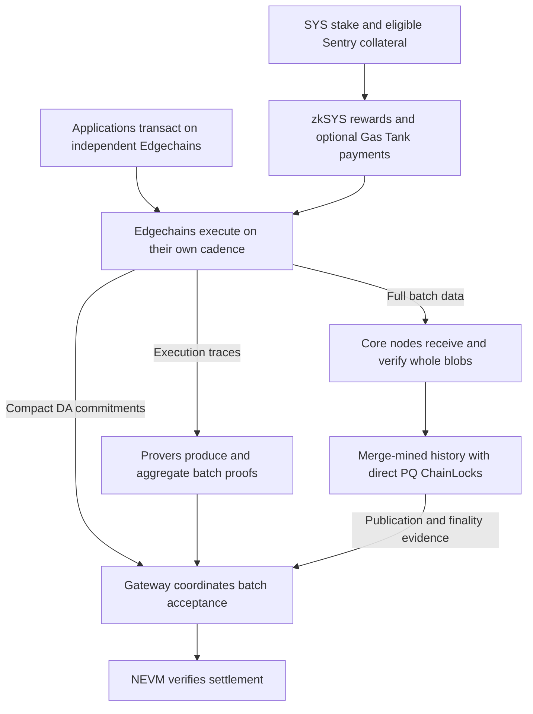

Syscoin's design starts with an operator question. As usage grows, can someone still run a node, check the shared history, recover the data they need, and choose an execution provider? The system keeps consensus rules general and budgets the work every full node must do. zkSYS is the worked example of scaling around that constraint. It moves execution and proof generation to independently operated layers while using Core for full data publication and NEVM for proof settlement. [Architecture assumptions and network status](../intro/status.mdx) · [Syscoin's original design rationale](https://jsidhu.medium.com/blockchain-idealisms-b61c5781ddc3)

| Design choice | What it buys | Cost or assumption that remains |
| --- | --- | --- |
| **Slower Core cadence with direct PQ checks** | Full nodes verify Sentry authorization and the scheduled signatures themselves. ChainLock validation has no recursive proof or prover dependency. | A complete certificate carries about 1 MB of signatures and authentication material. Quorum safety, signer state, timely relay, and the durable finality boundary still matter. [Signature checks and wire size](./post-quantum.mdx#what-a-full-node-verifies) |
| **Full retrieval and hash-based DA** | A reader can obtain the complete bytes and recompute their content hash. A recent publication can be checked independently of the Gateway transaction that references it. | Blob bandwidth rises with the payload. Nodes need to keep up in the live window and archival readers need retained data. A local fetch establishes local access at that time. [DA lifecycle](./data-availability.mdx) |
| **Compact Gateway commitments and validity proofs** | A new Edgechain can use its own execution resources while Gateway processes proofs and commitments. An Edgechain's full payload travels to Core without going through Gateway's transaction data. | Gateway still has shared acceptance and proving costs. The deployment needs sound verifiers, reachable DA, and operators who can maintain the settlement path. [Gateway data path](./zksys.mdx#what-gateway-changes) |
| **Local governance and SYS-linked issuance** | Separate chains can adopt their own operating rules and pay for specialized work. zkSYS connects issuance to SYS stake and eligible collateral, with a native SYS fee path and optional zkSYS gas credit. | Reward concentration, operator entry and replacement, sequencer discretion, upgrade keys, and claim rules determine how much independence that produces. [Enshrine or align?](./modular-alignment.mdx) |

## What the DA budget looks like

The plot assumes one block per 150 seconds for six hours. Average ingress is payload per block divided by 150 seconds. Raw retention is payload per block multiplied by 144 blocks. These are arithmetic estimates from an illustrative steady load. They exclude relay fan-out, burst traffic, metadata, and extra storage when finality or pruning is delayed. They give operators a baseline for measuring who can keep up. [Timing](./core.mdx#what-bitcoin-merge-mining-contributes) · [Blob limits and retention](./data-availability.mdx#retention-and-replay)

Measurements by Croman and coauthors explain why bytes delivered within one block interval matter. Higher per-interval load can leave slower peers behind. Gencer and coauthors also measure several independent dimensions, including network infrastructure and production concentration. Their historical measurements cannot establish a present-day Syscoin rate or rank current networks. They motivate measuring validator workload and operator control separately. [Croman et al., On Scaling Decentralized Blockchains](https://doi.org/10.1007/978-3-662-53357-4_8) · [Gencer et al., Decentralization in Bitcoin and Ethereum Networks](https://arxiv.org/abs/1801.03998)

Authenticated sampling makes a useful different trade. Research by Al-Bassam and coauthors shows how a light client can gain probabilistic confidence in availability from authenticated erasure-coded shares under networking and honest-rebroadcast assumptions. A participant that needs to reconstruct state still needs the bytes. Syscoin chooses to put whole-payload verification on the Core path and keep the live serving window bounded. [Al-Bassam et al., Fraud and Data Availability Proofs](https://doi.org/10.1007/978-3-662-64331-0_15) · [How other networks serve DA](./comparison.mdx)

## How to judge whether the design works

- **Independent Core verification.** Measure propagation and validation at different network speeds under sustained and bursty blob load. Track who falls behind, how long a new node takes to sync, and how well relaying recovers when new ChainLocks pause.
- **Scaling across Edgechains.** Compare the marginal payload, queue time, and proving work as active chains join Gateway. Then measure the time from a local receipt to canonical publication and verified settlement. Look for pressure in the shared DA path as well as at Gateway.
- **Operator decentralization.** Measure how many independently controlled parties can order, prove, relay, and recover. Test that they can take over from a stalled operator under the actual rules. Count control of roles and upgrade keys as well as processes or identities.
- **Independent recovery.** Follow an application from a fresh client through its proof, data, and settlement dependencies. Test replay from an authenticated snapshot after the live window and recovery using an independently retained archive.

For a community allocating shared resources, the same architecture lets local users make decisions quickly and others check them later. A proof can make the result independently verifiable. Shared finality matters when local groups contend for the same resource, and governance determines the rules and evidence each group accepts. [Humans, AI, and shared resources](../intro/human-and-ai.mdx) · [The interplanetary example](https://jsidhu.medium.com/truth-states-consciousness-and-decentralized-intelligence-d5415da47dc6)
