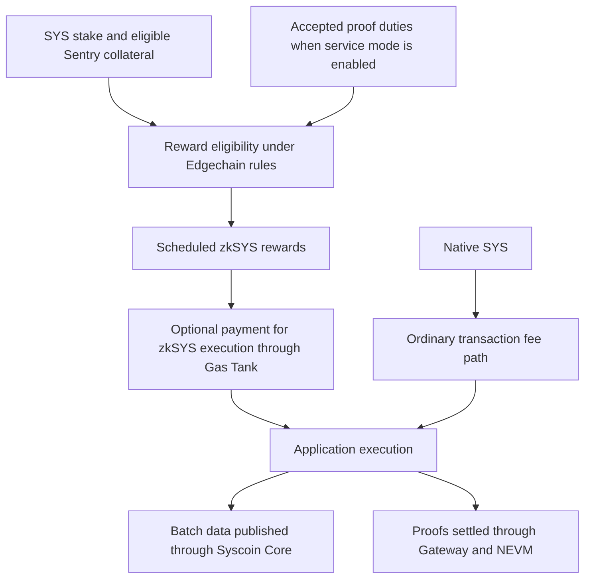

Enshrining a function makes it part of the rules every base validator enforces. Aligning an execution layer gives it its own work, governance, and economics while using base-layer services and tying rewards to the base asset. zkSYS uses the second approach. It consumes Core data availability and finality, settles through NEVM, and uses its own ordering and proving infrastructure. The intent is for launching another Edgechain to extend the system without requiring a Core upgrade or making every full node run its transactions. [System architecture](./overview.mdx) · [zkSYS](./zksys.mdx)

| Trade-off | Enshrine more in the base protocol | Run it separately and align with the base |
| --- | --- | --- |
| **Shared guarantees** | The base protocol can enforce uniform validity or availability rules, give users common verification semantics, and reduce the number of independently governed interfaces. | Each execution layer can choose its own cadence, verifier, fee policy, and governance. It inherits the guarantees of the base services it actually uses. Users check its contract and exit assumptions separately. |
| **Growth and cost** | Universal validation can make common functions widely accessible. More mandatory work per block raises node or prover requirements. Protocol-wide rules and upgrades coordinate the cost across all users. | Execution and proof production can grow independently across operators. Core still pays the common cost of DA, and the settlement chain still pays for contract execution and proof verification. Shared capacity can become congested. |
| **Governance and failure** | Base rules give participants one place to check an invariant. Changes require base-level coordination, and a defect in mandatory verification can affect all validators. | Each layer can change policy without changing Core. This adds dependencies on sequencer replacement, prover participation, contract upgrade authority, and recovery or exit rules. |
| **Economics** | The base protocol can specify who pays for mandatory work and who receives rewards. A universal policy can be difficult to adapt to specialized workloads. | An Edgechain can pay for its own specialized work. Charging gas in SYS creates a use for SYS. Reward eligibility linked to SYS stake or qualifying collateral adds a separate link to the base economy. |

Syscoin enshrines the rules that define Core history and the handling of its DA publications. Each Edgechain takes responsibility for ordering its transactions, proving them, and setting its economic policy. This separation gives other builders room to choose their own policy and settlement topology. Their common obligations include paying for shared capacity and honoring the rules of whichever contracts they settle through.

## What the base should be able to decide on its own

A shared settlement layer should let a node explain which history it accepts using public rules and verifiable evidence. The design goal is for routine failures to resolve through those rules. An exceptional protocol upgrade, such as migrating a signature system, is a different decision from asking participants to agree out of band on which already-finalized history to treat as authoritative.

This is also an argument for keeping the base stable. Syscoin's UTXO layer checks transfers, proof of work, data publication, and finality. NEVM supplies programmable settlement. Application behavior and specialized execution can evolve at the Edgechain without continually adding application rules to UTXO consensus. The practical test for a new base rule is whether the shared layer needs to enforce it for independent verification. [Core architecture](./core.mdx) · [The original base-layer design](https://jsidhu.medium.com/blockchain-idealisms-b61c5781ddc3)

Core lets miners submit valid work without a quorum vote for every new block. A loss of quorum can stall finality without halting mining above the last accepted ChainLock. Honest mining can re-enter that live contest. The already-locked ancestry remains binding, so new work cannot reverse a conflicting durable ChainLock. That is the boundary of the protocol's automatic recovery. [Mining and the durable finality boundary](./core.mdx#what-survives-a-finality-outage)

## The economic feedback loop

The economic goal is to connect demand for new execution and the rewards for servicing it to the infrastructure underneath it. Native SYS stake and qualifying Sentry collateral enter the reward calculation. The optional service design can release bonus weight for accepted proof duties from the existing emission schedule. Users can spend the issued zkSYS on execution through the Gas Tank, while ordinary SYS fees continue to work. Actual use makes demand for the shared DA and settlement paths. Each link is inspectable, from who qualifies for rewards to how a gas charge is routed. [Issuer and Gas Tank lifecycle](./zksys.mdx#sys-collateral-issuance-and-gas) · [Prover service accounting](https://github.com/syscoin/zksync-os-server/blob/v0.24.4/docs/src/design/prover_service_v1.md#agreed-economics)

An execution layer can pay base-layer fees while directing most new value to unrelated token holders or a privileged operator. Base-denominated gas alone leaves that question open. zkSYS is one design for linking the economics directly. Its alignment depends on who can actually earn issuance, join or replace operators, change the verifier, and capture fee or transaction-ordering revenue. Those rules determine whether an Edgechain functions as a useful extension of the base economy in practice. [Rollup economics across chains](./comparison.mdx#rollup-economics-and-collateral)

## Tapering issuance and optional gas use

Bitcoin's mining subsidy halves every 210,000 blocks and eventually rounds down to zero. The zkSYS reference schedule follows a different curve for a different job. It starts with annual emissions of 20%, 12%, and 8% of the remaining cap, then uses 5% of the remaining cap each year. That is a diminishing, capped tail. It can subsidize eligible service as it grows, including work that would otherwise depend on fees or transaction-ordering revenue. The schedule alone cannot assure that the market value of future rewards covers the cost of decentralized operation. [Bitcoin subsidy rule](https://github.com/bitcoin/bips/blob/master/bip-0042.mediawiki) · [zkSYS issuance curve](https://github.com/syscoin/zksync-os-server/blob/v0.24.4/contracts/src/zksys/ZkSysIssuer.sol#L353-L391)

The Gas Tank lets different fee assets cover the same numeric atomic-unit charge. When their market prices differ, users who can choose may prefer to spend the cheaper asset and hold the more expensive one. This is the spending preference behind the Gresham's-law analogy. There is no general convertibility at that rate. If users hold zkSYS, spend it less, or value it less, the native SYS fee path still supports transactions. Operator incentives and the value of the issuance can change even when the execution layer remains usable. [Bootloader fee selection](https://github.com/syscoin/zksync-os-server/blob/v0.24.4/scripts/patches/zksync-os-syscoin-v0.4.0.patch#L1431-L1512) · [Gas Tank accounting](./zksys.mdx#paying-execution-fees)
