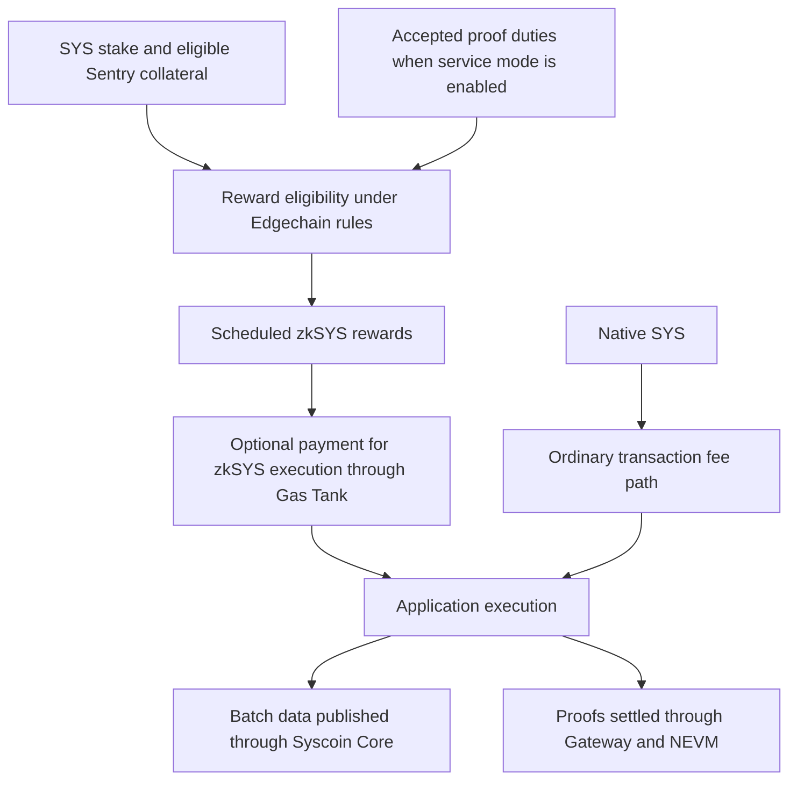

Suppose an Edgechain wants to reward independent operators for proving its batches. Who should enforce the payment rule? **Enshrining** it would make the rule part of base consensus. Every base validator would inherit the obligation to check it. **Aligning** the Edgechain lets it set the rule locally and tie reward eligibility to participation in the underlying SYS economy. zkSYS uses SYS stake and eligible Sentry collateral to assign reward weight. It can change its prover arrangements while Core continues to validate the published data and NEVM provides settlement. [System architecture](./overview.mdx) · [zkSYS operator model](./zksys.mdx#sequencing-proving-and-recovery)

| Trade-off | Enshrine more in the base protocol | Run it separately and align with the base |
| --- | --- | --- |
| **Shared guarantees** | The base protocol can enforce uniform validity or availability rules, give users common verification semantics, and reduce the number of independently governed interfaces. | Each execution layer can choose its own cadence, verifier, fee policy, and governance. It inherits the guarantees of the base services it actually uses. Users check its contract and exit assumptions separately. |
| **Growth and cost** | Universal validation can make common functions widely accessible. More mandatory work per block raises node or prover requirements. Protocol-wide rules and upgrades coordinate the cost across all users. | Execution and proof production can grow independently across operators. Core still pays the common cost of DA, and the settlement chain still pays for contract execution and proof verification. Shared capacity can become congested. |
| **Governance and failure** | Base rules give participants one place to check an invariant. Changes require base-level coordination, and a defect in mandatory verification can affect all validators. | Each layer can change policy without changing Core. This adds dependencies on sequencer replacement, prover participation, contract upgrade authority, and recovery or exit rules. |
| **Economics** | The base protocol can specify who pays for mandatory work and who receives rewards. A universal policy can be difficult to adapt to specialized workloads. | An Edgechain can pay for its own specialized work. Charging gas in SYS creates a use for SYS. Reward eligibility linked to SYS stake or qualifying collateral adds a separate link to the base economy. |

Syscoin enshrines the rules that define Core history and the handling of its DA publications. Each Edgechain takes responsibility for ordering its transactions, proving them, and setting its economic policy. This separation gives other builders room to choose their own policy and settlement topology. Their common obligations include paying for shared capacity and honoring the rules of whichever contracts they settle through.

## What the base should be able to decide on its own

A shared settlement layer should let a node explain which history it accepts using public rules and verifiable evidence. The design goal is for routine failures to resolve through those rules. An exceptional protocol upgrade, such as migrating a signature system, is a different decision from asking participants to agree out of band on which already-finalized history to treat as authoritative.

This is also an argument for keeping the base stable. Syscoin's UTXO layer checks transfers, proof of work, data publication, and finality. NEVM supplies programmable settlement. Application behavior and specialized execution can evolve at the Edgechain without continually adding application rules to UTXO consensus. The practical test for a new base rule is whether the shared layer needs to enforce it for independent verification. [Core architecture](./core.mdx) · [The original base-layer design](https://jsidhu.medium.com/blockchain-idealisms-b61c5781ddc3)

Core lets miners submit valid work without a quorum vote for every new block. A loss of quorum can stall finality without halting mining above the last accepted ChainLock. Honest mining can re-enter that live contest. The already-locked ancestry remains binding, so new work cannot reverse a conflicting durable ChainLock. That is the boundary of the protocol's automatic recovery. [Mining and the durable finality boundary](./core.mdx#what-survives-a-finality-outage)

## The economic feedback loop

An Edgechain can charge gas in SYS while directing nearly all issuance and ordering revenue to its own operator. zkSYS adds a second economic link. SYS stake or eligible Sentry collateral establishes who can earn scheduled issuance, and the optional service design ties part of that issuance to accepted proof duties. Spending zkSYS on execution then uses the same DA and settlement infrastructure as spending native SYS. [Issuer and Gas Tank lifecycle](./zksys.mdx#sys-collateral-issuance-and-gas) · [Prover service accounting](https://github.com/syscoin/zksync-os-server/blob/v0.24.4/docs/src/design/prover_service_v1.md#agreed-economics)

## Who gets paid for a proved batch?

The v0.24.4 service-accounting test gives Alice and Bob **100,000 units of passive weight each** through eligible Sentry membership. Alice qualifies for a further **35,000 units** for a particular period. The total weight is **235,000**. The fixture records two accepted duties for Alice’s operator, meeting its quota. It uses mock settlement to exercise the accounting. [Service configuration](https://github.com/syscoin/zksync-os-server/blob/v0.24.4/contracts/test/ZkSysServiceLifecycle.t.sol#L116-L139) · [Reward assertions](https://github.com/syscoin/zksync-os-server/blob/v0.24.4/contracts/test/ZkSysServiceLifecycle.t.sol#L452-L474)

To see who has a financial interest in someone else’s performance, normalize one period’s budget to **235 zkSYS** and hold the weights fixed. The bonus column is the amount available to claim after the period’s work is assessed. The two rows are calculations under the contract rules. [Period accounting](https://github.com/syscoin/zksync-os-server/blob/v0.24.4/contracts/src/zksys/ZkSysIssuer.sol#L324-L347) · [Bonus calculation](https://github.com/syscoin/zksync-os-server/blob/v0.24.4/contracts/src/zksys/ZkSysIssuer.sol#L484-L502) · [Duty fraction](https://github.com/syscoin/zksync-os-server/blob/v0.24.4/contracts/src/zksys/ZkSysProverServiceRegistryV1.sol#L583-L591)

| Duties credited to Alice’s operator | Alice’s passive share | Bob’s passive share | Service bonus earned | Unearned |
| --- | ---: | ---: | ---: | ---: |
| 2 of 2 | 100 | 100 | 35 | 0 |
| 1 of 2 | 100 | 100 | 17.5 | 17.5 |

Bob earns the same amount in both rows. A frozen bonus that Alice fails to earn stays unminted. Access to *future* periods is still valuable. The v1 service design uses one shared sequencer, so a reader evaluating operator independence also needs evidence about who gets assigned work, who can take over ordering, and who controls the operators behind the addresses. A settled duty receipt establishes the accepted work credited to an operator. [Admission, dispatch, and independence](https://github.com/syscoin/zksync-os-server/blob/v0.24.4/docs/src/design/prover_service_v1.md#L12-L46)

Reward weight, voting rights, and upgrade authority are separate grants of power. Core’s Sentries vote on treasury proposals. The Edgechain token supports delegated votes. In the reference deployment the issuer holds the mint role, the token administrator can govern role assignments, and the proxy administrator’s owner controls upgrades. To understand who can change the payment rule, inspect those deployed roles and owners alongside the reward distribution. [Core governance](../guides/governance.mdx) · [Token roles and delegation](https://github.com/syscoin/zksync-os-server/blob/v0.24.4/contracts/src/zksys/SyscoinZKSYSToken.sol#L38-L109) · [Deployment roles](https://github.com/syscoin/zksync-os-server/blob/v0.24.4/docs/src/guides/gateway_launch.md#L1917) · [Proxy ownership](https://github.com/syscoin/zksync-os-server/blob/v0.24.4/contracts/src/zksys/ZkSysProxyAdmin.sol#L6-L11)

## Tapering issuance and optional gas use

Bitcoin's mining subsidy halves every 210,000 blocks and eventually rounds down to zero. The zkSYS reference schedule follows a different curve for a different job. It starts with annual emissions of 20%, 12%, and 8% of the remaining cap, then uses 5% of the remaining cap each year. That is a diminishing, capped tail. It can subsidize eligible service as it grows, including work that would otherwise depend on fees or transaction-ordering revenue. The schedule alone cannot assure that the market value of future rewards covers the cost of decentralized operation. [Bitcoin subsidy rule](https://github.com/bitcoin/bips/blob/master/bip-0042.mediawiki) · [zkSYS issuance curve](https://github.com/syscoin/zksync-os-server/blob/v0.24.4/contracts/src/zksys/ZkSysIssuer.sol#L353-L391)

The Gas Tank lets different fee assets cover the same numeric atomic-unit charge. When their market prices differ, users who can choose may prefer to spend the cheaper asset and hold the more expensive one. This is the spending preference behind the Gresham's-law analogy. There is no general convertibility at that rate. If users hold zkSYS, spend it less, or value it less, the native SYS fee path still supports transactions. Operator incentives and the value of the issuance can change even when the execution layer remains usable. [Bootloader fee selection](https://github.com/syscoin/zksync-os-server/blob/v0.24.4/scripts/patches/zksync-os-syscoin-v0.4.0.patch#L1431-L1512) · [Gas Tank accounting](./zksys.mdx#paying-execution-fees)

Does burning zkSYS refill the rewards budget? The issuer calculates each year’s allowance from the cap less everything **already scheduled**. When someone calls `burnSurplus()` on fee backing left in the tank, outstanding token supply falls. The scheduled total stays the same, so the next cohort of provers still draws from the diminishing allowance. [Issuer formula](https://github.com/syscoin/zksync-os-server/blob/v0.24.4/contracts/src/zksys/ZkSysIssuer.sol#L360-L380) · [Tank burn](https://github.com/syscoin/zksync-os-server/blob/v0.24.4/contracts/src/zksys/ZkSysGasTank.sol#L167-L187) · [Compare rollup economics](./comparison.mdx#rollup-economics-and-collateral)
