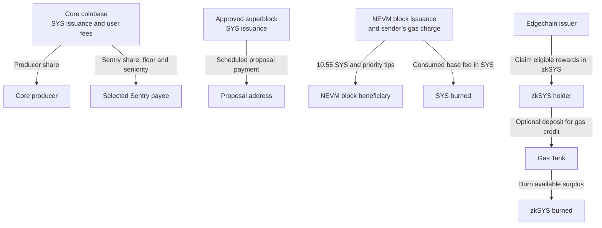

A rule is **enshrined** when all base-layer nodes must enforce it. An Edgechain can instead set its own rules and align economically with Syscoin. For example, zkSYS uses SYS stake and eligible Sentry collateral to assign reward weight while keeping its prover payments out of Core consensus. [System architecture](./overview.mdx) · [zkSYS operator model](./zksys.mdx#sequencing-proving-and-recovery)

| Trade-off | Enshrine more in the base protocol | Run it separately and align with the base |
| --- | --- | --- |
| **Shared guarantees** | The base protocol can enforce uniform validity or availability rules, give users common verification semantics, and reduce the number of independently governed interfaces. | Each execution layer can choose its own cadence, verifier, fee policy, and governance. It inherits the guarantees of the base services it actually uses. Users check its contract and exit assumptions separately. |
| **Growth and cost** | Universal validation can make common functions widely accessible. More mandatory work per block raises node or prover requirements. Protocol-wide rules and upgrades coordinate the cost across all users. | Execution and proof production can grow independently across operators. Core still pays the common cost of DA, and the settlement chain still pays for contract execution and proof verification. Shared capacity can become congested. |
| **Governance and failure** | Base rules give participants one place to check an invariant. Changes require base-level coordination, and a defect in mandatory verification can affect all validators. | Each layer can change policy without changing Core. This adds dependencies on sequencer replacement, prover participation, contract upgrade authority, and recovery or exit rules. |
| **Economics** | The base protocol can specify who pays for mandatory work and who receives rewards. A universal policy can be difficult to adapt to specialized workloads. | An Edgechain can pay for its own specialized work. Charging gas in SYS creates a use for SYS. Reward eligibility linked to SYS stake or qualifying collateral adds a separate link to the base economy. |

## What the base should be able to decide on its own

Syscoin's UTXO layer checks transfers, proof of work, data publication, and finality. NEVM supplies programmable settlement. Application behavior and specialized execution can evolve at the Edgechain without continually adding application rules to UTXO consensus. [Core architecture](./core.mdx) · [The original base-layer design](https://jsidhu.medium.com/blockchain-idealisms-b61c5781ddc3)

Core lets miners submit valid work without a quorum vote for every new block. A loss of quorum can stall finality without halting mining above the last accepted ChainLock. New work must build on the locked history. [Mining and the durable finality boundary](./core.mdx#what-survives-a-finality-outage)

## The economic feedback loop

Bitcoin supplies a market for SHA-256 mining. A participating pool can reuse its search for Syscoin, and an application using Syscoin can generate fees for publication and settlement. Those SYS receipts can help pay for continued mining. BTC remains the asset paid by the Bitcoin coinbase and the asset a proposed BTC bridge would release. SYS pays for shared Syscoin services. zkSYS provides a separate way to reward eligible Edgechain work and pay execution fees. [Why Bitcoin and Syscoin fit together](./core.mdx#why-bitcoin-and-syscoin-fit-together) · [Bitcoin bridge research](./bitcoin-bridge.mdx)

An Edgechain can charge gas in SYS while directing its issuance and ordering revenue to its own operator. zkSYS adds a second economic link. SYS stake or eligible Sentry collateral establishes who can earn scheduled issuance, and the optional service design ties part of that issuance to accepted proof duties. Spending zkSYS on execution uses the same DA and settlement infrastructure as spending native SYS. [Issuer and Gas Tank lifecycle](./zksys.mdx#sys-collateral-issuance-and-gas) · [Prover service accounting](https://github.com/syscoin/zksync-os-server/blob/v0.24.4/docs/src/design/prover_service_v1.md#agreed-economics)

## Who pays for the shared infrastructure?

Trace a publisher’s Core transaction fee, a settlement sender’s NEVM gas charge, and the protocol’s issuance separately. A fee moves or burns a user’s existing balance. Issuance creates units under the rules of the paying chain.

The diagram shows Core and NEVM mainnet payments and the zkSYS reference contracts. [Network and release status](../intro/status.mdx)

| Payment path | Who receives value and under what rule |
| --- | --- |
| **Core producer and Sentry · released mainnet** | The ordinary subsidy starts with a schedule that declines 5% per configured interval and returns zero after 50 reductions. Core subtracts a 10% governance portion before calculating the ordinary split. In the standard block template with a Sentry payee, the producer receives approximately one quarter of the ordinary subsidy and half of transaction fees. The selected Sentry starts at the greater of three quarters of the subsidy and **5.275 SYS**, then receives applicable collateral-seniority uplift and half the fees. Its registered payout can split the reward with an operator. The floor applies to the selected payee for a block. [Subsidy schedule](https://github.com/syscoin/syscoin/blob/ff8df9b44d603faf3cf78af28c633a066a8ec9a7/src/validation.cpp#L1934-L1952) · [Producer and fee split](https://github.com/syscoin/syscoin/blob/ff8df9b44d603faf3cf78af28c633a066a8ec9a7/src/masternode/masternodepayments.cpp#L178-L201) · [Sentry calculation and payout](https://github.com/syscoin/syscoin/blob/ff8df9b44d603faf3cf78af28c633a066a8ec9a7/src/masternode/masternodepayments.cpp#L240-L290) · [Mainnet floor and seniority](https://github.com/syscoin/syscoin/blob/ff8df9b44d603faf3cf78af28c633a066a8ec9a7/src/kernel/chainparams.cpp#L149-L162) |
| **PQ Sentry eligibility** | The subsidy schedule remains the same. Under the PQ payment rules, a verified empty eligible Sentry set leaves the Sentry allocation unminted. The producer keeps its quarter of the ordinary subsidy and receives all transaction fees. A node missing the data needed to determine eligibility cannot make that empty-set decision. [Subsidy schedule](https://github.com/syscoin/syscoin/blob/b3b4f643383a2149807a25fe38d26b5f058daa60/src/validation.cpp#L2804-L2822) · [Producer limit](https://github.com/syscoin/syscoin/blob/b3b4f643383a2149807a25fe38d26b5f058daa60/src/masternode/masternodepayments.cpp#L42-L64) · [Payee lookup](https://github.com/syscoin/syscoin/blob/b3b4f643383a2149807a25fe38d26b5f058daa60/src/masternode/masternodepayments.cpp#L434-L467) |
| **NEVM block beneficiary** | NEVM credits **10.55 SYS** to the designated beneficiary of each eligible block. The transaction sender pays gas in SYS. The beneficiary receives the effective priority tip multiplied by gas used, and the consumed base fee burns. This issuance follows NEVM’s own rules, independent of Core’s declining subsidy. [Released issuance constant](https://github.com/syscoin/go-ethereum/blob/73b431a9e695948ab6b2c483641e0b350a13972c/consensus/beacon/consensus.go#L41-L46) · [Beneficiary credit](https://github.com/syscoin/go-ethereum/blob/73b431a9e695948ab6b2c483641e0b350a13972c/consensus/beacon/consensus.go#L373-L396) · [Released fee accounting](https://github.com/syscoin/go-ethereum/blob/73b431a9e695948ab6b2c483641e0b350a13972c/core/state_transition.go#L527-L544) |
| **Public goods · released mainnet** | Sentry funding votes can qualify a proposal. A triggered superblock mints the scheduled SYS payments to proposal addresses. Its nominal budget can move up or down 10% in response to utilization. Unspent capacity creates no treasury payout. [Budget and payment rules](../guides/governance.mdx#how-the-superblock-budget-changes) |
| **Edgechain service · zkSYS v0.24.4 reference** | Eligible SYS stake and Sentry collateral affect who can claim newly minted **zkSYS**. The service configuration can tie a bonus to accepted duties. A holder can deposit zkSYS for gas credit. The Gas Tank can subsequently burn surplus zkSYS backing, which leaves future scheduled issuance unchanged. [Worked duty and reward example](#who-gets-paid-for-a-proved-batch) · [Issuance and burns](#tapering-issuance-and-optional-gas-use) |

## Who gets paid for a proved batch?

In the service-accounting test, Alice and Bob each receive **100,000 units of passive weight** through eligible Sentry membership. Alice qualifies for a further **35,000 units** for a particular period. The total weight is **235,000**. The fixture records two accepted duties for Alice’s operator, meeting its quota. It uses mock settlement to exercise the accounting. [Service configuration](https://github.com/syscoin/zksync-os-server/blob/v0.24.4/contracts/test/ZkSysServiceLifecycle.t.sol#L116-L139) · [Reward assertions](https://github.com/syscoin/zksync-os-server/blob/v0.24.4/contracts/test/ZkSysServiceLifecycle.t.sol#L452-L474)

With the same weights and a period budget of **235 zkSYS**, completing one duty instead of two cuts Alice’s service bonus in half. [Period accounting](https://github.com/syscoin/zksync-os-server/blob/v0.24.4/contracts/src/zksys/ZkSysIssuer.sol#L324-L347) · [Bonus calculation](https://github.com/syscoin/zksync-os-server/blob/v0.24.4/contracts/src/zksys/ZkSysIssuer.sol#L484-L502) · [Duty fraction](https://github.com/syscoin/zksync-os-server/blob/v0.24.4/contracts/src/zksys/ZkSysProverServiceRegistryV1.sol#L583-L591)

| Duties credited to Alice’s operator | Alice’s passive share | Bob’s passive share | Service bonus earned | Unearned |
| --- | ---: | ---: | ---: | ---: |
| 2 of 2 | 100 | 100 | 35 | 0 |
| 1 of 2 | 100 | 100 | 17.5 | 17.5 |

Bob keeps his 100 zkSYS in either case. The 17.5 zkSYS Alice leaves unearned stays unminted. The v1 service design credits provers for accepted duties while one shared sequencer orders transactions. Adding provers therefore widens participation in proof production while the sequencer still controls ordering. [Admission, dispatch, and independence](https://github.com/syscoin/zksync-os-server/blob/v0.24.4/docs/src/design/prover_service_v1.md#L12-L46)

Reward weight, voting rights, and upgrade authority are separate grants of power. Core’s Sentries vote on treasury proposals. The Edgechain token supports delegated votes. In the reference deployment the issuer holds the mint role, the token administrator can govern role assignments, and the proxy administrator’s owner controls upgrades. [Core governance](../guides/governance.mdx) · [Token roles and delegation](https://github.com/syscoin/zksync-os-server/blob/v0.24.4/contracts/src/zksys/SyscoinZKSYSToken.sol#L38-L109) · [Deployment roles](https://github.com/syscoin/zksync-os-server/blob/v0.24.4/docs/src/guides/gateway_launch.md#L1917) · [Proxy ownership](https://github.com/syscoin/zksync-os-server/blob/v0.24.4/contracts/src/zksys/ZkSysProxyAdmin.sol#L6-L11)

## Tapering issuance and optional gas use

Bitcoin's mining subsidy halves every 210,000 blocks and eventually rounds down to zero. The zkSYS reference schedule follows a different curve for a different job. It starts with annual emissions of 20%, 12%, and 8% of the remaining cap, then uses 5% of the remaining cap each year. That is a diminishing, capped tail. It can subsidize eligible service as it grows, including work that would otherwise depend on fees or transaction-ordering revenue. The schedule alone cannot assure that the market value of future rewards covers the cost of decentralized operation. [Bitcoin subsidy rule](https://github.com/bitcoin/bips/blob/master/bip-0042.mediawiki) · [zkSYS issuance curve](https://github.com/syscoin/zksync-os-server/blob/v0.24.4/contracts/src/zksys/ZkSysIssuer.sol#L353-L391)

The Gas Tank lets different fee assets cover the same numeric atomic-unit charge. When their market prices differ, users who can choose may prefer to spend the cheaper asset and hold the more expensive one. The protocol fee accounting does not set a market exchange rate. [Bootloader fee selection](https://github.com/syscoin/zksync-os-server/blob/v0.24.4/scripts/patches/zksync-os-syscoin-v0.4.0.patch#L1431-L1512) · [Gas Tank accounting](./zksys.mdx#paying-execution-fees)

The issuer calculates each year’s allowance from the cap less everything **already scheduled**. When someone calls `burnSurplus()` on fee backing left in the tank, outstanding token supply falls. The scheduled total stays the same, so the next cohort of provers still draws from the diminishing allowance. [Issuer formula](https://github.com/syscoin/zksync-os-server/blob/v0.24.4/contracts/src/zksys/ZkSysIssuer.sol#L360-L380) · [Tank burn](https://github.com/syscoin/zksync-os-server/blob/v0.24.4/contracts/src/zksys/ZkSysGasTank.sol#L167-L187) · [Compare rollup economics](./comparison.mdx#rollup-economics-and-collateral)
