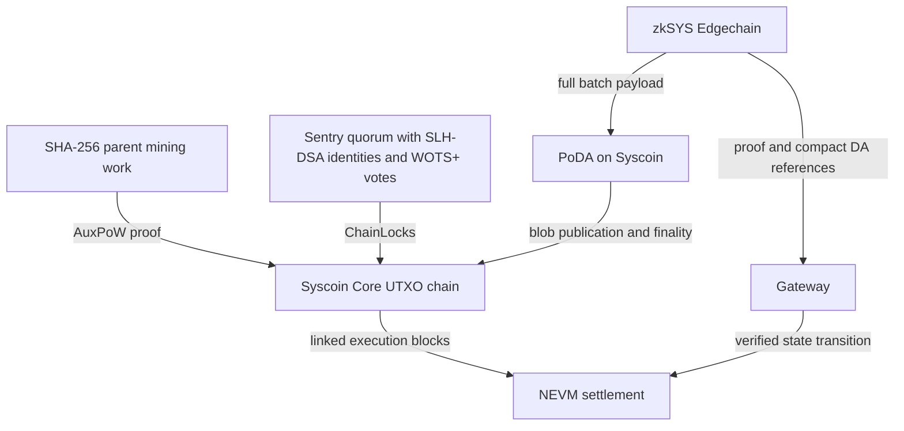

Syscoin is designed to give independently run applications a shared place to order commitments, recover the data behind them, and settle verified state. The base combines Bitcoin-merge-mined Core, post-quantum Sentry finality, and an EVM settlement environment called NEVM. zkSYS is the worked example of scaling this base with independently executed and proven batches.

This architecture assumes the PQ rules are active and zkSYS runs with validity-proof settlement. The [network and release status](../intro/status.mdx) tracks where those assumptions hold for operators and integrations. [Designing for independent validation](./design-tradeoffs.mdx) explains the shared costs these choices impose and how to measure them.

| Question | Mechanism | What to inspect |
| --- | --- | --- |
| Which base block does a node accept? | UTXO rules, cumulative proof of work, and the applicable ChainLock rules | [Core and merge mining](./core.mdx) |
| Who can attest to block finality? | A Sentry quorum that proves its scheduled vote signatures under authenticated commitments and a consensus-defined roster | [Post-quantum ChainLocks](./post-quantum.mdx) |
| Can a verifier reconstruct the data behind a batch? | Blob publication, finality, and a retrieval and retention policy. The verifier rehashes the exact bytes under the selected commitment algorithm. | [Data availability](./data-availability.mdx) |
| Does the submitted state transition satisfy the agreed rules? | The zkSYS verifier binds proof acceptance to the committed inputs, program, and output. | [zkSYS execution and settlement](./zksys.mdx) |

## Why Core and zkSYS run at different speeds

Core targets a block every 150 seconds. It uses that cadence and bounded Sentry rosters to carry roughly 1 MB of signatures in a completed PQ ChainLock certificate. Nodes verify SLH-DSA signatures on registrations and key commitments and check the scheduled WOTS+ signatures in the certificate directly. That spends bandwidth and local hash work and keeps recursive proof soundness and prover availability out of the ChainLock validation path. The protocol still depends on its quorum, signer-state, and relay assumptions. [Core block timing](./core.mdx#what-bitcoin-merge-mining-contributes) · [Full-node certificate checks](./post-quantum.mdx#what-a-full-node-verifies) · [Ethereum's recursive aggregation proposal](./comparison.mdx#direct-verification-and-recursive-aggregation)

zkSYS uses the same base for slower shared decisions and executes application transactions on its own cadence. A sequencer can issue a local execution receipt before the batch is published, proven, and settled. Proof work is shared across batches and can be aggregated before NEVM verification. Waiting for settlement still means waiting for the relevant publication, proof, and underlying finality. [Transaction lifecycle](./zksys.mdx#follow-an-application-transaction)

## Issuance tied to the base

zkSYS also shows how an execution layer can have its own issuance and give it a role in paying for computation. Eligible SYS stake or qualifying Sentry collateral contributes to reward weight under the issuance rules. The resulting zkSYS token can be deposited into the Gas Tank to pay eligible transaction fees. Native SYS continues to serve as the execution layer's base asset. This links local issuance and use to the system that supplies the underlying security and settlement. [zkSYS economics](./zksys.mdx#sys-collateral-issuance-and-gas) · [Enshrine or align?](./modular-alignment.mdx) · [Cross-chain comparison](./comparison.mdx#rollup-economics-and-collateral)

The decentralized target puts transaction ordering and proof production in the hands of multiple eligible operators over time. A validity proof can constrain the result regardless of who proves it. Sequencing authority, inclusion, replacement when an operator stalls, and compensation for service each require their own rules. [zkSYS operator model](./zksys.mdx#sequencing-proving-and-recovery)

## Why use hashes in several layers?

Proof of work uses SHA-256 to measure search effort. PoDA uses versioned hashes to bind payloads. SLH-DSA uses hash trees and one-time and few-time signature components to authenticate messages. The FRI-based prover uses hash commitments to bind transcript data as part of a larger proof system. Each construction pays for different properties and carries its own assumptions. The settlement proof also inherits the assumptions of its deployed wrapper.

A digest lets someone check bytes they obtain. A signature ties an authorized key to a statement. A validity proof checks a specified state transition against a verifier. Record retention and the accuracy of information originating outside the chain need their own checks. [Compare the architecture across chains](./comparison.mdx) · [Read the design thesis](../intro/human-and-ai.mdx)
