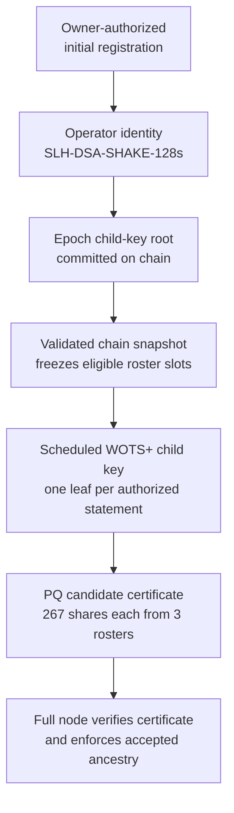

Under Core #609’s proposed post-quantum (PQ) rules, a peer claiming that a block is final can supply the Sentries’ signed votes. Each receiving Core node authenticates the votes against the keys and rosters in its own validated history. [Protocol design](https://github.com/syscoin/syscoin/blob/b3b4f643383a2149807a25fe38d26b5f058daa60/doc/pq-chainlocks.md#L27-L45) · [Network and release status](../intro/status.mdx)

## Why Core verifies the votes directly

<figure className="editorial-plate">

<figcaption>Under the Core #609 candidate, Sentries supply the votes. Each receiving Core node determines which roster slots are eligible, authenticates each signing key, and checks that it signed the statement for this block.</figcaption>
</figure>

Core gives this job a fixed budget. Every fifth block height is eligible for a ChainLock. A complete certificate for one target carries exactly 801 roster-slot signatures. At the 150-second mainnet block target, eligible heights are about 12½ minutes apart on average. A node can therefore budget for a roughly one-megabyte certificate at that cadence. Actual arrivals vary, and a certificate still needs enough timely votes. A recursive proof could reduce what peers transmit, but would also require someone to generate that proof and each node to rely on the proof system’s soundness. Core chooses to spend bandwidth and local hash work so operators can verify the original signing evidence themselves. [Core block target](https://github.com/syscoin/syscoin/blob/b3b4f643383a2149807a25fe38d26b5f058daa60/src/kernel/chainparams.cpp#L140-L142) · [Wire size and resource qualification](https://github.com/syscoin/syscoin/blob/b3b4f643383a2149807a25fe38d26b5f058daa60/doc/pq-chainlocks.md#L1565-L1567) · [Comparison with recursive aggregation](./comparison.mdx#direct-verification-and-recursive-aggregation)

Suppose the locked Core block contains a zkSYS blob publication. The ChainLock tells a reader which Core history contains the commitment. A reader with the blob can hash its bytes and check them against that commitment. To check whether executing the batch took the prior state to the claimed new state, zkSYS uses a validity proof. Gateway and NEVM handle that settlement. [Publication, inclusion and finality](./data-availability.mdx#availability-inclusion-and-finality) · [The two zkSYS proof stages](./zksys.mdx#why-there-are-two-proof-stages)

## Which object does each cryptographic check protect?

<figure aria-label="Cryptographic checks for a Syscoin payment and its settlement">

| Object to check | Mechanism and deployment scope |
| --- | --- |
| **Mining work for a Core block** | **Mainnet.** Core checks the Bitcoin-compatible parent header’s SHA-256 mining work against the Syscoin target. Merkle branches bind the child block to the parent coinbase and header. Inclusion in Bitcoin’s best chain requires its own evidence. [AuxPoW checks](./core.mdx#what-bitcoin-merge-mining-contributes) |
| **Bytes of a published blob** | **Released Core.** Recompute the versioned BLAKE2s-256 or legacy Keccak-256 digest and match it to the commitment. This authenticates a retrieved copy. Later readers need someone who retained it. [Blob encoding and digest](./data-availability.mdx#what-the-hash-commits-to) |
| **Authority to sign as a Sentry operator** | **Core PQ candidate.** An SLH-DSA-SHAKE-128s identity authenticates the operator’s child-key root. A node uses the on-chain registration and the roster for the target to identify the keys eligible to vote. [Signing roles](#signing-roles-and-keys) |
| **Finality statement for a specific Core block** | **Mainnet** uses BLS quorum signatures. **Core PQ candidate** uses scheduled WOTS+ signatures whose keys and roster slots each node checks against the block’s signing context. [Certificate checks](#what-a-full-node-verifies) · [Activation boundary](#released-behavior-and-migration) |
| **Permission to spend** | **Mainnet.** The locking script governs a Core output, including Sentry collateral or payouts. Ordinary NEVM transactions use classical secp256k1 signatures. **zkSYS experiment.** A smart account with the Pali SLH module can authorize user operations under a separate, limited-use SHA-2 signature profile. [Released account rules](../intro/status.mdx#released-networks-and-public-records) · [Smart-account signing](./zksys.mdx#wallets-and-post-quantum-account-authorization) |
| **Execution of a zkSYS batch** | **Real-proof configuration.** Airbender proves execution of the agreed batch program against its public input, including the commitment to the ordered blob identifiers. The proof system uses Merkle commitments and a FRI low-degree test. [Execution proof and input binding](./zksys.mdx#why-there-are-two-proof-stages) |
| **Proof accepted at settlement** | **Deployment-specific.** Check the deployed wrapper, verification key, public input and submitted proof. A real PLONK wrapper adds its own setup and soundness assumptions. **Observed testnet.** Gateway batch 9,448 used the mock format on Tanenbaum NEVM. [Decode that submission](../reference/zksys.mdx#trace-a-public-testnet-transaction) · [Real-verifier requirements](https://github.com/syscoin/zksync-os-server/blob/v0.24.4/docs/src/design/prover_api.md#real-snark-readiness) |

<figcaption>A Sentry can sign the history containing a payment. Only the account’s spending authority can authorize that payment. zkSYS’s settlement verifier checks what executing it did to the batch state.</figcaption>
</figure>

## Signing roles and keys

There are two signing jobs. A Sentry operator establishes who can vote by committing its child keys under a long-lived SLH-DSA identity. When a finality vote comes due, the operator signs with the WOTS+ leaf assigned to that statement. A full node can follow the vote back to the on-chain authority and check exactly which roster slot it counts toward. [Signing profiles and authority](https://github.com/syscoin/syscoin/blob/b3b4f643383a2149807a25fe38d26b5f058daa60/doc/pq-chainlocks.md)

| Layer | Selected profile | Purpose |
| --- | --- | --- |
| Owner | NIST FIPS 205 `SLH-DSA-SHAKE-128s`. | Authorize registrar changes, choose a voting delegate, and approve initial operator registration or delayed recovery. |
| Proposal funding voter | Independent `SLH-DSA-SHAKE-128s` key. | Sign proposal funding votes when authorized by the owner. The operator retains the trigger and non-funding vote roles. |
| Operator | `SLH-DSA-SHAKE-128s`, with a 32-byte public key and 7,856-byte signature. | Authenticate the operator and its child-key root, service updates, peer identity, and active-key rotation or revocation. |
| Scheduled vote | `SYS-SCHEDULED-WOTS+-SHAKE-N16-W16-H8-V1`, 704-byte inner signature. | Sign the statement assigned to one leaf of an epoch child key. This is a Syscoin profile built from hash-based components and subject to independent review before public deployment. |
| Child-key authentication | 32-byte child public key plus a depth-16 path of 512 bytes. | Authenticate that child key against the operator's frozen root. A vote with its key and path occupies 1,248 bytes. |

New registrations require an SLH owner proof of possession. Once a Sentry Node enrolls its SLH owner key, owner actions require that active key and version. An active SLH owner, an active funding vote key, and the relevant operator child root are required for Sentry payment eligibility. [Owner and voting migration](https://github.com/syscoin/syscoin/blob/b3b4f643383a2149807a25fe38d26b5f058daa60/doc/pq-chainlocks.md#L175-L235) · [Provider authorization checks](https://github.com/syscoin/syscoin/blob/b3b4f643383a2149807a25fe38d26b5f058daa60/src/evo/providertx.cpp#L648-L731)

The SLH identities are stateless. The scheduled WOTS+ signer needs durable state. The protocol derives its leaf from the signing slot. Each child key has 256 physical leaves, with 231 assigned to ChainLocks and four to payment audits. The other 21 leaves are invalid for signing. The signer reserves a leaf durably before signing and permits deterministic replay for the exact same message. Reorgs and crashes do not refund one-time leaves. Operating two copies of the same signer state or restoring a stale journal defeats the assumption that a leaf signs one distinct message. [FIPS 205](https://csrc.nist.gov/pubs/fips/205/final) · [Wire types](https://github.com/syscoin/syscoin/blob/b3b4f643383a2149807a25fe38d26b5f058daa60/src/llmq/pq_chainlock_types.h) · [Signer journal](https://github.com/syscoin/syscoin/blob/b3b4f643383a2149807a25fe38d26b5f058daa60/src/llmq/pq_signer_journal.cpp)

Core’s SLH-DSA-SHAKE-128s identity profile uses a 32-byte public key and a 7,856-byte signature. The FIPS 204 lattice-based alternative ML-DSA-44 uses a 1,312-byte public key and a 2,420-byte signature. Core accepts the larger identity signature to keep operator authorization under hash-based assumptions. The more frequent scheduled votes use a separate WOTS+ key. [FIPS 205](https://csrc.nist.gov/pubs/fips/205/final) · [FIPS 204](https://csrc.nist.gov/pubs/fips/204/final)

## What a full node verifies

ChainLocks use 288-block epochs and targets every fifth block. Local generation for a target at height `H` starts with five blocks of follow-on history, at `H + 5`. This signing delay governs local generation and is separate from the certificate validity rules. Four active rosters have 400 ordered slots each. A final certificate selects exactly three of them and contains exactly 267 authenticated signatures per selected roster, for **801 roster-slot signatures** total. An operator can appear in multiple rosters. Membership, order, eligibility, and child roots are derived from frozen, branch-bound deterministic-masternode and registry state. [Schedule](https://github.com/syscoin/syscoin/blob/b3b4f643383a2149807a25fe38d26b5f058daa60/src/llmq/pq_chainlock_schedule.h) · [Roster derivation](https://github.com/syscoin/syscoin/blob/b3b4f643383a2149807a25fe38d26b5f058daa60/src/llmq/pq_quorum_builder.cpp) · [Certificate checks](https://github.com/syscoin/syscoin/blob/b3b4f643383a2149807a25fe38d26b5f058daa60/src/llmq/pq_chainlock_verify.cpp)

A live share carries a statement identifier, packed slot, and authenticated signature. The receiver reconstructs the statement from its immutable signing context. The certificate includes the common statement once, the selected-roster mask and signer bitmaps, and the ordered signatures. Core #609 serializes a complete certificate in **1,001,572 bytes**, about 0.95 MiB, and a compact live share in 1,282 bytes. [Wire format and size accounting](https://github.com/syscoin/syscoin/blob/b3b4f643383a2149807a25fe38d26b5f058daa60/src/llmq/pq_chainlock_types.h#L760-L766)

For one marked signer slot, the node looks up the member’s frozen child-key root, checks the supplied Merkle path, and derives the WOTS+ leaf assigned to this target height in that roster’s epoch. It reconstructs the message from the block statement and signer context, then checks the signature against that message and leaf. The long-lived SLH-DSA key authorized the root when the operator registered it. The 801 certificate signatures use WOTS+. Core checks the certificate structure and branch context before scheduling the signature work and rechecks the branch context before accepting the lock. [Per-slot verifier](https://github.com/syscoin/syscoin/blob/b3b4f643383a2149807a25fe38d26b5f058daa60/src/llmq/pq_chainlock_verify.cpp#L1343-L1401) · [Verification order](https://github.com/syscoin/syscoin/blob/b3b4f643383a2149807a25fe38d26b5f058daa60/doc/pq-chainlocks.md#L1073-L1102)

A certificate authorizes the block and its ancestry under the checked signing context. A node verifies the branch-bound authority and its relation to the durable winner. Within an unchanged 400-slot roster, two sets of 267 share at least 134 slots. Two choices of three out of the same four rosters share at least two rosters. The within-roster bound assumes at most 133 Byzantine slots per selected roster. Across differently composed rosters, safety also assumes a complete certificate reaches honest signers before they sign a conflicting branch in a later view. Finality can pause when quorum or state is unavailable. [Certificate checks and safety model](https://github.com/syscoin/syscoin/blob/b3b4f643383a2149807a25fe38d26b5f058daa60/doc/pq-chainlocks.md#L1073-L1134)

## Checkpoints and recovery

A ChainLock statement carries a Bitcoin checkpoint cursor. At a scheduled candidate height `H`, the Syscoin block commits to a Bitcoin previous-block hash, `BTCPREV`, that must match the AuxPoW parent header. Signers independently check their Bitcoin headers view before signing an `ADVANCE`. A `KEEP` certificate preserves the cursor. The certificate attests to the signing quorum’s Bitcoin view. Consumers can validate a header proof and set their own Bitcoin confirmation policy. [Candidate binding and signer policy](https://github.com/syscoin/syscoin/blob/b3b4f643383a2149807a25fe38d26b5f058daa60/doc/pq-chainlocks.md#L1754-L1826)

The only on-chain carrier for that candidate is at `H + 10`. A non-null receipt must name the exact certificate for `H`. Only a verified `ADVANCE` forwards a new Bitcoin hash to NEVM, and `KEEP` leaves the NEVM checkpoint unchanged. Missing certificate bytes can pause the dependent paired execution, while base Syscoin synchronization can continue under the bounded recovery rules. [Receipt and NEVM replay](https://github.com/syscoin/syscoin/blob/b3b4f643383a2149807a25fe38d26b5f058daa60/doc/pq-chainlocks.md#L1839-L1891)

Payment audits are a separate certificate domain. Their compact receipts and probation commitment affect payment eligibility. Payment probation does not change the roster's signing authority. During recovery after pruning, a returning node can verify an exact certificate selected by a receipt on its fully replayed proof-of-work history. That bounded historical import relies on the replayed history for omitted roster transitions. A later certificate must still pass the normal forward-authorization checks, and historical import alone cannot advance finality. [Recovery and payment audit design](https://github.com/syscoin/syscoin/pull/609)

## Released behavior and migration

Core v5.1.3 uses BLS/DKG ChainLocks. The pinned Core #609 public profile uses compatibility replay, with the production activation height and receipt anchor both unset. That profile starts neither a legacy nor a PQ ChainLock service. Explicit regtest profiles exercise preparation and full PQ finality. [Network and release status](../intro/status.mdx) · [Network parameters](https://github.com/syscoin/syscoin/blob/b3b4f643383a2149807a25fe38d26b5f058daa60/src/consensus/params.h#L106-L153) · [Profile validation](https://github.com/syscoin/syscoin/blob/b3b4f643383a2149807a25fe38d26b5f058daa60/src/consensus/pq_migration_config.h)

1. An explicitly supported preparation profile can enroll operator keys, migrate existing ECDSA owner authority to SLH-DSA, and exercise roster coverage and restart recovery in shadow operation. Registration can also continue after activation.
2. A coordinated release sets the activation height `A`, the separate historical BTCC receipt assumption `R`, and network-specific schedules. Block `A` begins the new consensus rules. The first valid finality certificate still depends on quorum readiness.
3. An existing datadir hands off the exact legacy-validated `A−1` predecessor with validated local provenance. A fresh or reindexed BLS-free node without authenticated provenance remains restricted to historical replay until an authenticated bootstrap path is available. The design allows a later bootstrap release to publish the independently verified `A−1` block hash.

Below `A`, the final proposal structurally replays legacy BLS/DKG-shaped objects through compatibility codecs. This replay preserves relevant historical state effects and depends on the authenticated handoff for authority. Above the boundary, PQ provider authorization and receipt rules apply to the configured network. [Activation and release gates](https://github.com/syscoin/syscoin/blob/b3b4f643383a2149807a25fe38d26b5f058daa60/doc/pq-chainlocks.md#L2622-L2678) · [Handoff checks](https://github.com/syscoin/syscoin/blob/b3b4f643383a2149807a25fe38d26b5f058daa60/src/node/pq_activation_handoff.h)

Public activation still calls for the platform test matrix, independent review of the scheduled construction and payment-audit rules, and measured relay and verifier resource targets. [Outstanding activation requirements](https://github.com/syscoin/syscoin/blob/b3b4f643383a2149807a25fe38d26b5f058daa60/doc/pq-chainlocks.md#L3288-L3376)
