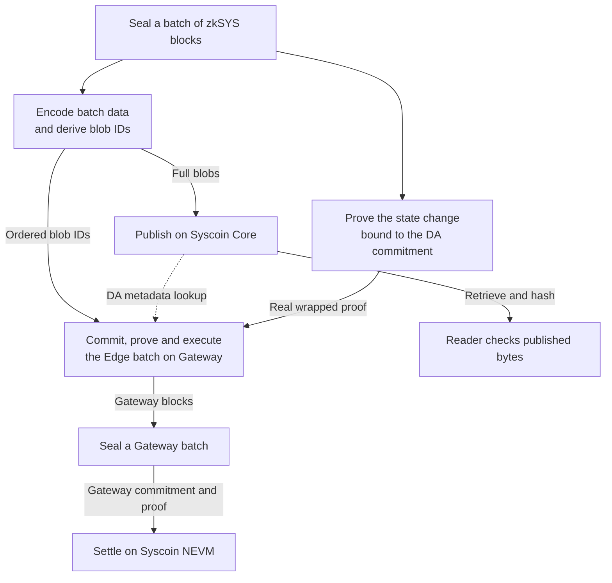
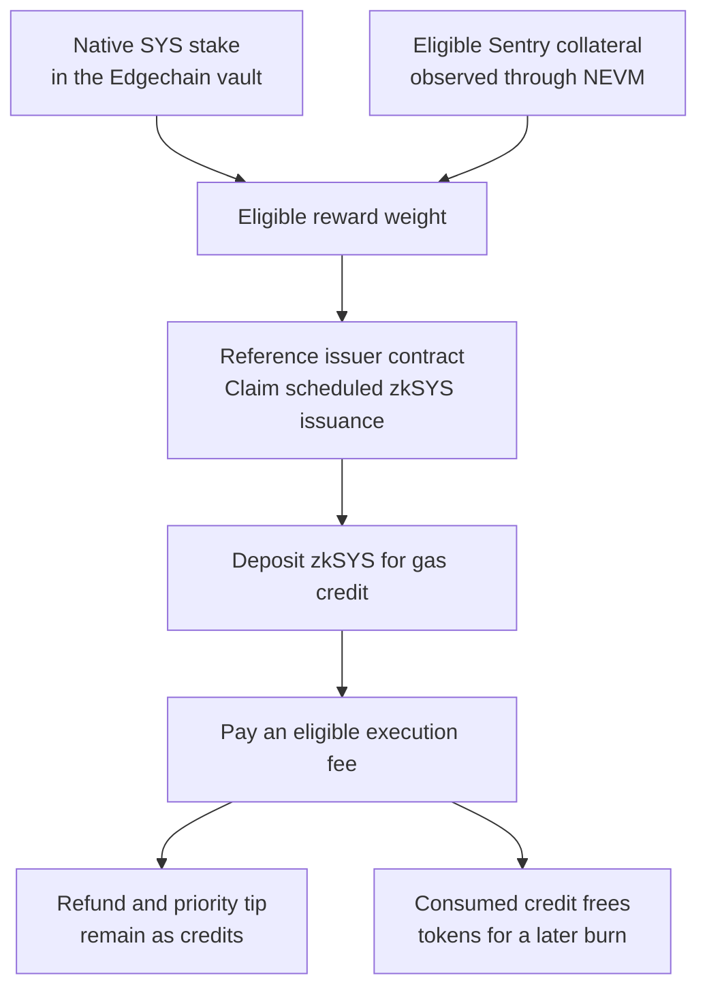

zkSYS runs Ethereum-compatible applications on chains called Edgechains. An Edgechain executes transactions and publishes its batch data to Syscoin Core. **Gateway**, the shared settlement chain, checks a batch’s commitment and proof, then settles its own batches on NEVM. Edgechains can share that path while setting their own execution and fee policies. [zkSYS server](https://github.com/syscoin/zksync-os-server/tree/v0.24.4)

The Genesis example below uses a test verifier on Tanenbaum NEVM. See [network and release status](../intro/status.mdx) for deployments and [verifier modes](https://github.com/syscoin/zksync-os-server/blob/v0.24.4/docs/src/design/prover_api.md#real-snark-readiness) for the real-proof configuration.

## What zkSYS uses from each layer

| Layer | What zkSYS uses it for |
| --- | --- |
| Core and ChainLocks | Order publications and finalize Core history. |
| PoDA | Publish the complete encoded batch data. A reader can fetch and hash the blobs. The Edge commit on Gateway carries their ordered identifiers. |
| Gateway | Accept Edgechain batch commitments and proofs. |
| NEVM | Settle Gateway batches. |
| Airbender and the settlement verifier | Prove execution in batches and verify succinct claims about the state changes. |
| SYS-linked issuance and fees | Allocate a separate reward token using base-asset stake and eligible collateral. Use that token for eligible execution fees through the Gas Tank. |

## Follow an application transaction

1. **Read the local receipt.** The sequencer orders the payment in an Edgechain block. The receipt records its execution status and logs. A batch later groups that block with others.
2. **Identify the published data.** The batcher derives a 32-byte BLAKE2s ID from each encoded blob and submits the full blobs to Core. For 5 MiB of application data, the Edge commit carries three IDs, **96 bytes** in its blob-ID field. Anyone with a copy can hash each blob and match it against the ordered list. [Batch publication](https://github.com/syscoin/zksync-os-server/blob/v0.24.4/node/bin/src/batcher/mod.rs#L578-L605) · [Encoding and exact wire sizes](./data-availability.mdx#how-much-crosses-gateway)
3. **Check execution against that data.** The proving program derives the blob IDs from the batch it executed. Keccak-256 commits to the IDs in order. The wrapped proof binds the state transition to the batch commitment. To accept it, the real verifier must check the proof against the agreed public input. A reader who wants to inspect a published payload fetches its bytes from Core or a retaining archive. [Proving guest](https://github.com/syscoin/zksync-os-server/blob/v0.24.4/scripts/patches/zksync-os-syscoin-v0.4.0.patch#L271-L289) · [Ordered commitment](https://github.com/syscoin/zksync-os-server/blob/v0.24.4/lib/batch_types/src/batch_info.rs#L580-L591) · [Settlement public input](https://github.com/syscoin/zksync-os-server/blob/v0.24.4/lib/l1_sender/src/commands/prove.rs#L350-L375)
4. **Match the two settlements.** Find the Edge batch’s execution event on Gateway. Its Gateway block belongs to a numbered Gateway batch. On NEVM, match that range to the Gateway batch’s commit, proof and execution records. Before submitting the Gateway commit, the node checks its own DA publications and the forwarded Edge blob references under its configured finality policy. [Gateway commit checks](https://github.com/syscoin/zksync-os-server/blob/v0.24.4/node/bin/src/batcher/bitcoin_da_finality_gate.rs#L598-L636)

Try the two-settlement check on Genesis. Edge block **10,968** belongs to Edge batch **10,436**. Gateway executed that batch in **block 31,362**. In turn, Gateway batch **9,448** covers blocks **31,360–31,362** and settled on Tanenbaum NEVM. The five public records span **22 minutes 37 seconds**. The NEVM proof transaction for this Gateway batch used the V8 testnet mock format. [Trace the transaction and decode the proof format](../reference/zksys.mdx#trace-a-public-testnet-transaction)

## Why there are two proof stages

The V32 server code separates execution V7 from proving V8. In the V8 proof path a worker proves the RISC-V batch program with Airbender. FRI is a low-degree test used by the proof system to check polynomial encodings of execution constraints. Merkle commitments bind queries to previously committed data. The server verifies the submitted proof and binds its output to the expected batch public input and program. Proof shape, recursion, and batch input checks all matter to what the verifier has accepted. [Execution and proving versions](https://github.com/syscoin/zksync-os-server/blob/v0.24.4/docs/src/design/prover_api.md) · [V8 proof verifier](https://github.com/syscoin/zksync-os-server/blob/v0.24.4/node/bin/src/prover_api/fri_proof_verifier.rs#L51-L146) · [Airbender source](https://github.com/syscoin/zksync-airbender/tree/b91eeaecc4d1b9a42ea6843432bb3e014899b303)

The separate SNARK stage aggregates and wraps proof work for an EVM-friendly verifier. The real proof producer checks that the deployed wrapper identifies itself as production mode and exposes the expected canonical verification key. An installed wrapper and valid public-input binding are part of the settlement security model. With a PLONK wrapper, the end-to-end system also has the wrapper's cryptographic and setup assumptions. The wrapper makes the proof cheap to verify in an EVM contract, at the cost of carrying those assumptions through settlement. [Wrapper readiness](https://github.com/syscoin/zksync-os-server/blob/v0.24.4/docs/src/design/prover_api.md#real-snark-readiness) · [Wrapper implementation](https://github.com/syscoin/zkos-wrapper) · [Airbender prover implementation](https://github.com/syscoin/zksync-airbender-prover)

## What Gateway changes

Gateway processes compact references from multiple Edgechains. Each chain publishes its full batch data on Core and puts an ordered list of 32-byte digests in its Gateway commit. The validity proof binds execution to the data commitment. Edgechains still share Gateway’s capacity for transaction processing, proving, and settlement. [Publication format](https://github.com/syscoin/zksync-os-server/blob/v0.24.4/lib/batch_types/src/batch_info.rs#L430-L512) · [Testnet measurements](https://syscoin.org/news/zksys-update)

1. **Admit a commitment.** In compact-reference mode, Gateway verifies the commitment format and checks availability through its configured Core DA node. The v0.24.4 admission path checks metadata in a bounded batch and can fall back to a configured archive for missing entries. A reader can obtain the full payload and verify its digest. Admission does not itself download and hash every blob or establish confirmation. [Availability check](https://github.com/syscoin/zksync-os-server/blob/v0.24.4/lib/rpc/src/tx_handler.rs#L251-L328) · [DA client and archive lookup](https://github.com/syscoin/bitcoin_da_client/blob/1b6f11d3e538120759e062ca0a478973653c1038/src/lib.rs#L757-L820)
2. **Recover outstanding publications.** If a publication stalls and the configured recovery policy allows another attempt, the finality gate can fetch the full blob, authenticate it against its digest, and republish it. Recovery depends on bytes still being available, a funded wallet, and the bounded recovery rules. [Authenticated recovery path](https://github.com/syscoin/zksync-os-server/blob/v0.24.4/node/bin/src/batcher/bitcoin_da_finality_gate.rs#L392-L474)
3. **Check finality before settling.** Gateway's commit path checks its own publications and forwarded Edge commitments against the configured policy. The NEVM `0x63` precompile exposes registered digest membership as a separate on-chain interface. An application that needs to prove historical availability, replay, or ChainLock ancestry needs the corresponding evidence. [Gateway commit gate](https://github.com/syscoin/zksync-os-server/blob/v0.24.4/node/bin/src/batcher/bitcoin_da_finality_gate.rs#L580-L639) · [NEVM membership check](../reference/zksys.mdx#check-nevm-registration)

## SYS collateral, issuance, and gas

SYS is the native balance on zkSYS. The zkSYS token is a separate 18-decimal ERC-20 issued on the Edgechain. In the reference design, native SYS staked on zkSYS and eligible Core Sentry collateral determine how accounts share scheduled zkSYS issuance. Wallets can use their issued or acquired zkSYS to prepay execution fees through the gas tank. [Token contract](https://github.com/syscoin/zksync-os-server/blob/v0.24.4/contracts/src/zksys/SyscoinZKSYSToken.sol#L12-L64) · [Reference deployment and roles](https://github.com/syscoin/zksync-os-server/blob/v0.24.4/docs/src/guides/gateway_launch.md#L1915-L1918)

### Collateral and issuance

1. **Stake native SYS.** The staking vault holds native SYS on zkSYS and reports an account's balance to the reward registry. A withdrawal lowers the account's stake and returns native SYS from its vault balance. [Native staking vault](https://github.com/syscoin/zksync-os-server/blob/v0.24.4/contracts/src/zksys/ZkSysNativeStakingVault.sol#L32-L96)
2. **Recognize Core Sentry collateral.** The NEVM registry bridge derives collateral height from the registered Sentry address via precompile `0x62` and enqueues a membership observation for the Edgechain registry. Each relay samples the addresses supplied to it, so membership and reward weights depend on updates reaching zkSYS, including removals and replacements. The resulting weight can depend on collateral seniority and whether service accounting is active. [Registry bridge](https://github.com/syscoin/zksync-os-server/blob/v0.24.4/contracts/src/zksys/ZkSysRegistryBridge.sol#L101-L197) · [Membership update path](https://github.com/syscoin/zksync-os-server/blob/v0.24.4/docs/src/guides/gateway_launch.md#L2015-L2016)
3. **Claim scheduled rewards.** The weight registry feeds periodic issuance accounting. Eligible accounts claim the rewards attributed to them and the issuer mints the ERC-20. The cumulative schedule applies 20%, 12%, and 8% of the remaining cap in the first three schedule years, then 5% per year, prorated over periods, subject to the 210 million zkSYS cap. SYS stake affects the share of this schedule. The token has its own supply and carries no contractual right to redeem it for SYS. [Reward weight registry](https://github.com/syscoin/zksync-os-server/blob/v0.24.4/contracts/src/zksys/ZkSysRewardWeightRegistry.sol) · [Issuer schedule and claims](https://github.com/syscoin/zksync-os-server/blob/v0.24.4/contracts/src/zksys/ZkSysIssuer.sol#L353-L442)

The reference configuration grants the issuer `MINTER_ROLE` and the Gas Tank `BURNER_ROLE`. Role administrators can change those assignments, and the proxy administrator can upgrade the token. [Token role checks](https://github.com/syscoin/zksync-os-server/blob/v0.24.4/contracts/src/zksys/SyscoinZKSYSToken.sol#L38-L89) · [Bootstrap authority wiring](https://github.com/syscoin/zksync-os-server/blob/v0.24.4/docs/src/guides/gateway_launch.md#L1915-L1918)

### Paying execution fees

1. **Fund gas credit.** With an ERC-20 allowance, `fund` deposits zkSYS for the caller. `fundFor` deposits for another account, and that recipient owns the resulting credit. The tank holds one atomic zkSYS unit for each atomic credit unit. A holder can withdraw unused credit as zkSYS. [Gas tank funding, typed balances, and withdrawals](https://github.com/syscoin/zksync-os-server/blob/v0.24.4/contracts/src/zksys/ZkSysGasTank.sol#L71-L164)
2. **Precharge.** The bootloader validates the sender's native SYS balance first. An ordinary transaction needs enough native balance for its value and maximum fee requirement even when it ultimately pays from the tank. Sufficient tank credit and execution resources allow the bootloader to precharge credit at the same numeric atomic-unit fee amount. Otherwise it can pay in native SYS. This native balance check is distinct from reward-eligible Sentry collateral and vault stake. [Native balance validation](https://github.com/syscoin/zksync-os-server/blob/v0.24.4/lib/revm_consistency_checker/src/syscoin_gas_tank.rs#L120-L136) · [Bootloader fee selection](https://github.com/syscoin/zksync-os-server/blob/v0.24.4/scripts/patches/zksync-os-syscoin-v0.4.0.patch#L1431-L1512)
3. **Settle and burn.** The bootloader returns unused fee credit to the refund recipient and credits the operator's priority tip. The base fee and any applicable blob gas fee reduce the tank's aggregate credit obligation. The corresponding zkSYS stays in the tank as surplus until someone calls `burnSurplus()`. The charge and token burn are separate events. [Bootloader refunds and fee settlement](https://github.com/syscoin/zksync-os-server/blob/v0.24.4/scripts/patches/zksync-os-syscoin-v0.4.0.patch#L1062-L1073) · [Priority tip and consumed credit](https://github.com/syscoin/zksync-os-server/blob/v0.24.4/scripts/patches/zksync-os-syscoin-v0.4.0.patch#L1133-L1164) · [Surplus burn](https://github.com/syscoin/zksync-os-server/blob/v0.24.4/contracts/src/zksys/ZkSysGasTank.sol#L167-L185)

The Gas Tank’s 1:1 accounting is between deposited zkSYS and gas credit. SYS and zkSYS prices are independent.

## Sequencing, proving, and recovery

- **Ordering and liveness.** A proof constrains the state transition that a verifier accepts. Timely inclusion still depends on the deployment's sequencer, DA publication, proving, and settlement paths.
- **Recovery.** To inspect published batch data, retrieve the encoded blobs and check their digests. To re-execute the original blocks, a replacement operator also needs the prior state, transactions, block context, protocol version and forced preimages. zkSYS keeps those inputs in its block replay archive and checks the replay against an authenticated history. [Replay inputs and recovery checks](./data-availability.mdx#what-can-someone-verify-a-week-later)
- **Cross-chain messages.** Verify the message against the receiving contract's protocol and accepted settlement root. A source transaction receipt alone is insufficient evidence of destination delivery.
- **Sentry proving.** The opt-in service lets eligible senior Sentries produce execution proofs and endorse wrapping. It pays bonuses for accepted work. A shared sequencer continues to order transactions. [Prover service design and rollout boundaries](https://github.com/syscoin/zksync-os-server/blob/v0.24.4/docs/src/design/prover_service_v1.md#L1-L46)

Use the [public Genesis commands](../reference/zksys.mdx) to check the network, [inspect a deployment's issuance and gas contracts](../reference/zksys.mdx#inspect-issuance-and-gas-credit), or read the [DA lifecycle](data-availability.mdx) for retention, retrieval, and membership checks.

## Wallets and post-quantum account authorization

**Pali v5** supports experimental post-quantum signing for zkSYS smart accounts. Pali manages the SLH-DSA keys locally. The validator module checks each user operation against the account’s authorized signer. With ERC-4337 modules, the account can set its own signing and recovery policies. [SLH-DSA integration in Pali](https://docs.paliwallet.com/docs/developers/slh-dsa-smart-accounts) · [ERC-4337](https://eips.ethereum.org/EIPS/eip-4337)

The native zkSYS verifier checks signatures under the experimental, limited-use `SLH-DSA-SHA2-128-24` profile. This puts the SHA-2 work on a path Airbender can prove efficiently. The signing policy must enforce the profile’s per-key limit. Core uses a different signature profile for long-lived Sentry identity. [Pali validation module](https://github.com/syscoin/zksync-os-server/blob/v0.24.4/contracts/src/pali/PaliSLHDSAValidatorModule.sol) · [Native verifier implementation](https://github.com/syscoin/zksync-os-server/pull/305) · [Core identity and voting keys](./post-quantum.mdx#signing-roles-and-keys)
