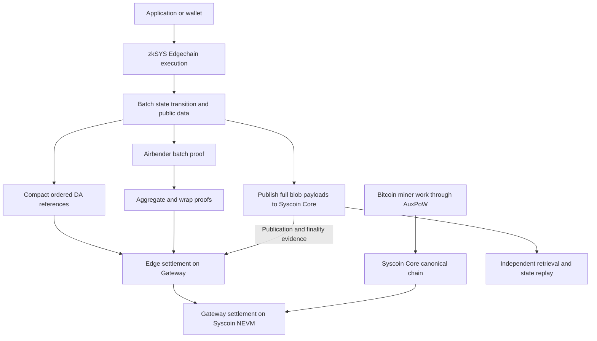
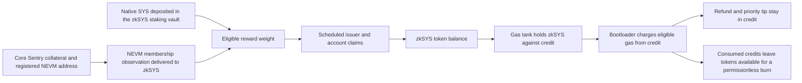

zkSYS is Syscoin's flagship EVM-compatible Edgechain and shows how execution scales in the PQ-era architecture. It executes transactions on its own chain, publishes batch bytes to Syscoin Core, and settles commitments and proofs through Gateway. Gateway coordinates settlement for multiple Edgechains and settles its own batches on Syscoin NEVM. Edgechains can choose their execution and fee policies while sharing this publication and settlement infrastructure. [Syscoin's Edgechain design](https://syscoin.org/news/syscoin-5-faqs) · [Syscoin's ZKsync OS server](https://github.com/syscoin/zksync-os-server/tree/v0.24.4)

The diagram describes the V32 topology and the real proof path implemented in the code. Genesis, the live public testnet, has its own chain ID, RPC, explorer, and bridge. Test deployments can select mock verification to exercise network and contract integration. Verify the deployed wrapper mode before treating a testnet settlement as evidence of a real proof. [Genesis public testnet](https://syscoin.org/news/zksys-genesis-public-testnet-is-live) · [V32 testnet configuration](https://github.com/syscoin/zksync-os-server/blob/v0.24.4/docs/src/guides/reference-assets/v32-public-tanenbaum-20261006/INSTALLATION-GATES.md#L80-L86) · [Real and mock verifier modes](https://github.com/syscoin/zksync-os-server/blob/v0.24.4/docs/src/design/prover_api.md#real-snark-readiness)

## What zkSYS uses from each layer

| Layer | What zkSYS uses it for |
| --- | --- |
| Core and PQ ChainLocks | Order and finalize publication so the settlement process can refer to a locked base-chain history. |
| PoDA | Publish the full bytes needed for independent replay. Carry only compact references through Gateway. |
| NEVM and Gateway | Coordinate acceptance of Edgechain commitments and settle verified batches into a shared EVM state. |
| Airbender and the settlement verifier | Prove execution in batches and verify succinct claims about the state changes. |
| SYS-linked issuance and fees | Allocate a separate reward token using base-asset stake and eligible collateral. Use that token for eligible execution fees through the Gas Tank. |
| Upgrade and operator rules | Set who can change contracts, order transactions, produce or attest proofs, and receive compensation for measured work. |

Fast execution is an Edgechain property. Shared history, durable finality, and proof settlement have their own timing. The governance boundary matters because the users who rely on a proof also rely on rules about who can upgrade its verifier or change the operator and fee policies. Verify those authorities in each deployment. [Base and Edgechain cadence](./overview.mdx#why-core-and-zksys-run-at-different-speeds) · [Operator participation](#sequencing-proving-and-recovery) · [Enshrine or align?](./modular-alignment.mdx)

## SYS collateral, issuance, and gas

SYS is the native balance on zkSYS. The zkSYS token is a separate 18-decimal ERC-20 issued on the Edgechain. In the reference design, native SYS staked on zkSYS and eligible Core Sentry collateral determine how accounts share scheduled zkSYS issuance. Wallets can use their issued or acquired zkSYS to prepay execution fees through the gas tank. [Token contract](https://github.com/syscoin/zksync-os-server/blob/v0.24.4/contracts/src/zksys/SyscoinZKSYSToken.sol#L12-L64) · [Reference deployment and roles](https://github.com/syscoin/zksync-os-server/blob/v0.24.4/docs/src/guides/gateway_launch.md#L1915-L1918)

### Collateral and issuance

1. **Stake native SYS.** The staking vault holds native SYS on zkSYS and reports an account's balance to the reward registry. A withdrawal lowers the account's stake and returns native SYS from its vault balance. [Native staking vault](https://github.com/syscoin/zksync-os-server/blob/v0.24.4/contracts/src/zksys/ZkSysNativeStakingVault.sol#L32-L96)
2. **Recognize Core Sentry collateral.** The NEVM registry bridge derives collateral height from the registered Sentry address via precompile `0x62` and enqueues a membership observation for the Edgechain registry. Each relay samples the addresses supplied to it, so membership and reward weights depend on updates reaching zkSYS, including removals and replacements. The resulting weight can depend on collateral seniority and whether service accounting is active. [Registry bridge](https://github.com/syscoin/zksync-os-server/blob/v0.24.4/contracts/src/zksys/ZkSysRegistryBridge.sol#L101-L197) · [Membership update path](https://github.com/syscoin/zksync-os-server/blob/v0.24.4/docs/src/guides/gateway_launch.md#L2015-L2016)
3. **Claim scheduled rewards.** The weight registry feeds periodic issuance accounting. Eligible accounts claim the rewards attributed to them and the issuer mints the ERC-20. The cumulative schedule applies 20%, 12%, and 8% of the remaining cap in the first three schedule years, then 5% per year, prorated over periods, subject to the 210 million zkSYS cap. SYS stake affects the share of this schedule. The token has its own supply and carries no contractual right to redeem it for SYS. [Reward weight registry](https://github.com/syscoin/zksync-os-server/blob/v0.24.4/contracts/src/zksys/ZkSysRewardWeightRegistry.sol) · [Issuer schedule and claims](https://github.com/syscoin/zksync-os-server/blob/v0.24.4/contracts/src/zksys/ZkSysIssuer.sol#L353-L442)

The reference configuration grants the issuer `MINTER_ROLE` and gas tank `BURNER_ROLE`. Token role admins govern those assignments, and the token is upgradeable through its proxy admin. Deployments should publish the chain ID, verified contract addresses, issuance start, and role and upgrade authorities. [Token role checks](https://github.com/syscoin/zksync-os-server/blob/v0.24.4/contracts/src/zksys/SyscoinZKSYSToken.sol#L38-L89) · [Bootstrap authority wiring](https://github.com/syscoin/zksync-os-server/blob/v0.24.4/docs/src/guides/gateway_launch.md#L1915-L1918)

### Paying execution fees

1. **Fund gas credit.** With an ERC-20 allowance, `fund` deposits zkSYS for the caller. `fundFor` deposits for another account, and that recipient owns the resulting credit. The tank holds one atomic zkSYS unit for each atomic credit unit. A holder can withdraw unused credit as zkSYS. [Gas tank funding, typed balances, and withdrawals](https://github.com/syscoin/zksync-os-server/blob/v0.24.4/contracts/src/zksys/ZkSysGasTank.sol#L71-L164)
2. **Precharge.** The bootloader validates the sender's native SYS balance first. An ordinary transaction needs enough native balance for its value and maximum fee requirement even when it ultimately pays from the tank. Sufficient tank credit and execution resources allow the bootloader to precharge credit at the same numeric atomic-unit fee amount. Otherwise it can pay in native SYS. This native balance check is distinct from reward-eligible Sentry collateral and vault stake. [Native balance validation](https://github.com/syscoin/zksync-os-server/blob/v0.24.4/lib/revm_consistency_checker/src/syscoin_gas_tank.rs#L120-L136) · [Bootloader fee selection](https://github.com/syscoin/zksync-os-server/blob/v0.24.4/scripts/patches/zksync-os-syscoin-v0.4.0.patch#L1431-L1512)
3. **Settle and burn.** The bootloader returns unused fee credit to the refund recipient and credits the operator's priority tip. The base fee and any applicable blob gas fee reduce the tank's aggregate credit obligation. The corresponding zkSYS stays in the tank as surplus until someone calls `burnSurplus()`. The charge and token burn are separate events. [Bootloader refunds and fee settlement](https://github.com/syscoin/zksync-os-server/blob/v0.24.4/scripts/patches/zksync-os-syscoin-v0.4.0.patch#L1062-L1073) · [Priority tip and consumed credit](https://github.com/syscoin/zksync-os-server/blob/v0.24.4/scripts/patches/zksync-os-syscoin-v0.4.0.patch#L1133-L1164) · [Surplus burn](https://github.com/syscoin/zksync-os-server/blob/v0.24.4/contracts/src/zksys/ZkSysGasTank.sol#L167-L185)

On an ETH-denominated rollup such as Arbitrum One, a user can bridge ETH to the rollup and pay fees with that native ETH balance. zkSYS joins two different mechanisms. Stake and collateral confer a share of independently scheduled issuance, and the gas tank lets users spend the resulting Edgechain asset on execution. The tank's 1:1 token-to-credit accounting sets a protocol fee rate in atomic units. It establishes no SYS-to-zkSYS market price or peg. [Arbitrum native tokens and deposits](https://docs.arbitrum.io/how-arbitrum-works/deep-dives/l1-to-l2-messaging)

## Follow an application transaction

1. **Execute.** A sequencer orders transactions and turns them into blocks. The application gets an EVM receipt with execution status and logs. Contracts rely on the instructions, precompiles, and fee rules of the deployed execution version.
2. **Seal and publish.** The batcher collects a range of blocks and produces canonical public data and state transition inputs. In the Syscoin DA mode, the batcher splits that data into blobs and publishes the actual bytes to Core. For Edgechains settling through Gateway, the Edge commitment contains compact references instead of a second copy of the Edge payload.
3. **Commit and prove.** Settlement binds committed batch metadata to the proof's public inputs. Proof workers prove the configured execution program. Depending on deployment mode, verification runs through the real wrapper or the designated test verifier.
4. **Verify and execute on settlement.** A commit records metadata, proof verification authorizes the agreed state transition, and execution makes the appropriate batch effects available to settlement contracts. In the Gateway topology, follow the Edge batch on Gateway and the relevant Gateway batch on NEVM. Application receipts, DA lookups, proof acceptance, and canonical settlement inclusion are different observations.

[Batch sealing and publication](https://github.com/syscoin/zksync-os-server/blob/v0.24.4/node/bin/src/batcher/mod.rs#L578-L610) · [Gateway availability and batch verification](https://github.com/syscoin/zksync-os-server/blob/v0.24.4/lib/batch_verification/src/verifier/mod.rs) · [Settlement sender](https://github.com/syscoin/zksync-os-server/blob/v0.24.4/lib/l1_sender/src/lib.rs)

## Why there are two proof stages

The V32 server code separates execution V7 from proving V8. In the V8 proof path a worker proves the RISC-V batch program with Airbender. FRI is a low-degree test used by the proof system to check polynomial encodings of execution constraints. Merkle commitments bind queries to previously committed data. The server verifies the submitted proof and binds its output to the expected batch public input and program. Proof shape, recursion, and batch input checks all matter to what the verifier has accepted. [Execution and proving versions](https://github.com/syscoin/zksync-os-server/blob/v0.24.4/docs/src/design/prover_api.md) · [V8 proof verifier](https://github.com/syscoin/zksync-os-server/blob/v0.24.4/node/bin/src/prover_api/fri_proof_verifier.rs#L51-L146) · [Airbender source](https://github.com/syscoin/zksync-airbender/tree/b91eeaecc4d1b9a42ea6843432bb3e014899b303)

The separate SNARK stage aggregates and wraps proof work for an EVM-friendly verifier. The real proof producer checks that the deployed wrapper identifies itself as production mode and exposes the expected canonical verification key. An installed wrapper and valid public-input binding are part of the settlement security model. With a PLONK wrapper, the end-to-end system also has the wrapper's cryptographic and setup assumptions. The FRI path and hash-based DA should each be evaluated independently of the wrapper, paymaster, bridge, or signatures used by a deployment. [Wrapper readiness](https://github.com/syscoin/zksync-os-server/blob/v0.24.4/docs/src/design/prover_api.md#real-snark-readiness) · [Wrapper implementation](https://github.com/syscoin/zkos-wrapper) · [Airbender prover implementation](https://github.com/syscoin/zksync-airbender-prover)

## What Gateway changes

Gateway can coordinate settlement for multiple Edgechains. If each chain sends its full payload through Gateway, each added byte uses the shared ingestion, batching, and proving path. One busy Edgechain can slow the others. The testnet update described this backlog in the earlier full-data path. Compact references move the payload to Core and leave Gateway with a smaller commitment workload. A proof that checks an Edgechain's execution binds the batch to its DA commitment. Gateway checks that the ordered array of 32-byte hashes matches the committed value. Its own execution data, proof aggregation, and settlement capacity still matter. [Testnet update](https://syscoin.org/news/zksys-update) · [Batch publication](https://github.com/syscoin/zksync-os-server/blob/v0.24.4/node/bin/src/batcher/mod.rs#L578-L605) · [Reference format and commitment](https://github.com/syscoin/zksync-os-server/blob/v0.24.4/lib/batch_types/src/batch_info.rs#L430-L512)

1. **Admit a commitment.** In compact-reference mode, Gateway verifies the commitment format and checks availability through its configured Core DA node. The v0.24.4 admission path checks metadata in a bounded batch and can fall back to a configured archive for missing entries. A reader can obtain the full payload and verify its digest. Admission does not itself download and hash every blob or establish confirmation. [Availability check](https://github.com/syscoin/zksync-os-server/blob/v0.24.4/lib/rpc/src/tx_handler.rs#L251-L328) · [DA client and archive lookup](https://github.com/syscoin/bitcoin_da_client/blob/1b6f11d3e538120759e062ca0a478973653c1038/src/lib.rs#L757-L820)
2. **Recover outstanding publications.** If a publication stalls and the configured recovery policy allows another attempt, the finality gate can fetch the full blob, authenticate it against its digest, and republish it. Recovery depends on bytes still being available, a funded wallet, and the bounded recovery rules. [Authenticated recovery path](https://github.com/syscoin/zksync-os-server/blob/v0.24.4/node/bin/src/batcher/bitcoin_da_finality_gate.rs#L392-L474)
3. **Check finality before settling.** Gateway's commit path checks its own publications and forwarded Edge commitments against the configured policy. The NEVM `0x63` precompile exposes registered digest membership as a separate on-chain interface. An application that needs to prove historical availability, replay, or ChainLock ancestry needs the corresponding evidence. [Gateway commit gate](https://github.com/syscoin/zksync-os-server/blob/v0.24.4/node/bin/src/batcher/bitcoin_da_finality_gate.rs#L580-L639) · [NEVM membership check](../reference/zksys.mdx#check-nevm-registration)

This makes Gateway closer to a light client for the shared execution history it accepts. It processes commitments and proof results while relying on a DA path capable of serving full data. Faster root import can make messages usable sooner after Gateway accepts the source root. It cannot fix an ingress backlog that delays source acceptance. [PoDA capacity and retention](./data-availability.mdx#retention-and-replay) · [Cross-chain DA comparison](./comparison.mdx#whole-payload-verification-and-data-availability-sampling)

## Sequencing, proving, and recovery

- **Ordering and liveness.** A proof constrains the state transition that a verifier accepts. Timely inclusion still depends on the deployment's sequencer, DA publication, proving, and settlement paths.
- **Recovery.** Keep the payloads and identifiers needed to replay from an authenticated state. An accepted proof alone cannot reconstruct missing batch data.
- **Cross-chain messages.** Verify the message against the receiving contract's protocol and accepted settlement root. A source transaction receipt alone is insufficient evidence of destination delivery.
- **Progressively decentralizing operators.** Decentralized sequencing and proving are distinct objectives. Independently operated provers can share execution proof duties and endorse wrapping while a sequencer still determines transaction order. The opt-in senior Sentry service describes that intermediate configuration with one shared sequencer and work-based bonus accounting. Decentralizing sequencing also requires a deployed ordering and handoff protocol. Verify both the actual sequencer configuration and the active prover roster before making operator decentralization claims. [Prover service design and rollout boundaries](https://github.com/syscoin/zksync-os-server/blob/v0.24.4/docs/src/design/prover_service_v1.md#L1-L46)

Use the [public Genesis commands](../reference/zksys.mdx) to check the network, [inspect a deployment's issuance and gas contracts](../reference/zksys.mdx#inspect-issuance-and-gas-credit), or read the [DA lifecycle](data-availability.mdx) for retention, retrieval, and membership checks.

## Wallets and post-quantum account authorization

Pali is the user-facing side of this model. An ERC-4337 smart account can apply its own signer and recovery policies, subject to the deployed account modules. Pali's public v4.0.30 pre-release and the zkSYS testnet update are useful milestones for following that work. [Pali release](https://github.com/syscoin/pali-wallet/releases/tag/v4.0.30) · [ERC-4337](https://eips.ethereum.org/EIPS/eip-4337)

The zkSYS code implements an experimental limited-use SHA-2 signature profile and a native verification path designed for the Airbender proving environment. That moves hash work out of a generic Solidity verifier. The account module and its usage limits have their own assumptions. Core uses a different signature profile for long-lived Sentry identity. [Pali validation module](https://github.com/syscoin/zksync-os-server/blob/v0.24.4/contracts/src/pali/PaliSLHDSAValidatorModule.sol) · [Native verifier implementation](https://github.com/syscoin/zksync-os-server/pull/305) · [Core identity and voting keys](./post-quantum.mdx#signing-roles-and-keys)
