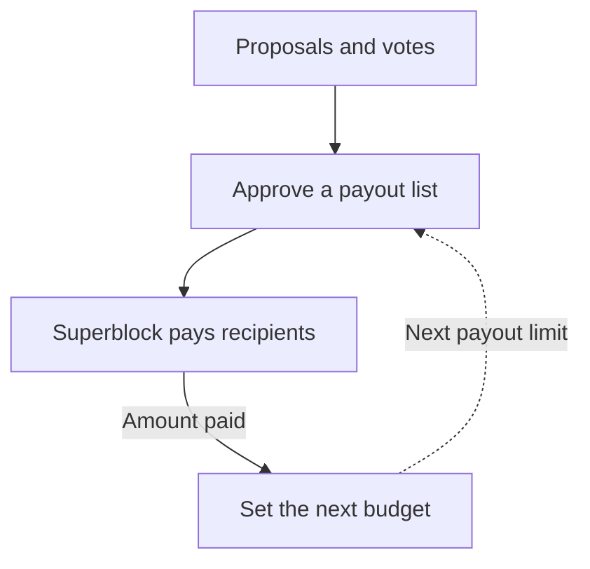

The Nexus upgrade made Syscoin's public funding budget responsive to how much the network actually pays. The budget can move by up to 10% per cycle. Proposal details and votes show why a request qualified, and the superblock records what was paid. [Nexus rationale](https://syscoin.org/news/codename-nexus) · [Proposal approval](https://syscoin.org/news/syscoin-5-approved) · [Design background](https://medium.com/@sidhujag/dealing-with-social-conditions-in-a-decentralized-world-fd6d59552213)

## How one cycle sets up the next

Mainnet schedules a superblock every **17,520 blocks**. Each valid Sentry Node can vote on funding proposals through its registered voting key. Core ranks qualifying requests by net support and applies their payment windows and the cycle's spending limit. Sentry Nodes vote separately on the resulting payout list, called a governance trigger. When a trigger is approved, the superblock records the selected payments in its coinbase transaction. [Proposal and schedule commands](../guides/governance.mdx#inspect-proposals-and-the-schedule) · [Trigger voting](https://github.com/syscoin/syscoin/blob/ff8df9b44d603faf3cf78af28c633a066a8ec9a7/src/governance/governance.cpp#L736-L791)



The **nominal budget** is the baseline for the cycle. Payouts can reach **110% of the nominal budget**, capped at **5 million SYS**. Core uses the amount paid to set the next nominal budget.

| Share of the current nominal budget paid | Next nominal budget |
| --- | --- |
| Zero | Stays the same. |
| More than zero, up to and including 95% | Falls by 10%, with a floor of 20,000 SYS. |
| Above 95% and below 105% | Stays the same. |
| 105% or more | Rises by 10%, up to 5 million SYS. |

<figure className="budget-example">
  <figcaption>Next budget when the current budget is 2 million SYS</figcaption>
  <dl className="budget-cases">
    <div><dt>Zero paid</dt><dd><strong>2.0M SYS</strong></dd></div>
    <div><dt>1.9M SYS paid</dt><dd><strong>1.8M SYS</strong></dd></div>
    <div><dt>2.0M SYS paid</dt><dd><strong>2.0M SYS</strong></dd></div>
    <div><dt>2.1M SYS paid</dt><dd><strong>2.2M SYS</strong></dd></div>
  </dl>
</figure>

[Budget calculation and limits](../guides/governance.mdx#how-the-superblock-budget-changes)

## Follow a public payout

In August 2026, an ecosystem sustainability proposal requested **4,350,000 SYS per month**. Superblock **2,330,160** paid that amount in output 2 of its coinbase transaction. The recipient matches the address published with the proposal. The governance trigger lists the proposal hash, amount, and address. These records establish the payment. Tracking the work and any subsequent spending requires separate evidence. [Proposal](https://support.syscoin.org/t/syscoin-ecosystem-sustainability-liability-reduction-proposal/900) · [Published recipient](https://syscoin-infra-support.vercel.app/) · [Coinbase transaction](https://blockbook.syscoin.org/tx/8fd680c0a6e510ea9bb5777c467081fc343b9d9b66c0c295a0a3f8bb37f24322)

<details>
<summary>Verify the trigger and coinbase from Core</summary>

On a synced mainnet node that retains the governance trigger, check its event height, proposal hash, recipient, and amount. Read the third coinbase output from the block using `jq`.

```bash
trigger=d29a40acbd9d623580eeb33680e0636b02fbe27b2994322137c952a1033382a8
syscoin-cli gobject_get "$trigger"
block=$(syscoin-cli getblockhash 2330160)
syscoin-cli getblock "$block" 2 | jq '.tx[0].vout[2]'
```

The trigger refers to proposal `9c675dfc0bd5d7b08dbdd8300e918d1f9c50b0c6804ede8336c41d010e5248a2`. The transaction output remains available from a block explorer or archival node after the governance object expires.

</details>

[Submit a proposal or cast a vote](../guides/governance.mdx)
