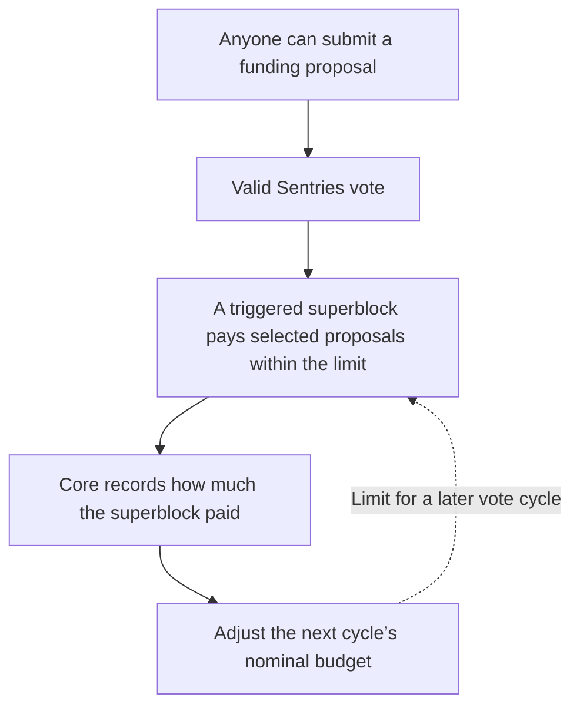

Who pays for open-source work after the original team leaves? We designed dynamic governance so wallets, documentation, hosting, and research can compete for public funding. When a small treasury group controls day-to-day funding, the people maintaining the network depend on that group’s priorities and finances. A public proposal, vote, and payout give the community a way to scrutinize those choices over time. [Sidhu’s February 2025 essay](https://medium.com/@sidhujag/dealing-with-social-conditions-in-a-decentralized-world-fd6d59552213)

We limit what a funding vote can do and how fast the budget can change. The time between cycles gives people a chance to see where funds went and respond. A funding vote can pay for work on a protocol change. Activating consensus rules still requires nodes to run software that enforces them. The Syscoin 5 Nexus upgrade added the adaptive budget described below. [Nexus rationale](https://syscoin.org/news/codename-nexus) · [Proposal approval](https://syscoin.org/news/syscoin-5-approved)

## How one cycle sets up the next

Proposals compete for funding in a scheduled cycle of 17,520 blocks on mainnet. Sentry votes determine which requests qualify and their priority. The payment window and the cycle’s ceiling determine what can be paid. At a triggered superblock, a node can verify the selected payouts in the block’s coinbase outputs. Core uses the payout it records to set the next nominal budget. [Mainnet schedule and proposal rules](../guides/governance.mdx#inspect-proposals-and-the-schedule)



The nominal budget is the baseline, and the current cycle can pay up to **110%** of it, subject to the **5 million SYS** payment ceiling. If the recorded payout is positive and at most **95%** of the nominal budget, the next budget falls by **10%**, down to a **20,000 SYS** floor. At **105%** or more, it rises by **10%**, up to **5 million SYS**. Between those thresholds, or with zero paid, it stays the same.

<figure className="budget-example">
  <figcaption>What becomes the next nominal budget when the current budget is 2 million SYS?</figcaption>
  <dl className="budget-cases">
    <div><dt>Zero paid</dt><dd><strong>2.0M SYS</strong> No change</dd></div>
    <div><dt>1.9M SYS paid · 95%</dt><dd><strong>1.8M SYS</strong> Falls by 10%</dd></div>
    <div><dt>2.0M SYS paid · 100%</dt><dd><strong>2.0M SYS</strong> No change</dd></div>
    <div><dt>2.1M SYS paid · 105%</dt><dd><strong>2.2M SYS</strong> Rises by 10%</dd></div>
  </dl>
</figure>

The step limit gives participants time to see and respond to sustained changes in spending. Payouts give the protocol an observable input. They can also reflect the voting threshold, proposal timing, or which requests fit the ceiling. Unused capacity creates no treasury payment.

**[Read the exact budget rules](../guides/governance.mdx#how-the-superblock-budget-changes)**

## Follow a public payout

An August 2026 ecosystem sustainability proposal requested **4,350,000 SYS per month**. Superblock **2,330,160** paid that amount in output 2 of its coinbase transaction. The address matches the mainnet wallet published on the proposal’s linked infrastructure support page. The governance trigger identifies the same proposal hash, amount, and recipient. That lets an independent reader verify the amount and destination of the payment. Subsequent expenditures and the delivery of the proposed work are separate facts. [Proposal](https://support.syscoin.org/t/syscoin-ecosystem-sustainability-liability-reduction-proposal/900) · [Published recipient](https://syscoin-infra-support.vercel.app/) · [Coinbase transaction](https://blockbook.syscoin.org/tx/8fd680c0a6e510ea9bb5777c467081fc343b9d9b66c0c295a0a3f8bb37f24322)

<details>
<summary>Verify the trigger and coinbase from Core</summary>

On a synced mainnet node that retains the governance trigger, check its event height, proposal hash, recipient, and amount. Read the third coinbase output from the canonical block using `jq`.

```bash
trigger=d29a40acbd9d623580eeb33680e0636b02fbe27b2994322137c952a1033382a8
syscoin-cli gobject_get "$trigger"
block=$(syscoin-cli getblockhash 2330160)
syscoin-cli getblock "$block" 2 | jq '.tx[0].vout[2]'
```

The trigger refers to proposal `9c675dfc0bd5d7b08dbdd8300e918d1f9c50b0c6804ede8336c41d010e5248a2`. The block output remains checkable long after a node has forgotten the governance object.

</details>

Use a synced Core node to inspect the schedule and nominal budget, submit a proposal, cast a vote, or verify a payout against a block’s outputs. [Governance commands](../guides/governance.mdx#inspect-proposals-and-the-schedule)
