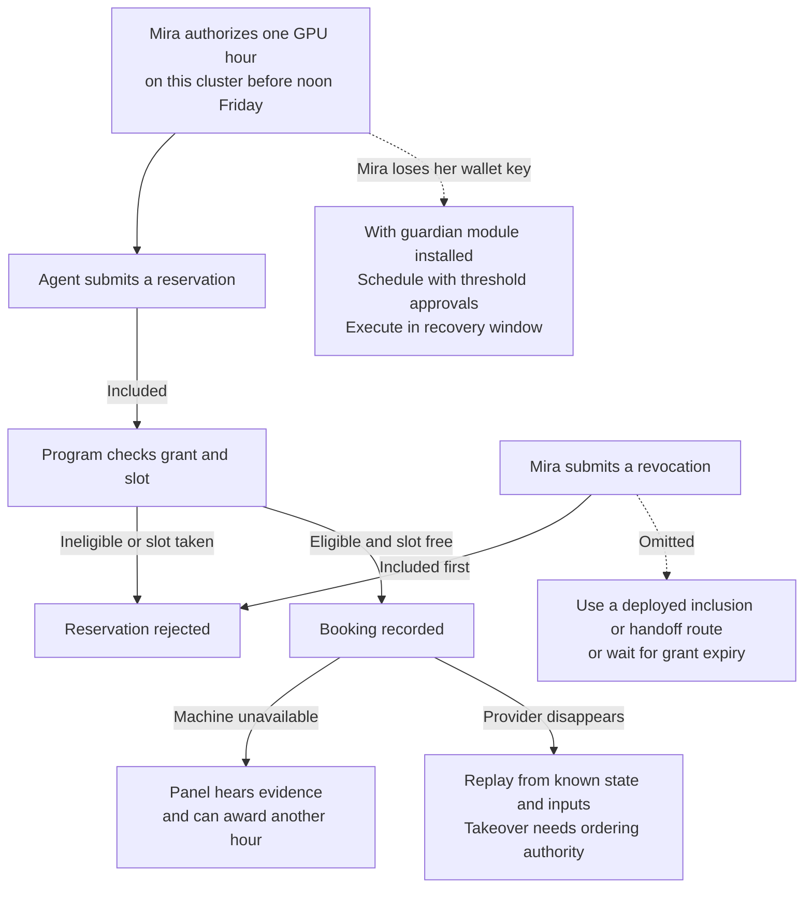
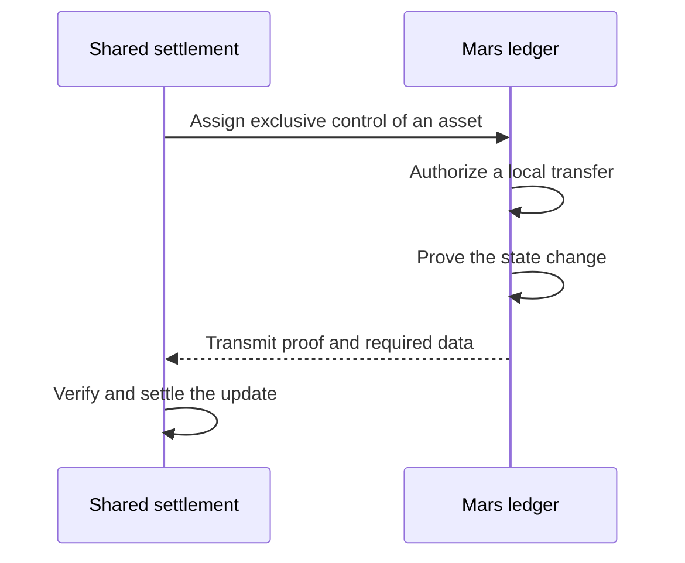

Even if intelligence and software labor become cheap, water, land, energy, and compute remain scarce. A community might allocate them through prices, membership, need, or negotiated quotas. If money plays a smaller role, people still need to know who granted an agent authority, when its grant ends, and whether everyone was held to the same rule. [Design for an Efficient Coordinated Financial Computing Platform](https://jsidhu.medium.com/a-design-for-an-efficient-coordinated-financial-computing-platform-ab27e8a825a0) · [Truth States, Consciousness, and Decentralized Intelligence](https://jsidhu.medium.com/truth-states-consciousness-and-decentralized-intelligence-d5415da47dc6)

Two AI agents request the last hour on a community’s GPU cluster. Writing either job takes seconds. The cluster can run only one. Who gets the hour? If the decision looks wrong, what can a member check, and who can put it right?

<figure className="editorial-plate">

<figcaption>A member can verify who booked the machine from the ledger. Finding out whether the machine was available takes a separate observation.</figcaption>
</figure>

## The community sets the rules

The cooperative below sets rules for its own equipment. Syscoin Core governance applies the same questions about authority and evidence to a different resource, the network’s public funding budget. [Who decides what in Syscoin](../governance/overview.mdx#who-can-decide-what)

A real example comes from irrigation. Elinor Ostrom describes a study of irrigation systems in Nepal. After accounting for differences in the physical environment, farmers who managed their own canals on average kept them in better repair, delivered more water to users at the tail end, and achieved higher agricultural productivity than government-managed systems. An expanded dataset of 229 systems confirmed the earlier findings. The farmer at the end of the canal is a telling measure of whether coordination worked. Ostrom also identifies ways users can help change rules, hold monitors accountable, and resolve disputes locally. The result is specific to these institutions and conditions. [Ostrom’s Nobel lecture, *Beyond Markets and States*](https://faculty.sites.iastate.edu/tesfatsi/archive/tesfatsi/BeyondMarketsAndStates.NobelLecture.EOstrom2009.pdf)

Imagine a federation of compute cooperatives. Mira grants her agent authority to reserve **one GPU hour on this cluster before Friday at noon**, with no authority to spend from her wallet. The federation adopts a rule for its shared machine. **The first eligible request in the ledger’s agreed order gets the slot. The grant must still be active when the request is processed.** The cooperatives can set their own membership rules while agreeing on this one rule. Here is a hypothetical dispute under that policy.

| What happened | What a member can check |
| --- | --- |
| **Mira revokes her agent’s grant.** Her agent had already sent a reservation, but the revocation was recorded first. | Mira’s signature identifies who revoked the grant. The ledger shows which action the program processed first. |
| **Sol’s agent gets the hour.** The program rejects Mira’s request under the revoked grant. Sol’s grant is active and the slot is still free. | The policy version in force, the two recorded outcomes, and the change from one free slot to zero. A participant can replay those inputs or verify a proof of their execution. |
| **Sol shows up and the machine is offline.** The scheduler had advertised an hour during planned maintenance. | An elected monitor independent of the scheduler supplies a signed maintenance record. Sol supplies the failed job record. Each signature identifies the reporter. The appeal panel weighs the two accounts and can seek more evidence. |
| **The members’ panel awards Sol a replacement hour.** Its authority comes from the federation’s appeals policy. | A new, authorized entry assigns a specific available hour and refers back to the disputed reservation. Both the original decision and the remedy remain visible. |

A proof can establish that the published program respected a revocation and allocated the recorded slot once. Someone still has to maintain the cluster, report its capacity honestly, and honor the replacement. Members can also question the ordering rule itself. Prioritizing emergencies takes a different rule. Detecting that a scheduler held back a request takes evidence from outside the ordered ledger, such as a signed acknowledgement of receipt. [Verifiable computation on specified inputs, *Pinocchio*](https://eprint.iacr.org/2013/279)

### What counts as a truth state?

*Truth States* starts with a distinction. Anyone can observe a shared state when they have access to the evidence. The rules determine who can change it. The essay connects this to consciousness by asking what happens when observers recognize the consequences of their own actions. Sol sees who received the hour. The monitor can testify about the machine. Only the panel can award a remedy under the federation’s rules. Members can verify who recorded the booking and who authorized the remedy, then disagree about whether the policy was fair. They can use what happened to Sol to change the *next* version of the rule. [Truth States, Consciousness, and Decentralized Intelligence](https://jsidhu.medium.com/truth-states-consciousness-and-decentralized-intelligence-d5415da47dc6)

### If the operator stops cooperating

In the example, Mira’s revocation worked because the sequencer included it. Suppose instead that it ignores her request. She can still authenticate what she signed, but other operators will see the old grant until the revocation enters the agreed history or the grant expires. Her one-hour cap limits the possible loss. A proof of an accepted batch can verify the transactions in it. Detecting an omitted request takes other evidence, and getting it processed takes an inclusion or operator-replacement rule. [zkSYS operator model](../architecture/zksys.mdx#sequencing-proving-and-recovery)

| When something goes wrong | Who can act and what they need |
| --- | --- |
| An agent tries to book outside its grant | In the hypothetical cooperative, the program checks the signer, cluster, budget, expiry and recorded revocation. Whoever holds upgrade authority can change future rules. The sequencer controls inclusion. A signed acknowledgement can support Mira’s complaint about a delayed revocation. Her grant expires on Friday regardless. |
| A member loses a wallet key | A Pali v5 smart account with our reference guardian module can schedule recovery once enough of its appointed guardians approve. The recovery transaction must be included after the configured delay and before expiry. [Guardian settings and scheduling](https://github.com/syscoin/zksync-os-server/blob/v0.24.4/contracts/src/pali/PaliGuardianRecoveryModule.sol#L68-L157) · [Execution window](https://github.com/syscoin/zksync-os-server/blob/v0.24.4/contracts/src/pali/PaliGuardianRecoveryModule.sol#L183-L209) |
| The provider fails | A replacement with the saved inputs and a known prior state can reconstruct the booking. The deployment’s handoff rules decide who may sequence the next one. Sol can bring the original booking and the monitor’s signed maintenance record to the members’ panel before the appeal deadline. [What survives a seven-day appeal](../architecture/data-availability.mdx#what-can-someone-verify-a-week-later) |
| A member leaves | If a chain runs the reference Gas Tank, an included withdrawal returns unused credit as zkSYS **on that chain**. Moving the balance elsewhere depends on the destination’s release rules. The Genesis record shows a settled batch. A unilateral exit during censorship would need its own inclusion or fallback path. The federation decides separately whether another cooperative will honor unused hours. [Gas Tank withdrawal](https://github.com/syscoin/zksync-os-server/blob/v0.24.4/contracts/src/zksys/ZkSysGasTank.sol#L123-L164) · [Public settlement trace](../reference/zksys.mdx#trace-a-public-testnet-transaction) |

## Where Syscoin fits

The closest public example is a Genesis testnet payment. Its receipt identifies the Edgechain batch accepted on Gateway, and the enclosing Gateway batch reached Tanenbaum NEVM with a mock proof. For a proof to settle the cooperative’s actual reservations, the deployed verifier would have to enforce the execution rules. [Trace the public payment](../reference/zksys.mdx#trace-a-public-testnet-transaction) · [Deployment status](./status.mdx)

In the PQ-era design, a cooperative could run its reservation program on zkSYS, where an Edgechain orders requests and gives users local receipts. It publishes the batch bytes to Core. Bitcoin merge-mining supplies work for the Core history, and Sentry quorums can sign ChainLocks over it. Gateway carries compact references and settles Edge batches under its configured finality and proof rules. NEVM then records settlement of the Gateway batch. A member can check the reservation against the same history even after the cooperative replaces its scheduler. That requires the batch data and the applicable program and state. If appeals outlast Core’s retention window, the federation must arrange an archive. Private testimony needs its own access and retention rules. [Core and finality](../architecture/core.mdx) · [DA retention and replay](../architecture/data-availability.mdx#retention-and-replay) · [zkSYS proof flow](../architecture/zksys.mdx#follow-an-application-transaction)

| What changes for the cooperative | Where the limit lies |
| --- | --- |
| Members can run their own Core node to check mining work and, under the PQ candidate, the Sentries’ hash-based finality votes. | Each node still needs the bandwidth and processing time to keep up with bursts of data. [Independent node costs](../architecture/design-tradeoffs.mdx#what-the-da-budget-looks-like) |
| Another cooperative can run its own reservation program on an Edgechain. The extra execution work stays with that Edgechain. | Both cooperatives draw on the same publication capacity. Their receipts can arrive before the data and proofs reach shared settlement. [Scaling tradeoffs](../architecture/design-tradeoffs.mdx#what-happens-when-a-second-edgechain-joins) |
| Members can check a booking after the original scheduler leaves. | A replacement needs the retained inputs and permission to take over. Each account’s recovery policy determines who can restore access after a lost key. [Powers and remedies](#if-the-operator-stops-cooperating) |
| SYS rewards and fees pay for mining and Sentry services. Treasury proposals can fund shared work. zkSYS rewards eligible participants in the execution economy. | A protocol can specify who gets paid. Operators decide whether those receipts justify the cost of keeping independent infrastructure online. [Funding and operator incentives](../architecture/modular-alignment.mdx) |

If members decide that emergency jobs should get the first hour, they can change the rule for future bookings. Members can still see which rule applied to Sol, how the panel ruled and when the change took effect.

## Verification across distance

<figure className="editorial-plate">

  
    
    Earth
  
  
    <strong>About 3–22.4 min</strong> one-way signal time
  
  
    
    Mars
  

<figcaption>Signal time changes as the planets orbit. A right assigned exclusively to Mars can change hands locally while people on Earth wait for the record. <a href="https://science.nasa.gov/mars/mars-relay-network/">NASA Mars Relay Network</a></figcaption>
</figure>

In our coordinated computing design, rollups handle execution like a computer’s arithmetic units. The settlement layer coordinates their work like a control unit. The Earth–Mars example in *Truth States* asks how that design could coordinate rights when its parts are light-minutes apart. Imagine settlement has assigned a right exclusively to Mars. Mars can authorize local transfers during a communication gap because Earth has already given up the right to make a competing transfer. When a message arrives, a verifier on Earth can check a proof against the previously agreed state and program. It can then accept the update without a round trip for every intermediate computation. [Blockchain as a coordinated global Von Neumann architecture](https://jsidhu.medium.com/blockchain-as-a-coordinated-global-von-neumann-architecture-2876e3c7b0ea) · [Earth–Mars example in *Truth States*](https://jsidhu.medium.com/truth-states-consciousness-and-decentralized-intelligence-d5415da47dc6)

Proofs change **how much interaction verification needs**. Messages and data still travel at physical speeds. If Earth and Mars both retain the right to promise the same GPU hour, a proof of each local promise leaves a real conflict to resolve. The useful design question, on Earth as much as on Mars, is which decisions a community can make for itself and exactly when someone elsewhere may rely on them. [Edgechain settlement](../architecture/zksys.mdx#follow-an-application-transaction) · [Modular governance](../architecture/modular-alignment.mdx#what-the-base-should-be-able-to-decide-on-its-own)
