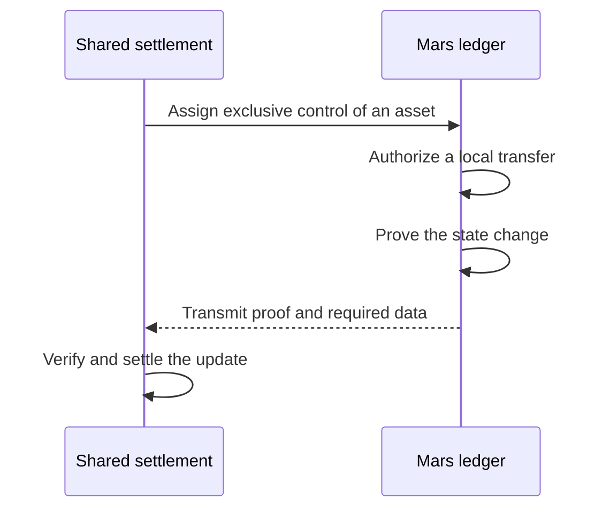

Two AI agents request the last hour on a community's GPU cluster. Writing either job takes seconds. The cluster can run only one. Who has authority to reserve that hour, and what could a member of the community inspect if the decision looks wrong?

If AI drives the cost of another unit of intelligence or software labor toward zero, the ability to pay for that labor loses some of its power to organize society. Money might also recede as the primary way to decide who gets access to shared resources. Communities would still have to allocate water, electricity, land, and compute. They would need a way to agree on who can use how much, change those rules, and show how a particular decision followed the agreement.

The Syscoin thesis is that independently verifiable rules and records could do some of that coordinating work. A community could grant access through membership, need, allocation windows, or a negotiated local quota. Several communities could keep their own policies and share a verification and settlement layer when their decisions affect each other. Jagdeep Sidhu develops the underlying idea by connecting shared state, specialized execution, and verifiable computation. [Design for an Efficient Coordinated Financial Computing Platform](https://jsidhu.medium.com/a-design-for-an-efficient-coordinated-financial-computing-platform-ab27e8a825a0) · [Truth States, Consciousness, and Decentralized Intelligence](https://jsidhu.medium.com/truth-states-consciousness-and-decentralized-intelligence-d5415da47dc6) · [Public design notes](../reference/research.mdx)

## The community sets the rules

Elinor Ostrom's research on common-pool resources documents how resource users have organized to govern shared systems at multiple scales. Some communities give users a role in changing rules, use monitors accountable to those users, and provide accessible ways to resolve disputes. Polycentric governance takes seriously that several decision-making groups can work under shared arrangements. Which arrangements work depends on the resource and the people using it. [Beyond Markets and States](https://www.nobelprize.org/uploads/2018/06/ostrom_lecture.pdf)

Suppose the cluster belongs to a federation of compute cooperatives. Each cooperative sets its membership rules and decides how to allocate its portion. The federation agrees on a capacity limit and a reservation rule. An agent needs a member's unexpired grant for that resource and time. The first eligible reservation in the agreed order consumes the slot. Any member can check the grant, the order, and the recorded outcome. If the cluster operator misreported the available hours, members can appeal that report.

| What participants need to check | Evidence the application would need |
| --- | --- |
| The right people or agents submitted or changed an allocation | Grants bound to a specific resource, scope, and period, with verifiable delegation and revocation. |
| The allocation followed the agreed rules | A versioned policy and a validity proof bound to its inputs and outputs. The public statement could show the capacity constraint was satisfied while keeping sensitive eligibility details private. |
| A participant can retrieve the decision record | Available public reconstruction data, a commitment to authenticate it, and retention for the entire review period. Sensitive inputs need a separate disclosure and appeals policy. |
| Two cooperatives cannot spend the same shared capacity | A shared record of reservations and a finality policy for accepting them. The operators who control the physical resource must enforce that allocation. |

In this example the grant decides who can receive a slot. Network fees and operating incentives pay for the infrastructure that carries the decision.

## Where Syscoin fits

Bitcoin merge-mining supplies proof of work to order Core blocks. Post-quantum Sentry Nodes build ChainLocks over that history under a separate quorum security model. zkSYS can follow finalized Core checkpoints when it uses Core for data availability. Its DA path retrieves the batch bytes and checks their digest, while the execution proof checks the state transition under the verifier's rules. Hash-based signatures extend the same concern for long-lived verifiability to authorization, with separate migration paths for Sentry Nodes, wallets, and smart accounts. [Core and finality](../architecture/core.mdx) · [Data availability](../architecture/data-availability.mdx) · [zkSYS proof flow](../architecture/zksys.mdx) · [Post-quantum migration](../architecture/post-quantum.mdx)

The same separation applies to the compute cooperatives. Members can make routine reservations on an Edgechain at local speed. They can later verify a batch against a record grounded in shared DA and settlement. Base-layer operators spend more time on durable ordering and direct signature checks. The Edgechain uses its own policy and economics for faster processing while drawing on that slower shared infrastructure. [Core and Edgechain cadence](../architecture/overview.mdx#why-core-and-zksys-run-at-different-speeds) · [zkSYS issuance and gas](../architecture/zksys.mdx#sys-collateral-issuance-and-gas)

If the two agents dispute the last hour, a proof can establish that the winning reservation was authorized and that the allocation program consumed the slot once. A machine outage raises a different question. The cooperative decides who may report the outage, issue replacement time, or hear an appeal. A new operator can check the same reservation history without taking its predecessor's word for the outcome. [What the base can decide on its own](../architecture/modular-alignment.mdx#what-the-base-should-be-able-to-decide-on-its-own)

## Verification across distance

Sidhu's global-computing essay uses a shared computer as a design analogy. Parts of the system can specialize in recording state, executing programs, proving results, or verifying them. Picture a local community running its own allocation program while participants on another planet receive the proof and the data they need later. The verification procedure can establish that the transition satisfies the agreed program without coordinating every computational step with the machine that ran it. Zero knowledge can also hide inputs when the proof system and application support that property. [Blockchain as a coordinated global Von Neumann architecture](https://jsidhu.medium.com/blockchain-as-a-coordinated-global-von-neumann-architecture-2876e3c7b0ea) · [Validity proofs over distance](https://x.com/realSidhuJag/status/2112948741288419820)

Execution and verification can be separated in time. Proofs and data still take time to travel. If two distant groups can allocate the same resource, they must agree when an allocation becomes binding or partition authority so that each group can act locally. Sidhu's Earth–Mars example makes the rule concrete. Mars can act locally on assets already assigned exclusively to its ledger. Its validity proof and the required state data travel to the common settlement layer when communication is available. [Truth States, Consciousness, and Decentralized Intelligence](https://jsidhu.medium.com/truth-states-consciousness-and-decentralized-intelligence-d5415da47dc6)

The practical question for a community designing an application is which rights it can assign exclusively in advance. Local operators can exercise those rights during a communications gap. Competing claims over a shared right still require a common ordering decision. [See how zkSYS separates local execution from settlement](../architecture/zksys.mdx#follow-an-application-transaction)
