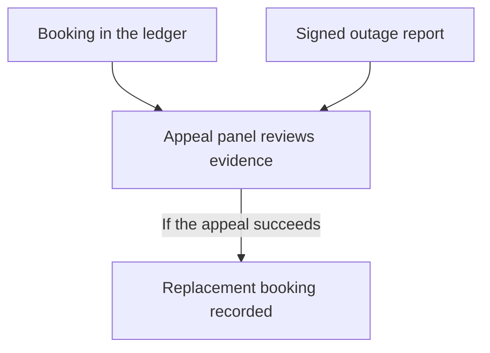
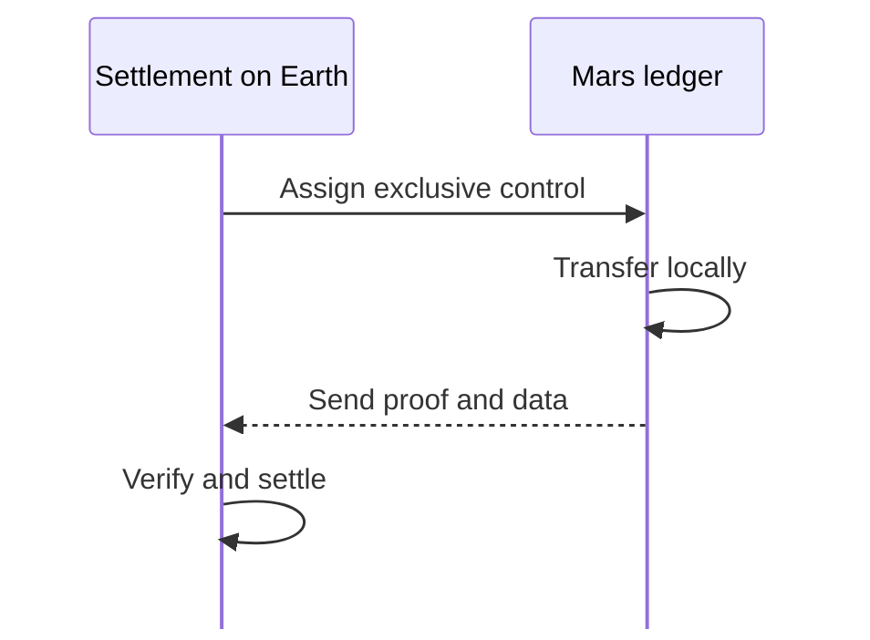

Software can make it cheaper to plan how to use shared resources. A community still needs rules for who can reserve equipment, spend a budget, or change those rules. A shared ledger can record grants and decisions so participants can check them independently. [Coordinated financial computing](https://jsidhu.medium.com/a-design-for-an-efficient-coordinated-financial-computing-platform-ab27e8a825a0) · [Truth States](https://jsidhu.medium.com/truth-states-consciousness-and-decentralized-intelligence-d5415da47dc6)

## The community sets the rules

Suppose a computing cooperative lets a member's agent reserve **one GPU hour before Friday at noon**. Its application awards the slot to the first eligible request in the ledger's order. The grant must be active when the application processes the request. If the ledger records a revocation first, the application rejects the request.

The cooperative also needs a way to resolve disputes. If the application books an hour during an outage, members may need the original booking, a signed outage report, and an authorized panel to decide whether to award a replacement. Elinor Ostrom's work on shared resources describes how users can help set rules, monitor their application, and resolve disputes locally. [Ostrom's Nobel lecture](https://faculty.sites.iastate.edu/tesfatsi/archive/tesfatsi/BeyondMarketsAndStates.NobelLecture.EOstrom2009.pdf)

### What counts as a truth state?

Participants with access to the ledger can check the grant, the ordering of transactions, and the recorded booking. A validity proof can establish that the program applied the agreed rule to its committed inputs. A signed report identifies who attested to an outage. The cooperative's appeals policy determines what weight to give that report and who can authorize a remedy. [Truth States](https://jsidhu.medium.com/truth-states-consciousness-and-decentralized-intelligence-d5415da47dc6) · [zkSYS proof stages](../architecture/zksys.mdx#why-there-are-two-proof-stages)

### If the operator stops cooperating

A signed revocation takes effect when the application processes it. If a sequencer omits it, the existing grant remains usable until the revocation is included or the grant expires. A signed acknowledgement can help show when the operator received the request. Enforcing inclusion or replacing an operator depends on the deployed rules. A replacement needs both permission to take over and the data required to reconstruct state. [Sequencing and recovery](../architecture/zksys.mdx#sequencing-proving-and-recovery) · [Retention and replay](../architecture/data-availability.mdx#retention-and-replay)

## Where Syscoin fits

In the zkSYS design, an application runs on an Edgechain. It publishes batch data to Syscoin Core and its batches settle on Gateway. Gateway settles its own batches on NEVM. To verify an older decision, a participant needs access to the retained batch data and an authenticated starting state. Choose a retention period that covers the application's dispute window. [System architecture](../architecture/overview.mdx) · [What to retain](../architecture/data-availability.mdx#what-can-someone-verify-a-week-later)

A public Genesis testnet payment shows the settlement route. Its Edgechain batch settled on Gateway, and the enclosing Gateway batch reached Tanenbaum NEVM using a mock proof. Check the deployed verifier and network status before relying on validity-proof enforcement. [Trace the testnet payment](../reference/zksys.mdx#trace-a-public-testnet-transaction) · [Network status](./status.mdx)

## Verification across distance

The Earth–Mars example in *Truth States* is a thought experiment about delegated authority. If shared settlement assigns Mars exclusive control of an asset, people on Mars can transfer it locally. Shared settlement can verify the update once the proof and required data arrive. Signals still take minutes to travel between the planets. The design relies on clear control over the asset while the two sides are out of contact. [Truth States](https://jsidhu.medium.com/truth-states-consciousness-and-decentralized-intelligence-d5415da47dc6) · [NASA Mars Relay Network](https://science.nasa.gov/mars/mars-relay-network/)

