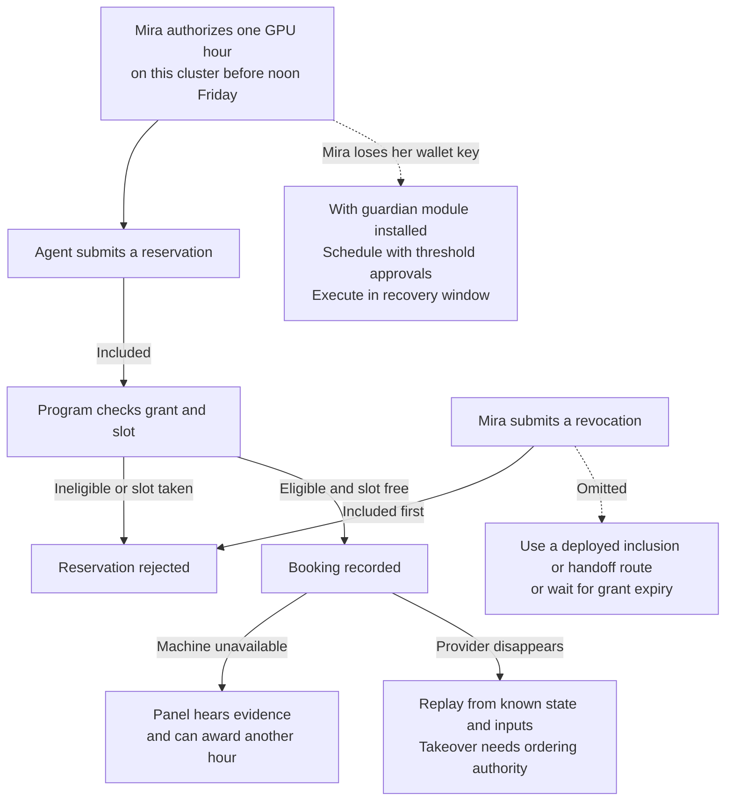
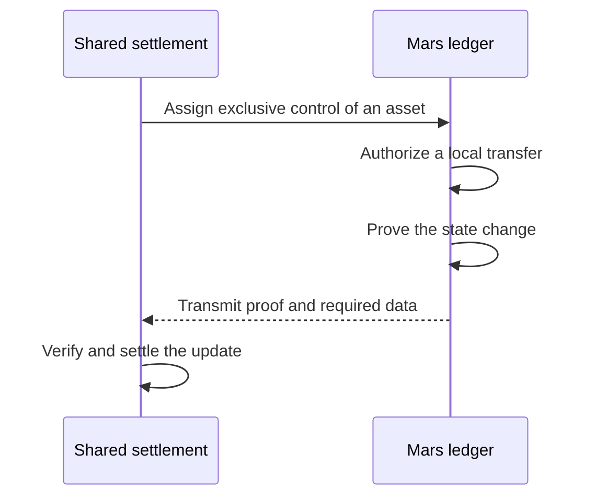

Two AI agents request the last hour on a community’s GPU cluster. Writing either job takes seconds. The cluster can run only one. Who gets the hour? If the decision looks wrong, what can a member check, and who can put it right?

<figure className="editorial-plate">

<figcaption>A member can verify who booked the machine from the ledger. Finding out whether the machine was available takes a separate observation.</figcaption>
</figure>

Even if intelligence and software labor become cheap, water, land, energy, and compute remain scarce. A community might allocate them through prices, membership, need, or negotiated quotas. If money plays a smaller role, it becomes particularly important to know who granted an agent authority, when its grant ends, and whether everyone was held to the same rule. Sidhu’s proposal is to let communities keep authority over those choices and share infrastructure for verifying decisions that cross their boundaries. [Design for an Efficient Coordinated Financial Computing Platform](https://jsidhu.medium.com/a-design-for-an-efficient-coordinated-financial-computing-platform-ab27e8a825a0) · [Truth States, Consciousness, and Decentralized Intelligence](https://jsidhu.medium.com/truth-states-consciousness-and-decentralized-intelligence-d5415da47dc6)

## The community sets the rules

A real example comes from irrigation. Elinor Ostrom describes a study of irrigation systems in Nepal. After accounting for differences in the physical environment, farmers who managed their own canals on average kept them in better repair, delivered more water to users at the tail end, and achieved higher agricultural productivity than government-managed systems. An expanded dataset of 229 systems confirmed the earlier findings. The farmer at the end of the canal is a telling measure of whether coordination worked. Ostrom also identifies ways users can help change rules, hold monitors accountable, and resolve disputes locally. The result is specific to these institutions and conditions. [Ostrom’s Nobel lecture, *Beyond Markets and States*](https://faculty.sites.iastate.edu/tesfatsi/archive/tesfatsi/BeyondMarketsAndStates.NobelLecture.EOstrom2009.pdf)

Imagine a federation of compute cooperatives. Mira grants her agent authority to reserve **one GPU hour on this cluster before Friday at noon**, with no authority to spend from her wallet. The federation adopts a rule for its shared machine. **The first eligible request in the ledger’s agreed order gets the slot. The grant must still be active when the request is processed.** The cooperatives can set their own membership rules while agreeing on this one rule. Here is a hypothetical dispute under that policy.

| What happened | What a member can check |
| --- | --- |
| **Mira revokes her agent’s grant.** Her agent had already sent a reservation, but the revocation was recorded first. | Mira’s signature, the grant’s scope, and the order in which the ledger processed both actions. An earlier send time can coexist with a later execution position. |
| **Sol’s agent gets the hour.** The program rejects Mira’s request under the revoked grant. Sol’s grant is active and the slot is still free. | The policy version in force, the two recorded outcomes, and the change from one free slot to zero. A participant can replay those inputs or verify a proof of their execution. |
| **Sol shows up and the machine is offline.** The scheduler had advertised an hour during planned maintenance. | An elected monitor independent of the scheduler supplies a signed maintenance record. Sol supplies the failed job record. Each signature identifies the reporter. The appeal panel weighs the two accounts and can seek more evidence. |
| **The members’ panel awards Sol a replacement hour.** Its authority comes from the federation’s appeals policy. | A new, authorized entry assigns a specific available hour and refers back to the disputed reservation. Both the original decision and the remedy remain visible. |

A proof can establish that the published program respected a revocation and allocated the recorded slot once. Someone still has to maintain the cluster, report its capacity honestly, and honor the replacement. Members can also question the ordering rule itself. Prioritizing emergencies takes a different rule. Detecting that a scheduler held back a request takes evidence from outside the ordered ledger, such as a signed acknowledgement of receipt. [Verifiable computation on specified inputs, *Pinocchio*](https://eprint.iacr.org/2013/279)

### What counts as a truth state?

In *Truth States*, Sidhu treats the capacity to observe a shared state and the authority to change it as distinct. His philosophical account of consciousness asks what happens when an observer recognizes the consequences of their own actions. Sol can observe who received the hour. The monitor can testify about the machine. The panel has the authority to grant a remedy. They can all agree on the recorded history and disagree about whether the original rule was just. What people learn from that disagreement can change the *next* version of the rule. The role for cryptography here is precise. A reader can authenticate those decisions and check their consequences within the program. Conscious experience and the legitimacy of the policy remain human questions in this example. [Truth States, Consciousness, and Decentralized Intelligence](https://jsidhu.medium.com/truth-states-consciousness-and-decentralized-intelligence-d5415da47dc6)

### If the operator stops cooperating

In the example, Mira’s revocation worked because the sequencer included it. Suppose instead that it ignores her request. She can still authenticate what she signed, but other operators will see the old grant until the revocation enters the agreed history or the grant expires. Her one-hour cap limits the possible loss. A proof of an accepted batch can verify the transactions in it. Detecting an omitted request takes other evidence, and getting it processed takes an inclusion or operator-replacement rule. [zkSYS operator model](../architecture/zksys.mdx#sequencing-proving-and-recovery)

| Power a member wants to retain | Who can enforce, change, or block it? | What the member can do |
| --- | --- | --- |
| Limit and revoke an agent’s authority | **Hypothetical application.** The reservation program checks the signer, cluster, remaining budget, expiry, and recorded revocation. Its upgrade authority can change future rules. The sequencer controls when submitted actions enter the ledger. | Inspect the policy and its upgrade authority before granting access. Keep the signed revocation, any acknowledgement, and its inclusion record. A short expiry gives the grant a bound even if inclusion is delayed. |
| Recover an account after losing a key | **Reference implementation.** A Pali account with the guardian recovery module installed can require a threshold of guardian approvals and a delay. Recovery depends on reachable guardians, the configured execution window, and transaction inclusion. | Read that account’s installed guardian list, threshold, delay, and expiry. Use the scheduled recovery procedure if those prerequisites hold. [Guardian settings and scheduling](https://github.com/syscoin/zksync-os-server/blob/v0.24.4/contracts/src/pali/PaliGuardianRecoveryModule.sol#L68-L157) · [Execution window](https://github.com/syscoin/zksync-os-server/blob/v0.24.4/contracts/src/pali/PaliGuardianRecoveryModule.sol#L183-L209) |
| Replace a failed provider or appeal a decision | **Two authorities.** A replacement node can replay retained inputs against a known state, but the deployment decides who can take over sequencing. In the illustrative federation, members appoint the appeal panel and machine operator. | Restore a batch against a known block. Check the handoff authority. For a lost hour, bring the original booking and signed maintenance records to the panel before its deadline. [What survives a seven-day appeal](../architecture/data-availability.mdx#what-can-someone-verify-a-week-later) |
| Leave with a balance or a service claim | **Deployment-specific.** On a chain running the reference Gas Tank, a holder can withdraw unused credit as zkSYS on that chain if the transaction executes. A cross-chain withdrawal needs the destination’s release rule. The federation separately decides whether unspent hours can be redeemed elsewhere. | Identify the asset, destination, and authorized release contract. Verify its settlement evidence and any inclusion deadline or fallback. The sampled Genesis trace documents settlement. It supplies no demonstration of a unilateral exit during censorship. [Gas Tank withdrawal](https://github.com/syscoin/zksync-os-server/blob/v0.24.4/contracts/src/zksys/ZkSysGasTank.sol#L123-L164) · [Public trace](../reference/zksys.mdx#trace-a-public-testnet-transaction) |

## Where Syscoin fits

The cooperative is a hypothetical application. For a public counterpart to its settlement path, follow a Genesis transaction from its Edgechain receipt through Gateway to Tanenbaum NEVM. You can see which batch reached each chain and inspect the mock proof that NEVM accepted for this testnet Gateway batch. The architecture below assumes an enforcing validity-proof verifier. [Trace a public testnet transaction](../reference/zksys.mdx#trace-a-public-testnet-transaction) · [Deployment status](./status.mdx)

In the PQ-era design, a cooperative could run its reservation program on zkSYS, where an Edgechain orders requests and gives users local receipts. It publishes the batch bytes to Core. Bitcoin merge-mining supplies work for the Core history, and Sentry quorums can sign ChainLocks over it. Gateway carries compact references and settles Edge batches under its configured finality and proof rules. NEVM then records settlement of the Gateway batch. A member can check the reservation against the same history even after the cooperative replaces its scheduler. That requires the batch data and the applicable program and state. If appeals outlast Core’s retention window, the federation must arrange an archive. Private testimony needs its own access and retention rules. [Core and finality](../architecture/core.mdx) · [DA retention and replay](../architecture/data-availability.mdx#retention-and-replay) · [zkSYS proof flow](../architecture/zksys.mdx#follow-an-application-transaction)

| What the members need | Why the design puts the work there | What members still have to test |
| --- | --- | --- |
| An independent check of shared history | Core checks mining work locally. Under the PQ candidate, it also checks a bounded set of hash-based finality votes. A member can verify the history on a separately operated node. | Can an independent operator receive and verify peak loads on available hardware and bandwidth? [Node cost envelope](../architecture/design-tradeoffs.mdx#what-the-da-budget-looks-like) |
| More compute as agents take on more work | Execution and proving move to Edgechains. Adding reservation programs can increase local compute without requiring every Core node to re-execute those programs. | Can publishers obtain shared DA capacity and settle proofs fast enough for the federation’s deadlines? [Scaling tradeoffs](../architecture/design-tradeoffs.mdx#what-happens-when-a-second-edgechain-joins) |
| Rights that survive a change of operator or key | The application defines delegation, the account defines key recovery, and the shared settlement history gives a replacement a record to check. | Can members revoke or recover their actual accounts? Can another operator restore the inputs and take over under the deployed rules? [Powers and remedies](#if-the-operator-stops-cooperating) |
| Operators and infrastructure that can keep working | SYS rewards and fees help fund mining and Sentry services. Treasury proposals can fund shared work. zkSYS separately rewards eligible participants in the execution economy. | Do receipts cover real costs, do multiple independent parties participate, and can members hold recipients accountable? [Funding and operator incentives](../architecture/modular-alignment.mdx) |

The federation could verify a perfectly executed reservation rule and still allocate the hour unfairly. Members choose what the rule should reward and who can change it. A convincing deployment would let them verify a disputed decision, keep the evidence through the appeal, and use a remedy even after the original provider leaves.

## Verification across distance

<figure className="editorial-plate">

<figcaption>Radio signals between Mars and Earth take about 3 to 22.4 minutes each way as the planets move. A right assigned exclusively to Mars can change hands locally while people on Earth wait for the record. <a href="https://science.nasa.gov/mars/mars-relay-network/">NASA Mars Relay Network</a></figcaption>
</figure>

Sidhu’s 2022 essay compares rollups to the arithmetic units of a computer and the settlement layer to its control unit. The Earth–Mars example in *Truth States* asks how such a computer could coordinate rights when its parts are light-minutes apart. Imagine settlement has assigned a right exclusively to Mars. Mars can authorize local transfers during a communication gap because Earth has already given up the right to make a competing transfer. When a message arrives, a verifier on Earth can check a proof against the previously agreed state and program. It can then accept the update without a round trip for every intermediate computation. [Blockchain as a coordinated global Von Neumann architecture](https://jsidhu.medium.com/blockchain-as-a-coordinated-global-von-neumann-architecture-2876e3c7b0ea) · [Sidhu’s Earth–Mars example in *Truth States*](https://jsidhu.medium.com/truth-states-consciousness-and-decentralized-intelligence-d5415da47dc6)

Proofs change **how much interaction verification needs**. Messages and data still travel at physical speeds. If Earth and Mars both retain the right to promise the same GPU hour, a proof of each local promise leaves a real conflict to resolve. The useful design question, on Earth as much as on Mars, is which decisions a community can make for itself and exactly when someone elsewhere may rely on them. [Edgechain settlement](../architecture/zksys.mdx#follow-an-application-transaction) · [Modular governance](../architecture/modular-alignment.mdx#what-the-base-should-be-able-to-decide-on-its-own)
