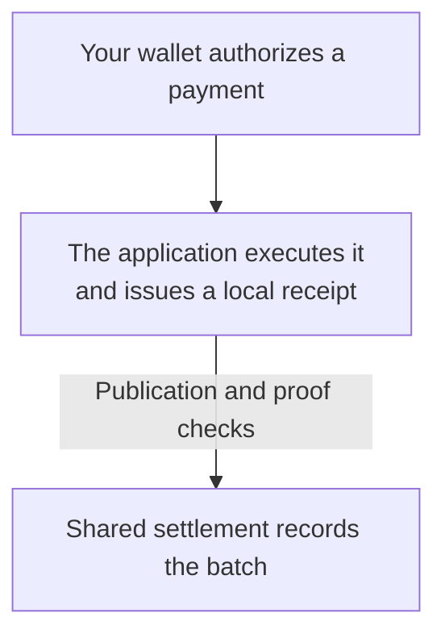

Syscoin is a Bitcoin-merge-mined blockchain with its own rules for asset transfers, data publication, and programmable settlement. Its design lets people and autonomous agents act through independently operated applications while sharing a history they can verify for themselves. [Core and merge-mining](../architecture/core.mdx#what-bitcoin-merge-mining-contributes) · [System architecture](../architecture/overview.mdx)

## Mission

An open source community dedicated to scaling Bitcoin, especially its proof-of-work security, to meet global needs and emerging use-cases, while sticking as close as possible to Bitcoin's original ideals.

As intelligence gets cheaper, people still have to decide how to share water, energy and computing power. We want communities to make those decisions on their own terms, give their agents limited authority, and leave a record others can verify across distance. [Human and AI coordination](./human-and-ai.mdx)

## Current Research & Development

Core and its Ethereum-compatible settlement layer, NEVM, run on mainnet. As of **November 19, 2026**, four projects extend what a node, a wallet holder, or a Bitcoin bridge can verify. [Network and release status](./status.mdx)

- **Post-quantum finality · Release candidate.** Core nodes verify the hash-based signatures that lock a block directly. SLH-DSA authenticates Sentry operators and their voting keys. WOTS+ signs the scheduled votes. The candidate exercises the handoff on regtest and has no mainnet activation height. [How a node verifies a ChainLock](../architecture/post-quantum.mdx#what-a-full-node-verifies)
- **zkSYS scaling · Public Genesis testnet.** An application publishes its batch data on Core. Gateway carries a 32-byte BLAKE2s identifier per blob. You can follow one payment all the way to Tanenbaum NEVM, where Gateway batch 9,448 used a mock proof. Sharing proof work among independent operators and decentralizing transaction ordering are separate rollout steps. [Trace the payment](../reference/zksys.mdx#trace-a-public-testnet-transaction) · [Sequencing and proving](../architecture/zksys.mdx#sequencing-proving-and-recovery)
- **Post-quantum spending · Experimental smart accounts.** A Pali user can authorize an operation with a hash-based signature when their smart account has the signing module installed. A native zkSYS verifier handles the hash work. Ordinary SYS outputs and NEVM accounts use separate spending rules. [Pali’s signing module and the zkSYS verifier](../architecture/zksys.mdx#wallets-and-post-quantum-account-authorization)
- **Bitcoin withdrawals · Bridge research.** Participating miners already name Syscoin blocks in Bitcoin coinbases. The proposed BitVM2 bridge would let a challenger use a timely conflicting tag to veto a BTC withdrawal. Witness encryption is a separate line of research into releasing funds against verified evidence. [Inspect a miner’s tag](../architecture/bitcoin-bridge.mdx#inspect-a-tag-in-a-bitcoin-block) · [How a withdrawal would be enforced](../architecture/bitcoin-bridge.mdx#from-detection-to-enforcement-on-bitcoin)

## Why build on Bitcoin mining?

A participating pool can use the same hash attempts to compete for BTC on Bitcoin and SYS on Syscoin. Bitcoin validates its own blocks. Syscoin’s nodes validate the additional transactions, data commitments, and settlement rules. SYS pays for using those services and helps fund the operators who provide them. zkSYS adds a separate reward token tied to SYS stake or eligible Sentry collateral. Whether the revenue attracts more independent operators depends on demand, costs, and who controls the equipment. [Follow the mining work and revenue](../architecture/core.mdx#why-bitcoin-and-syscoin-fit-together) · [Who pays whom](../architecture/modular-alignment.mdx#who-pays-for-the-shared-infrastructure) · [zkSYS issuance and fees](../architecture/zksys.mdx#sys-collateral-issuance-and-gas)

Syscoin’s 2021 scaling proposal began with a wallet holder’s problem. Keeping control of your coins is one requirement. Being able to spend them when an operator goes offline is another. Moving execution off the shared chain makes room for more applications, but it also means someone else must be able to recover the data and check the result. The same reasoning applies to an agent acting for a community. Who gave it the right to act, and what can a member verify after the operator is gone? [How the design developed, from the wallet holder’s problem to *Truth States*](../reference/research.mdx#from-a-computational-court-to-authority-over-scarce-resources)

## Follow the payment

Suppose your wallet sends a payment on zkSYS. It gets a local receipt. Later, someone who never used your wallet wants to check the result after the original operator has gone offline. This example assumes the new finality rules are active and settlement enforces real execution proofs.

1. **Get a receipt.** An operator called a sequencer orders the payment on zkSYS and executes it. The receipt tells your wallet the local outcome. The batch containing the payment still has to reach shared settlement. [zkSYS transaction lifecycle](../architecture/zksys.mdx#follow-an-application-transaction)
2. **Inspect the publication.** zkSYS groups transactions into a batch and publishes its encoded data on Syscoin Core. A reader can retrieve each blob and hash it to check the batch’s ordered identifiers. After Core’s serving window, the reader needs an archive that kept those bytes. [Data publication and retention](../architecture/data-availability.mdx)
3. **Check which history counts.** Bitcoin miners can reuse their work to mine Core blocks. Under the post-quantum rules, a quorum of Sentry Nodes signs the block history, and Core nodes verify those signatures directly. A ChainLock gives readers a common finalized history in which to locate the batch publication. [Mining and finality](../architecture/core.mdx)
4. **Check the result.** A prover supplies evidence that the batch obeyed the execution rules. Identify the payment’s block and batch, then follow that batch to settlement on Gateway. Gateway settles its own batches on NEVM, Syscoin's Ethereum-compatible contract layer. To re-execute the blocks yourself, start from authenticated state and restore the replay inputs, including transactions, block context, protocol version and required preimages. [Proof and settlement](../architecture/zksys.mdx) · [Replay inputs](../architecture/data-availability.mdx#what-can-someone-verify-a-week-later)

The division of work lets zkSYS respond on its own schedule. Applications that join an Edgechain add execution work there. Their publications consume Core bandwidth and storage, and Core nodes validate blocks and check finality. [System map](../architecture/overview.mdx) · [Costs of independent validation](../architecture/design-tradeoffs.mdx)

Try the settlement check on a public Genesis testnet transaction. Follow its receipt to the Edgechain batch on Gateway, then find the Gateway batch on Tanenbaum NEVM. [Trace a public testnet transaction](../reference/zksys.mdx#trace-a-public-testnet-transaction)

## Where the other pieces fit

| Component | Purpose |
| --- | --- |
| [Core](../architecture/core.mdx) | Tracks balances as unspent transaction outputs (UTXOs). Accepts Bitcoin-compatible parent mining work through auxiliary proof of work (AuxPoW). |
| [Syscoin Platform Tokens and Z-DAG](../tech/tokens.mdx) | Let applications transfer assets directly as Core outputs. For eligible payments, wallets can ask a node for an early mempool conflict signal. |
| [Post-quantum ChainLocks](../architecture/post-quantum.mdx) | **Release candidate.** Authenticate Sentry operators with SLH-DSA hash-based signatures. Operators sign scheduled block votes with WOTS+ keys. |
| [Proof of Data Availability](../architecture/data-availability.mdx) | Publishes payloads through Core. Gateway can carry compact identifiers while independent readers retrieve and check the larger payloads. |
| [NEVM](../reference/nevm.mdx) | Runs Ethereum-compatible contracts, including verification and settlement contracts. |
| [zkSYS](../architecture/zksys.mdx) | **Public Genesis testnet and proof-settled design.** Executes on an Edgechain and settles through Gateway. Its reference contracts link reward eligibility to SYS and allow zkSYS to cover eligible fees. Inspect the verifier for the batch in question. |

Some of this history is visible from Bitcoin itself. Participating miners publish references to Syscoin ancestors in Bitcoin coinbases. Those references give the proposed BTC bridge a way to detect a withdrawal that points to a conflicting Syscoin history. [Two Bitcoin coinbases carrying the same Syscoin reference](../architecture/bitcoin-bridge.mdx#inspect-a-tag-in-a-bitcoin-block) · [How other chains handle settlement and data](../architecture/comparison.mdx) · [Core and NEVM commands](../reference/overview.mdx)

A payment is one example of a state change. A grant to use a shared resource is another. The [human and AI design thesis](./human-and-ai.mdx) follows a community deciding who can reserve a scarce hour of compute.
