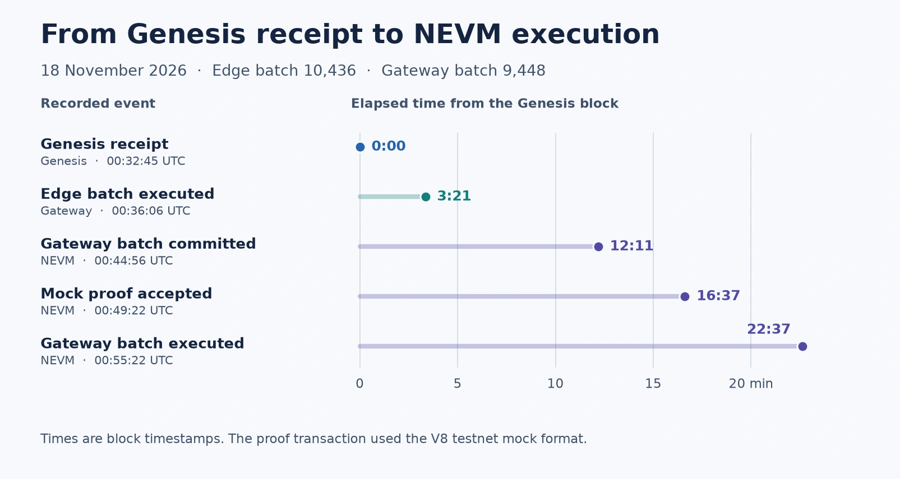

## Public Genesis testnet

Genesis is zkSYS's live public testnet. These endpoints let you inspect execution and test applications. The public network settings identify the native SYS balance. Treat the separately issued zkSYS token and gas tank as deployment-specific contracts and verify their addresses before importing a token or making an approval. [Genesis settings](https://syscoin.org/news/zksys-genesis-public-testnet-is-live) · [Issuance and gas design](../architecture/zksys.mdx#sys-collateral-issuance-and-gas)

| Setting | Value |
| --- | --- |
| Network | zkSYS Genesis Testnet |
| Chain ID | `57057` (`0xdee1`) |
| Currency symbol | `SYS` (testnet) |
| RPC | [rpc-zk.tanenbaum.io](https://rpc-zk.tanenbaum.io) |
| Explorer | [explorer-zk.tanenbaum.io](https://explorer-zk.tanenbaum.io) |
| Faucet | [faucet-zk.tanenbaum.io](https://faucet-zk.tanenbaum.io) |
| Testnet bridge | [bridge-zk.tanenbaum.io](https://bridge-zk.tanenbaum.io) |

Genesis and Tanenbaum NEVM use different chain IDs. EVM transactions signed for Genesis use `57057`. Tanenbaum NEVM uses `5700`, and Syscoin mainnet NEVM uses `57`. Check the wallet's chain ID before signing, especially if its visible network name matches another entry. [Genesis settings](https://syscoin.org/news/zksys-genesis-public-testnet-is-live) · [NEVM chain configuration](https://github.com/syscoin/go-ethereum/blob/1c046ba92f8ea95be024a790e9444b80ccbf019a/params/config.go#L74-L130)

Query the network and server identity. The `eth_chainId` result is hex, and the `eth_syncing` result may be `false` or an object with progress. These commands use `curl` and `jq`.

```bash
zk_rpc=https://rpc-zk.tanenbaum.io

curl --fail --silent --show-error "$zk_rpc" \
  -H 'content-type: application/json' \
  --data '[
    {"jsonrpc":"2.0","id":1,"method":"eth_chainId","params":[]},
    {"jsonrpc":"2.0","id":2,"method":"web3_clientVersion","params":[]},
    {"jsonrpc":"2.0","id":3,"method":"eth_syncing","params":[]}
  ]' | jq '.[] | {id, result, error}'
```

The next request returns the latest and finalized block hashes reported by this node. If the finalized query returns `null` or an error, the endpoint has supplied no finalized block for that request. The worked transaction below follows settlement on Gateway and NEVM.

```bash
curl --fail --silent --show-error "$zk_rpc" \
  -H 'content-type: application/json' \
  --data '[
    {"jsonrpc":"2.0","id":1,"method":"eth_getBlockByNumber","params":["latest",false]},
    {"jsonrpc":"2.0","id":2,"method":"eth_getBlockByNumber","params":["finalized",false]}
  ]' | jq '.[] | {id, error, block: (.result | if . then {number, hash} else null end)}'
```

## Trace a public testnet transaction

On November 18, 2026, a contract call on Genesis emitted token transfers. Its receipt is the first of five public records you can follow. Each chain has its own block and batch numbers. The link between them is the event or block range recorded by the next chain.

| Where to look | What to match |
| --- | --- |
| Genesis transaction | The transaction succeeded in Edge block **10,968**. The batch RPC below places that block in Edge batch **10,436** and reports Gateway execution block **31,362**. [Genesis receipt and token transfers](https://explorer-zk.tanenbaum.io/tx/0xa018d61db50752eeda10c6d52b51fd1741cc8eb41db46d9b972677539d5fef0b) |
| Gateway execution | The settlement transaction in Gateway block **31,362** emitted `BlockExecution` for Edge batch **10,436**. The event’s state and batch commitments match the Genesis batch RPC result. [Gateway execution logs](https://explorer-gw.tanenbaum.io/api/v2/transactions/0x321f5184dea2ff8026bc84b01df304c8936b139e64b25774ffd326853b2391d9/logs) |
| Gateway batch on NEVM | In Tanenbaum NEVM block **1,009,176**, the range report for Gateway batch **9,448** covers Gateway blocks **31,360–31,362**. The same transaction emitted the batch commitment. [NEVM range and commit events](https://explorer.tanenbaum.io/api/v2/transactions/0x4661a9f890147e1ceb4dc8647eeba801ec206d4a318b299083c291b89f9820f3/logs) |
| Gateway batch proof on NEVM | In NEVM block **1,009,179**, the proof transaction for batch **9,448** succeeded. Its inner payload uses the V8 **testnet mock proof** format. The settlement contract emitted `BlocksVerification(9447, 9448)`. [Transaction and calldata](https://explorer.tanenbaum.io/api/v2/transactions/0xc82091801f6b0947db4bed5fb2400e07313e2730b0c37d389d2b3c5dba9fdde0) · [Verification event](https://explorer.tanenbaum.io/api/v2/transactions/0xc82091801f6b0947db4bed5fb2400e07313e2730b0c37d389d2b3c5dba9fdde0/logs) |
| Gateway batch execution on NEVM | In NEVM block **1,009,182**, the same contract emitted `BlockExecution` for batch **9,448** with the original state and batch commitments. [NEVM execution logs](https://explorer.tanenbaum.io/api/v2/transactions/0x6498e1f4bd29000890343b377d9790b2a63db10e03d3d25fcd5ea1f9ed4f29e6/logs) |

[](../../static/img/genesis-settlement-trace.webp)

The five blocks span **22 minutes 37 seconds**. These timestamps describe one testnet transaction and include waiting between blocks. Measuring real proving time requires a batch that runs the production proof path and timing from its workers. [Full-size timing chart](../../static/img/genesis-settlement-trace.webp) · [V8 proof formats](https://github.com/syscoin/zksync-os-server/blob/v0.24.4/lib/l1_sender/src/commands/prove.rs#L434-L465)

Reproduce the first link with `curl` and `jq`. Replace `tx_hash` to follow another mined transaction on the same deployment. The Ethereum receipt encodes its block number in hex. The zkSYS batch method takes that height as a JSON integer.

```bash
zk_rpc=https://rpc-zk.tanenbaum.io
tx_hash=0xa018d61db50752eeda10c6d52b51fd1741cc8eb41db46d9b972677539d5fef0b

block_hex=$(jq -nc --arg tx "$tx_hash" \
  '{jsonrpc:"2.0",id:1,method:"eth_getTransactionReceipt",params:[$tx]}' | \
  curl -fsS "$zk_rpc" -H 'content-type: application/json' --data-binary @- | \
  jq -er '.result.blockNumber')
block_number=$(printf '%d' "$block_hex")

jq -nc --argjson block "$block_number" \
  '{jsonrpc:"2.0",id:1,method:"zks_getBatchByBlockNumber",params:[$block]}' | \
  curl -fsS "$zk_rpc" -H 'content-type: application/json' --data-binary @- | \
  jq '{error, batch: .result.batch_info.batch_number, range: .result.block_range,
       state: .result.batch_info.state_commitment, commitment: .result.batch_info.commitment,
       settlementBlock: .result.execute_sl_block_number}'
```

In the event logs, each indexed value occupies a 32-byte topic. For `BlockExecution` the first topic identifies the event, followed by the batch number, state commitment, and batch commitment. For `ReportCommittedBatchRangeZKsyncOS` the three values are the batch number, first block, and last block. Match the emitting settlement contract as well as the values. Checking Core blob availability and destination withdrawal execution requires their respective records. [Event ABI](https://github.com/syscoin/zksync-os-server/blob/v0.24.4/lib/contract_interface/src/lib.rs#L385-L392) · [Batch watcher](https://github.com/syscoin/zksync-os-server/blob/v0.24.4/lib/l1_watcher/src/persist_batch_watcher.rs#L18-L30)

<details>
<summary>Reproduce the proof-format check with Foundry Cast</summary>

Read the original transaction input. Decode the outer call, remove the one-byte encoding version `0x01`, then decode the previous batch, the new batch array and the submitted proof words. [Outer and inner ABI](https://github.com/syscoin/zksync-os-server/blob/v0.24.4/lib/contract_interface/src/lib.rs#L403-L410) · [Stored batch tuple](https://github.com/syscoin/zksync-os-server/blob/v0.24.4/lib/contract_interface/src/lib.rs#L350-L360) · [Versioned encoding](https://github.com/syscoin/zksync-os-server/blob/v0.24.4/lib/l1_sender/src/commands/prove.rs#L495-L509)

```bash
prove_tx=0xc82091801f6b0947db4bed5fb2400e07313e2730b0c37d389d2b3c5dba9fdde0
input=$(cast tx "$prove_tx" input --rpc-url https://rpc.tanenbaum.io)
inner=$(cast decode-calldata --json 'proveBatchesSharedBridge(address,uint256,uint256,bytes)' "$input" | \
  jq -er '.[3] | select(startswith("0x01")) | "0x" + .[4:]')
stored='(uint64,bytes32,uint64,uint256,bytes32,bytes32,bytes32,uint256,bytes32)'
cast abi-decode --input --json "proofPayload(${stored},${stored}[],uint256[])" "$inner" | \
  jq '{previous: .[0][0], batch: .[1][0][0], words: (.[2]|length), prefix: .[2][:3]}'
```

The decoded batches are **9,447 → 9,448**, with four proof words. The first three are **2051, 0, 13**. The first word is `0x803`, which selects verifier version 8 and proof type 3. The fourth word matches the folded public input computed from the previous and new state commitments, Gateway’s chain configuration and the batch commitment. This establishes that the sampled Gateway-to-NEVM submission used the test format that checks this binding. The real V8 format uses type 2 and carries 44 cryptographic proof words after the two routing words. [Type and sizes](https://github.com/syscoin/zksync-os-server/blob/v0.24.4/lib/l1_sender/src/commands/prove.rs#L16-L25) · [Public input calculation](https://github.com/syscoin/zksync-os-server/blob/v0.24.4/lib/l1_sender/src/commands/prove.rs#L344-L376) · [Mock and real encodings](https://github.com/syscoin/zksync-os-server/blob/v0.24.4/lib/l1_sender/src/commands/prove.rs#L437-L465)

</details>

## Inspect issuance and gas credit

Use these [Foundry Cast](https://www.getfoundry.sh/cast/) commands on a zkSYS deployment that publishes validated build and contract addresses. Set `zk_rpc` to its RPC and `token`, `issuer`, `tank`, `vault`, and `account` to the corresponding `0x`-prefixed addresses. Check the chain ID against the deployment record and confirm that the contracts exist. For an upgradeable contract, also check the proxy implementation and authority against that record. A testnet chain ID alone cannot establish that issuance or gas payment is configured.

```bash
cast chain-id --rpc-url "$zk_rpc"
block=$(cast block-number --rpc-url "$zk_rpc")
cast code "$tank" --rpc-url "$zk_rpc" --block "$block"
cast call "$tank" 'token()(address)' --rpc-url "$zk_rpc" --block "$block"
cast call "$issuer" 'token()(address)' --rpc-url "$zk_rpc" --block "$block"
```

Both `token()` calls should match the verified token address on that chain. Inspect the issuance clock and the account's reward and stake records at the same block height. These are distinct balances. `pendingRewards` returns legacy or passive reward accounting. A service-enabled deployment exposes per-period bonuses separately through `pendingServiceRewards(address,uint256)`. [Issuer views](https://github.com/syscoin/zksync-os-server/blob/v0.24.4/contracts/src/zksys/ZkSysIssuer.sol#L477-L525) · [Staking vault](https://github.com/syscoin/zksync-os-server/blob/v0.24.4/contracts/src/zksys/ZkSysNativeStakingVault.sol#L19-L25)

```bash
cast call "$issuer" 'startTime()(uint256)' --rpc-url "$zk_rpc" --block "$block"
cast call "$issuer" 'currentPeriod()(uint256)' --rpc-url "$zk_rpc" --block "$block"
cast call "$issuer" 'pendingRewards(address)(uint256)' "$account" --rpc-url "$zk_rpc" --block "$block"
cast call "$vault" 'stakeOf(address)(uint256)' "$account" --rpc-url "$zk_rpc" --block "$block"
```

Check credit, backing, and the native SYS balance separately. The tank's zkSYS token balance should be at least its `totalCredits`. The `surplus()` view is clamped to zero, so it cannot diagnose a shortfall by itself. The native balance check remains relevant when sending ordinary transactions with tank credit. [Tank accounting](https://github.com/syscoin/zksync-os-server/blob/v0.24.4/contracts/src/zksys/ZkSysGasTank.sol#L71-L98) · [Native validation](https://github.com/syscoin/zksync-os-server/blob/v0.24.4/lib/revm_consistency_checker/src/syscoin_gas_tank.rs#L120-L136)

```bash
cast call "$tank" 'creditOf(address)(uint256)' "$account" --rpc-url "$zk_rpc" --block "$block"
cast call "$tank" 'totalCredits()(uint256)' --rpc-url "$zk_rpc" --block "$block"
cast call "$token" 'balanceOf(address)(uint256)' "$tank" --rpc-url "$zk_rpc" --block "$block"
cast balance "$account" --rpc-url "$zk_rpc" --block "$block"
```

## Read a Core blob

Use `syscoin-cli` against your selected Core node. The node must be on the network that published the blob. Inspect the help for the release you run. Set `digest` to the 64 hexadecimal characters returned as `versionhash`, without a `0x` prefix or BLAKE2s version byte.

```bash
syscoin-cli help listnevmblobdata
syscoin-cli help getnevmblobdata
syscoin-cli listnevmblobdata 10 0
syscoin-cli getnevmblobdata "$digest" false
```

The metadata response includes `versionhash`, `txid`, `mtp`, and `datasize`. It can include the active block `height`, `blockhash`, and `chainlock` when Core can locate the publication and report its ChainLock state. Use the publication's block and configured policy to evaluate confirmations. Listing or retrieving a blob does not establish finality. [Core blob lookup and response](https://github.com/syscoin/syscoin/blob/b3b4f643383a2149807a25fe38d26b5f058daa60/src/services/rpc/nevmrpc.cpp#L103-L216) · [Core list help](https://github.com/syscoin/syscoin/blob/b3b4f643383a2149807a25fe38d26b5f058daa60/src/services/rpc/nevmrpc.cpp#L315-L351)

For a blob recorded as BLAKE2s, retrieve its bytes and check the digest locally. This example uses Python's BLAKE2s implementation. Use a Keccak-256 implementation for legacy blobs.

```bash
set -o pipefail
syscoin-cli getnevmblobdata "$digest" true | \
  python3 -c 'import hashlib, json, sys
payload = bytes.fromhex(json.load(sys.stdin)["data"])
expected = sys.argv[1].lower()
actual = hashlib.blake2s(payload).hexdigest()
if actual != expected:
    raise SystemExit(f"Digest mismatch: {actual}")
print(actual)' "$digest"
```

If Core no longer serves the blob, query the archive provided by your deployment and verify its returned bytes. Keep the original publication locator alongside the digest and raw payload for audit and recovery. Core's query window can expire even though an application still needs replay data. [Retention and integrity](../architecture/data-availability.mdx#retention-and-replay)

## Check NEVM registration

Use the **NEVM** JSON-RPC endpoint for your deployment. Set `nevm_rpc` to that endpoint and `digest` as above. `0x0000000000000000000000000000000000000063` is the Syscoin DA membership precompile. In the paired sysgeth code, a member is returned as the exact digest. An empty successful response is `0x`. Treat RPC errors as unavailable observations.

```bash
jq -nc --arg data "0x$digest" \
  '{jsonrpc:"2.0",id:1,method:"eth_call",params:[{
     to:"0x0000000000000000000000000000000000000063",data:$data
   },"latest"]}' | \
  curl --fail --silent --show-error "$nevm_rpc" \
    -H 'content-type: application/json' --data-binary @- | jq .
```

The call reads sysgeth’s current 50,001-block canonical membership window. Passing an older block number to `eth_call` selects historical EVM state, while `0x63` still reads the current index. Retry if sysgeth reports that its metadata changed during the call. To establish a publication’s original inclusion and finality, verify the transaction in its Core block and apply your deployment’s finality policy. To inspect its contents, retrieve and hash the blob. [NEVM precompile](https://github.com/syscoin/go-ethereum/blob/1c046ba92f8ea95be024a790e9444b80ccbf019a/core/vm/contracts.go#L1212-L1226) · [Membership window](https://github.com/syscoin/go-ethereum/blob/1c046ba92f8ea95be024a790e9444b80ccbf019a/docs/syscoin-data-hash-index-upgrade.md#L3-L6) · [Retry and historical reads](https://github.com/syscoin/go-ethereum/blob/1c046ba92f8ea95be024a790e9444b80ccbf019a/docs/syscoin-data-hash-index-upgrade.md#L72-L96)
