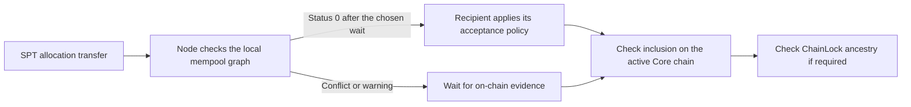

Z-DAG (Zero-Confirmation Directed Acyclic Graph) was designed for Syscoin Platform Token payments. A recipient can use a Core node’s view of the transaction and its dependencies to get an early indication that a payment is progressing. The recipient chooses when to act on that evidence. Proof-of-work inclusion and ChainLocks supply later assurances through the normal block path. [Z-DAG whitepaper](https://syscoin.org/zdag_syscoin_whitepaper.pdf) · [Syscoin Platform Tokens](./tokens.mdx)

An unconfirmed transfer can depend on another unconfirmed transfer. Core uses the mempool graph to check the queried transaction and its ancestors for observed competing spends, replaceability, and policy eligibility. This lets a receiver treat conflicts in an ancestor as relevant to its own payment. The output reflects the node’s peer and mempool view at query time. [Current status check](https://github.com/syscoin/syscoin/blob/b3b4f643383a2149807a25fe38d26b5f058daa60/src/services/rpc/assetrpc.cpp#L27-L65)

The eligible Core transaction type is SPT allocation send, version `142`. Ordinary native SYS payments, NEVM transfers, asset mints, and bridge burns use their own confirmation or settlement path. Core #609 retains specific conflict warnings and adds status `5` when the node has exhausted its budget for keeping conflict evidence. The [Z-DAG developer guide](../dev-resources/sys/z-dag.mdx) explains the statuses and the recommended fallback. [Transaction eligibility](https://github.com/syscoin/syscoin/blob/b3b4f643383a2149807a25fe38d26b5f058daa60/src/primitives/transaction.cpp#L456-L475) · [Core and finality](../architecture/core.mdx)

The whitepaper describes the original interactive timing and security model. Whiteblock evaluated Z-DAG throughput in a controlled deployment of an earlier Core 4 release. Use those sources to understand the design and the tested conditions. Current acceptance thresholds depend on the application, observed network, and risk tolerance. [Whiteblock performance report](https://syscoin.org/tps_whiteblock_syscoin_report.pdf)
