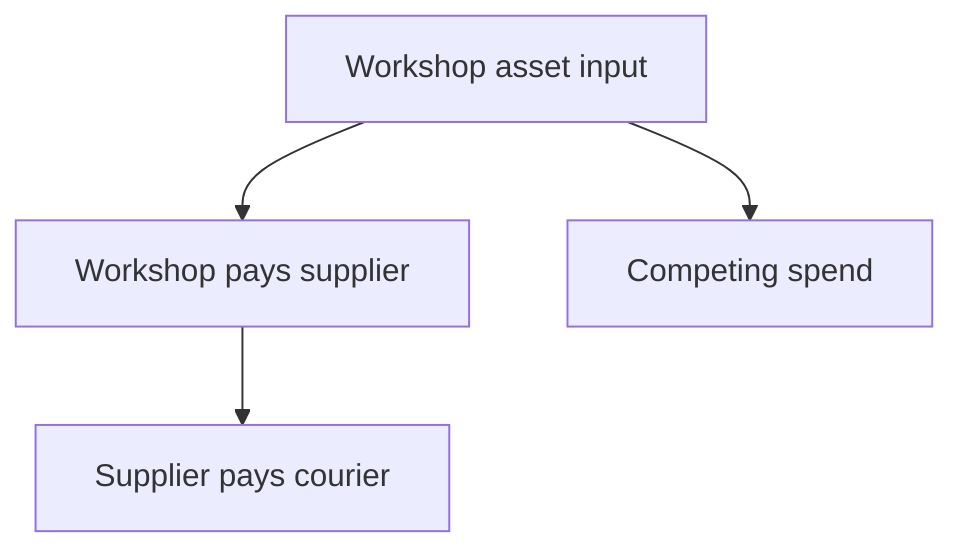

Z-DAG (Zero-Confirmation Directed Acyclic Graph) was designed for Syscoin Platform Token payments. A recipient can use a Core node’s view of the transaction and its dependencies to get an early indication that a payment is progressing. The recipient chooses when to act on that evidence. Proof-of-work inclusion and ChainLocks supply later assurances through the normal block path. [Z-DAG whitepaper](https://syscoin.org/zdag_syscoin_whitepaper.pdf) · [Syscoin Platform Tokens](./tokens.mdx)

## Why check the ancestors of a payment?

Take the supplier who received 7 tokens in the [workshop example](./tokens.mdx#why-put-an-asset-in-an-output). The supplier pays a courier with that output before the workshop payment confirms. If the workshop’s original input also funds a competing transaction, the courier’s payment depends on which spend gets into the chain. The courier can ask Core about its own incoming payment and receive a warning about a conflict one transaction earlier.

The courier queries the **supplier-to-courier transaction ID**. Core checks that transaction and its unconfirmed ancestors in the node’s local mempool view. A known double spend can produce status `4`. After the recipient’s chosen wait, only `0` qualifies for early acceptance under Z-DAG. For every other result, check the transaction on the active chain and apply the recipient’s confirmation policy. A missing mempool entry can mean the payment already confirmed. [Current status check](https://github.com/syscoin/syscoin/blob/b3b4f643383a2149807a25fe38d26b5f058daa60/src/services/rpc/assetrpc.cpp#L27-L65) · [RPC status reference](../dev-resources/sys/z-dag.mdx#understanding-z-dag-statuses)

Z-DAG applies to SPT allocation sends, transaction version `142`. Native SYS payments, NEVM transfers, asset mints and bridge burns follow their own confirmation or settlement rules. [Z-DAG developer guide](../dev-resources/sys/z-dag.mdx) · [Core and finality](../architecture/core.mdx)

Whiteblock’s Core 4 tests measured how quickly unconfirmed asset payments propagated as network latency changed. A merchant still chooses how long to wait before honoring an eligible payment and when to require block confirmation. [Measured Z-DAG results](../architecture/design-tradeoffs.mdx#published-measurements) · [Whiteblock performance report](https://syscoin.org/tps_whiteblock_syscoin_report.pdf)
